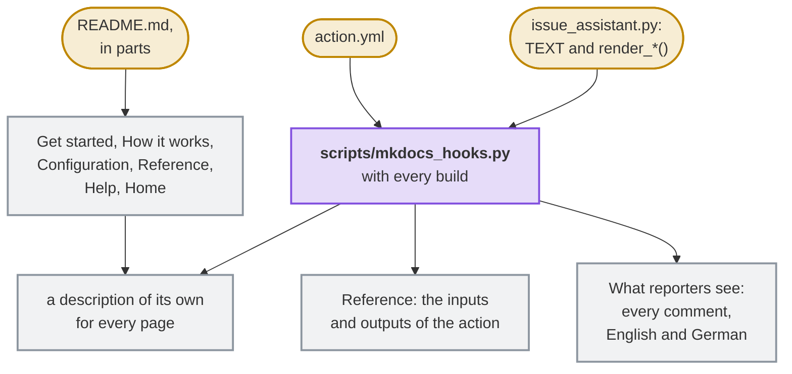
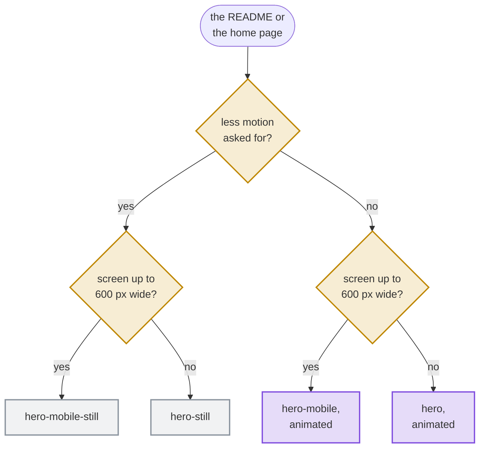

# Contributing

Contributions are welcome through issues and pull requests.
Participation follows [CODE_OF_CONDUCT.md](CODE_OF_CONDUCT.md), and project decision-making is described in [GOVERNANCE.md](GOVERNANCE.md).
Use [SUPPORT.md](SUPPORT.md) to choose the correct public support channel and [SECURITY.md](SECURITY.md) for private vulnerability reports.

All changes reach the protected `main` branch through pull requests that pass every required check.

## Requirements for changes

- Changes need tests, and the checks of `scripts/check.sh` pass.
- Every commit carries a [Developer Certificate of Origin](https://developercertificate.org/) sign-off, `Signed-off-by: Your Name <you@example.com>`, which `git commit -s` adds.
- Name the issue that a pull request fixes with `Fixes #123` in its description. The issue stays open until a release ships the fix and then closes with a link to the release.
- The script and the hooks of the website in `scripts/mkdocs_hooks.py` keep 100 % line and branch coverage; `tests/test_templates.py` pins the security rules of the templates, and every rule that keeps the AI read-only or checks its answer has a test.
- The action runs on the Python 3.12 of GitHub's runners with the standard library alone. Use no third-party packages in `issue_assistant.py`.
- The prompts in `prompts/` and the comment texts in `TEXT` name no AI vendor; only `ENGINES` does. A test checks this.
- A change of a template is a change for every repository that uses the action: say in the pull request what repositories must do, such as run `install` again.

## Tests

New functionality comes with tests in the automated test suite, in the same pull request, and so does every change of behavior. A bug fix comes with a test that fails without the fix, so that the bug can't return unnoticed. `scripts/check.sh` fails when a line or a branch of the code runs in no test. A pull request without the tests it needs is not merged.

## Coding standards

- **Python** follows [PEP 8](https://peps.python.org/pep-0008/) in the format of [Ruff](https://docs.astral.sh/ruff/), which matches Black, with the rules of Ruff that `pyproject.toml` selects. The code has type hints, which mypy checks in its strict mode.
- **Shell scripts** pass [ShellCheck](https://www.shellcheck.net/), **workflows** pass actionlint and zizmor's audit of their security, and **Markdown** follows the rules of markdownlint in `.markdownlint.jsonc`.
- **Every text file** has LF line endings, no trailing whitespace and a line break at its end; `.editorconfig` sets up most editors for it.

`scripts/check.sh` and the Lint workflow check these standards on every pull request, which merges only when they pass. An exception to a rule is rare and is marked at its place in the code, with its reason in a comment.

## Workflow

1. Open an issue first for anything larger than a small fix, so we can agree on the approach.
2. Create a branch from `main`.
3. Describe what changes for users under `## Unreleased` in `CHANGELOG.md`, in the words of a user; the check *changelog* asks for it in every `feat`, `fix` or `perf` pull request.
4. A change that makes or changes a decision that shapes the project, such as a supported platform or the way of releasing, records it in [`docs/decisions/`](docs/decisions/README.md).
5. Open a pull request whose title is a [Conventional Commit](https://www.conventionalcommits.org/), such as `feat(settings): add a dark mode` or `fix: keep the token secret`. Mark a breaking change with `!`. Pull requests are squashed into one commit named after the title, and the title decides the next version: `fix` a patch, `feat` a minor, `!` a major version.

## Checks

```sh
python3 -m venv .venv
.venv/bin/pip install --require-hashes -r requirements-dev.txt
. .venv/bin/activate && bash scripts/check.sh
```

To run them before every push on its own, turn on the hook of the repository once:

```sh
git config core.hooksPath .githooks
```

Git runs the hook only when its file is executable. Windows has no such mode and adds the file as a plain one, which `scripts/check.sh` reports; `git update-index --chmod=+x .githooks/pre-push` and a commit make it executable.

The dev container in `.devcontainer/` has all of this set up, for VS Code and for GitHub Codespaces: open the repository in it, and `bash scripts/check.sh` runs.

Update `requirements-dev.txt` with `pip-compile --generate-hashes --allow-unsafe requirements-dev.in`.

The cleaning of the AI's text has two more guards, which judge the result with an independent CommonMark parser (`tests/oracle.py`): property tests with Hypothesis in `tests/test_properties.py`, part of the test suite, and coverage-guided fuzzing with Atheris, which the Fuzzing workflow runs for a minute on every change and for a quarter of an hour every week:

```sh
.venv/bin/pip install --require-hashes -r requirements-fuzz.txt
.venv/bin/python fuzz/fuzz_sanitize.py -max_total_time=60
```

A finding of either becomes an example in `test_tricky_text_is_cleaned_safely` in `tests/test_assistant.py` with its fix.

## Website

MkDocs builds the website from `mkdocs.yml` and the pages in `docs/`. The check *docs* builds it strictly in every pull request, so that a broken link fails, and every change of `main` publishes it on GitHub Pages. To see it while you write, at <http://127.0.0.1:8000>:

```sh
python3 -m venv .venv-docs
.venv-docs/bin/pip install --require-hashes -r .github/docs-requirements.txt
.venv-docs/bin/mkdocs serve
```

On Windows, use `py -3` in place of `python3` and `.venv-docs/Scripts/` in place of `.venv-docs/bin/`; the dev container sets these tools up on its own. With them, `bash scripts/check.sh` builds the website strictly as well, as the check *docs* does, and without them it leaves that to the CI. The preview cards for social media come from the CI alone, because they need the Cairo library, which Windows doesn't have; where it is installed, `CI=true` before the command draws them too.

Each page of the website has one topic. It includes the parts of the README that belong to it, between the markers `<!-- --8<-- [start:name] -->` and `<!-- --8<-- [end:name] -->`, so that nothing is written twice, and `tests/test_docs.py` checks that each part is on the website once. `scripts/mkdocs_hooks.py` adds what no file of `docs/` holds:



- **What reporters see** shows every comment that the assistant posts, in English and in German. The hook makes them with every build, by the functions and with the texts of `issue_assistant.py`, for the demo project of the pictures, in place of the part of `docs/comments.md` between `<!-- comments of issue_assistant.py -->` and `<!-- end of the comments -->`. A new text in `TEXT` or a new kind of comment needs an example in the hook; a test fails without one.
- **The reference** has a table of the inputs or the outputs of `action.yml` where a page has the line `<!-- action.yml: inputs -->` or `<!-- action.yml: outputs -->`. The tables of the keys of the settings on the page *Configuration* are written by hand, and tests compare them with the code: every key, its default and the values that `check` accepts.
- **Every page has a description of its own** for search engines and the cards of shared links: the `description` of its front matter, or else its first paragraph.
- **Links from before keep working.** The guide was one page; a link to one of its anchors, such as `guide.html#settings`, leads to the page that has the anchor now, by a script that the hook adds to the overview of the guide.
- **The brand** is the speech bubble of the social preview in `docs/assets/logo.svg`, the logo of the header and the icon of the tab, and the violet of the badge of the action in `docs/stylesheets/brand.css`, light and dark. Tests make sure that each colour has the contrast that WCAG asks for; links in the text are underlined, as on GitHub, since their colour alone sets them apart too little.

The social plugin, which draws the cards of shared links, needs the library Cairo; without it, as on Windows, build the website in a Linux container or let the check *docs* build it.

The pictures in `docs/images` show a demo project, never real issues or people. `scripts/render-images.sh` renders them in Docker, each light and dark, from the texts of `issue_assistant.py` itself; run it after a change of those texts, and commit the pictures with the change. They are WebP: the still pictures lossless, as sharp as a PNG at less than a third of its size, and the animation of the life of an issue twice, wide and upright for phones, each with a still picture for readers who asked for less motion. The `<source>`s of a `<picture>` choose among them, the first whose condition holds:



Each of them ends in `-light` or `-dark`, after the theme of the reader. The README shows the pictures with their address on `main`, and `scripts/mkdocs_hooks.py` gives the website its own copies: one for each theme, so that the switch in the header chooses, each loaded only while it is shown and with its size, so that the page doesn't jump when it arrives. Diagrams are Mermaid in the Markdown, which GitHub and the website both draw; on a phone, the website lets them scroll sideways. Each one runs from top to bottom, as `flowchart TB` or a `sequenceDiagram`, so that its text keeps its size; tells screen readers what it shows with `accTitle` and `accDescr`; draws its boxes with a border of 2 pixels, as the diagrams of the blueprint do; and is written once: a page of the website shows a diagram of the README by including the part of the README around it, such as `workflows-diagram`. `tests/test_docs.py` checks all four.

## Releases

The release bot keeps a pull request titled `chore: release x.y.z` with the next version, up to date with `main` and decided anew with every merge. Its section of the changelog is the text of Unreleased; without one, it lists the pull requests. Merging it creates the release with its package, SBOM and signed provenance, and delivers it by moving the major tag, such as `v1`. A release of dependency updates merges and publishes itself. Repositories that use the action receive the release as a Dependabot pull request.

A line `Release-As: 2.0.0-beta.1` in the description of a pull request sets the version of the next release, for a prerelease for example. A prerelease keeps the text of Unreleased for the release that follows it.

By contributing, you agree that your contribution is licensed under the MIT license of this project.
