# Contributing

Contributions are welcome through issues and pull requests.
Participation follows [CODE_OF_CONDUCT.md](CODE_OF_CONDUCT.md), and project decision-making is described in [GOVERNANCE.md](GOVERNANCE.md).
Use [SUPPORT.md](SUPPORT.md) to choose the correct public support channel and [SECURITY.md](SECURITY.md) for private vulnerability reports.

All changes reach the protected `main` branch through pull requests that pass every required check.
Coding agents find these rules in short in [AGENTS.md](AGENTS.md), with the files that belong to the blueprint and are changed there. A pull request that changes one of those, as `.github/blueprint/owned.txt` lists them, gets a notice that says where the change belongs instead.

## Requirements for changes

- Changes need tests, and the checks of `scripts/check.sh` pass.
- Every commit carries a [Developer Certificate of Origin](https://developercertificate.org/) sign-off, `Signed-off-by: Your Name <you@example.com>`, which `git commit -s` adds.
- Every commit also has a signature that GitHub verifies, as the rules of `main` require; without one, GitHub blocks the merge, and the check *signed commits* and the PR coach name the commit and how to sign it again. `git commit -S` signs, while `git commit -s` only adds the sign-off, so a commit needs both. To sign every commit with an SSH key, run `git config gpg.format ssh`, `git config user.signingkey ~/.ssh/id_ed25519.pub` and `git config commit.gpgsign true`. The same key goes on your account on GitHub as a *signing key*, and the email of the commit must be verified on your account, as [GitHub's guide](https://docs.github.com/en/authentication/managing-commit-signature-verification) explains.
- Keep *Allow edits by maintainers* on for a pull request from a fork. Without it the branch bot can't bring the pull request up to date, and a person has to.
- Name the issue that a pull request fixes with `Fixes #123` in its description. The issue stays open until a release ships the fix and then closes with a link to the release.
- The package `issue_assistant/` and the hooks of the website in `scripts/mkdocs_hooks.py` keep 100 % line and branch coverage; `tests/test_templates.py` pins the security rules of the templates, and every rule that keeps the AI read-only or checks its answer has a test.
- The action runs on the Python 3.12 of GitHub's runners with the standard library alone. Use no third-party packages in `issue_assistant/`.
- The code is the package `issue_assistant/`, and [the map of its modules](docs/architecture/modules.md) says where a change goes. A module imports only from those before it in `issue_assistant/__init__.py`, and a test that replaces a name does so in the module that looks it up.
- The prompts in `prompts/` and the comment texts in the catalogs of `locales/` name no AI vendor; only `ENGINES` does. A test checks this. A new text goes into every catalog, with the same placeholders; the tests check that too.
- A change of a template is a change for every repository that uses the action: say in the pull request what repositories must do, such as run `install` again.

## Tests

New functionality comes with tests in the automated test suite, in the same pull request, and so does every change of behavior. A bug fix comes with a test that fails without the fix, so that the bug can't return unnoticed. `scripts/check.sh` fails when a line or a branch of the code runs in no test, and runs the tests on every logical core with pytest-xdist where it is installed, in at most eight processes unless `PYTEST_XDIST_AUTO_NUM_WORKERS` sets another number, so each test stands on its own, without the state or the order of another one. A test that makes a Git repository of its own first clears the variables that point Git at another, such as `GIT_DIR`, which Git sets for its hooks in a worktree and an agent sets for a worktree in a container, with `unset $(git rev-parse --local-env-vars)` in a shell script; otherwise its `git init` and its commits land in the repository that runs the tests. A pull request without the tests it needs is not merged.

Every Monday the mutation tests change the code in thousands of small ways and show in the summary of the *Mutation* workflow each change that no test noticed, those that change the logic first, each with its change: a test that fails with such a change kills it. A line whose text no test needs to check, such as a log line, a note or the help of an option, gets `# pragma: no mutate` at its end, and mutmut leaves it alone; `# pragma: no mutate block` at the end of the first line of an `if`, `for`, `with` or another statement with a block leaves that statement and its block alone, and `# pragma: no mutate start` … `# pragma: no mutate end` the lines between them. On a line of its own, `# pragma: no mutate block` leaves alone every statement up to the end of the block it stands in. mutmut runs the tests in a copy of the repository, `mutants/`, which has no Git and holds the code with every mutant: a test that can't pass there, because it reads the code as text, asks Git or starts the tool, also a copy of it in a folder of its own, gets `@pytest.mark.mutation_unsafe`, and a test of a function with a cache of `functools` clears it with `cache_clear()`. mutmut copies a whole function for each of its mutants: a long function with many of them, such as a parser with the options of every command, makes a copy of many megabytes that takes minutes to compile, so split it into smaller functions.

## Coding standards

- **Python** follows [PEP 8](https://peps.python.org/pep-0008/) in the format of [Ruff](https://docs.astral.sh/ruff/), which matches Black, with the rules of Ruff that `pyproject.toml` selects. The code has type hints, which mypy checks in its strict mode.
- **Shell scripts** pass [ShellCheck](https://www.shellcheck.net/), which the CI never skips, **workflows** pass actionlint and zizmor's audit of their security, and **Markdown** follows the rules of markdownlint in `.markdownlint.jsonc`.
- **A new action or reusable workflow** needs its pattern `owner/repo@*` in `[actions.selected]` of `.github/repository.project.toml`, also for what it runs in turn: GitHub starts only the listed ones. The step *Check that the allowed actions let every action start* of the check *lint* fails while the list lacks one, and `python3 .github/blueprint.py settings actions` runs it on your machine, with the GitHub CLI. Its jobs start once a maintainer has run `python3 .github/blueprint.py settings apply`. A step with `uses: docker://…` is an action as well, which GitHub refuses whatever the list names, and `settings check` names it too: run the image in a `run:` step instead, pinned by its digest, as `docker run --rm --volume "$PWD:/github/workspace" --workdir /github/workspace <image>` with the step's `with: args` after it and its `entrypoint` as `--entrypoint`, which is what GitHub does for such a step.
- **Every text file** has LF line endings, no trailing whitespace, a line break at its end and no conflict markers that a merge left; `.editorconfig` sets up most editors for it.

`scripts/check.sh` and the Lint workflow check these standards on every pull request, which merges only when they pass. An exception to a rule is rare and is marked at its place in the code, with its reason in a comment.

## Workflow

1. Open an issue first for anything larger than a small fix, so we can agree on the approach.
2. Create a branch from `main`.
3. Describe what changes for users, in the words of a user, in a new file in `changelog.d/` named after your branch without its type, such as `changelog.d/dark-mode.md` for the branch `feat/dark-mode`, below the heading of its kind of change, such as `### Features` or `### Bug fixes`. The check of the title, *conventional title*, asks for it in every `feat`, `fix` or `perf` pull request, and checks it as the release takes it in. A file of its own conflicts with no other pull request; a line under `## Unreleased` in `CHANGELOG.md` works as well, but conflicts with each pull request that adds one at the same place.
4. A change that makes or changes a decision that shapes the project, such as a supported platform or the way of releasing, records it in [`docs/decisions/`](docs/decisions/README.md).
5. Open a pull request whose title is a [Conventional Commit](https://www.conventionalcommits.org/), such as `feat(settings): add a dark mode` or `fix: keep the token secret`. Mark a breaking change with `!`. Pull requests are squashed into one commit named after the title, and the title decides the next version: `fix` a patch, `feat` a minor, `!` a major version, or a minor one while the version is below 1.0.0.

### The changelog

A fragment holds the entries of one pull request, each below the heading of its kind of change:

```markdown
### Features

- **Dark mode:** the settings follow the theme of the system.
```

The headings are those of the blueprint, `Breaking changes`, `Features`, `Changes`, `Bug fixes` and `Performance`, those of [Keep a Changelog](https://keepachangelog.com/), `Added`, `Changed`, `Deprecated`, `Removed`, `Fixed` and `Security`, and every other one that `CHANGELOG.md` has already. The release bot moves the entries of every fragment and of Unreleased into the section of the next release, each kind of change below one heading, and deletes the fragments in the same commit of the release pull request. `bash scripts/check.sh` checks every fragment as the release takes it in, those that wait on `main` for the next release too, with `python3 .github/blueprint.py fragments`. A heading that surely means a kind of change, such as `### Fixes` for `### Fixed` or `## Features` for `### Features`, `python3 .github/blueprint.py fragments --fix` renames, as the fix bot does on the branch of a pull request and suggests on one from a fork; a heading as close to one kind as to another, such as `### Change`, stays for you. The check of the title, *conventional title*, takes only a new fragment as the entry of a pull request: one that `main` has already is the entry of another pull request that waits for its release, so a pull request that changes it gets a warning, and one that needs an entry adds a fragment of its own under a new name. A page of the website that includes `CHANGELOG.md` with a line `--8<-- "CHANGELOG.md"` shows the entries of the fragments under Unreleased until the release takes them in, grouped as the release groups them.

## Checks

```sh
python3 -m venv .venv
.venv/bin/pip install --require-hashes -r requirements-dev.txt
. .venv/bin/activate && bash scripts/check.sh
```

To run them before every push on its own, turn on the hook of the repository once:

```sh
git config core.hooksPath .githooks
```

Git runs the hook only when its file is executable. Windows has no such mode and adds the file as a plain one, which `scripts/check.sh` reports; `git update-index --chmod=+x .githooks/pre-push` and a commit make it executable.

The dev container in `.devcontainer/` has all of this set up, for VS Code and for GitHub Codespaces: open the repository in it, and `bash scripts/check.sh` runs.

Update `requirements-dev.txt` with `pip-compile --generate-hashes --allow-unsafe requirements-dev.in`.

The cleaning of the AI's text has two more guards, which judge the result with an oracle of their own, `tests/oracle.py`: a CommonMark parser with a model of what GitHub adds, its tables, autolinks, mentions and references, which shares no code with the cleaning and which `tests/test_oracle.py` holds to what GitHub's renderer does. Property tests with Hypothesis in `tests/test_properties.py`, part of the test suite, judge cleaned text and whole comments, built from the schema of the answer; for a longer search, run them with the profile `nightly`, which tries fifty times as many examples. Coverage-guided fuzzing with Atheris, which the Fuzzing workflow runs for a minute on every change and for a quarter of an hour every week, fuzzes the cleaning and whole comments, each with its dictionary `fuzz/<target>.dict` and its seeds in `fuzz/corpus/<target>/`:

```sh
.venv/bin/python -m pytest -m hypothesis --hypothesis-profile=nightly
.venv/bin/pip install --require-hashes -r requirements-fuzz.txt
.venv/bin/python fuzz/fuzz_sanitize.py -max_total_time=60
.venv/bin/python fuzz/fuzz_render.py -max_total_time=60
```

A finding of either becomes an example in `test_tricky_text_is_cleaned_safely` in `tests/test_assistant.py` with its fix, and a seed of the fuzzers: the text after three bytes for `fuzz_sanitize`, such as `printf '\0\0\377%s' "$text"`, and after two for `fuzz_render`, `printf '\0\0%s' "$text"`. A text that GitHub renders differently from the oracle becomes an example in `tests/test_oracle.py`, with what `gh api markdown -f mode=gfm -f text=...` made of it.

## When a check fails

A check that fails explains itself. The PR coach writes what the check found, why that matters and how to fix it, with the commands to run, into the summary of the check and as its annotation; the pull request also shows each finding of a tool at the line that it names, as an annotation, and the comment lists them: those of the text files and of ShellCheck, and of Ruff, mypy and pytest. After the checks, the coach keeps one comment on the pull request up to date with a section for each check that failed, also on a pull request from a fork, and a title that is no Conventional Commit gets one that passes. The comment follows every push and says so once every check passes. On a pull request of a person, the same comment also says what the merge makes: the next version, from the title and a `BREAKING CHANGE:` or `Release-As:` line of the description; the entry that it adds to the changelog; the coverage of the tests against that of `main`, file by file; and, when it changes the website, a link to the website that the check *docs* built, with the address of each page that it changes. While the checks pass, it comments only when it has something of this to say. On your machine, `scripts/check.sh` explains the step that stopped it in the same words.

The explanations are in `.github/checks.toml`, which the blueprint keeps current, and in `.github/checks.project.toml` for the checks of this project alone, whose explanations win. A check that you add to the required checks of `.github/repository.project.toml`, or that `scripts/check-project.sh` runs, comes with its explanation in `.github/checks.project.toml`, in the same pull request: what it found, why that matters and how to fix it, with the commands and a link to read more. The step *Explanations of the checks* of `scripts/check.sh` fails for every required check and every step of `scripts/check.sh` without one, which `python3 .github/blueprint.py coach verify` lists. The comment follows the workflows of the checks that the blueprint sets up; for a workflow of this project alone, such as one of visual tests, name it in the answer `test_workflows` of `.copier-answers.yml`, which the next update of the blueprint brings into `.github/workflows/after-checks.yml`.

A workflow of this project that has something to say about a pull request, such as the size of a module or the result of visual tests, adds a part to the same comment instead of a comment of its own. It keeps the artifact `pr-report-<name>` for the head of the pull request, with the file `report.md`, and `[report.<name>]` in `.github/checks.project.toml` gives the part its title, the text of `about` and, in `replaces`, the marker of its old comment, which the coach then deletes. The coach shows the Markdown of `report.md` only as code, a table with code in each cell, and a part whose first line is `<!-- quiet -->` brings no comment while the checks pass.

## Pull requests fix themselves

What a command can fix, a pull request fixes by itself. When a check fails, its job runs the commands of `autofix` from `.github/checks.toml` on the head of the pull request, such as the fix of the text files or of the format of the code, and keeps the files that they changed. After the checks, the fix bot commits them as one commit onto a branch of this repository, also one of Renovate, and the checks run again: pull the branch before you push again. On a pull request from a fork, it suggests the fixes at their lines, and **Commit suggestion** takes each. A pull request with the label `no-bot-fixes` gets no commit of the bot. On your machine, `python3 .github/blueprint.py fix run` runs the same commands, `python3 .github/blueprint.py fix text` fixes the text files alone, and `python3 .github/blueprint.py fix version` writes the version of the release bot back into each file where a hand changed it.

Every explanation says in `autofix` how its check fixes itself: the commands, a list in which `{blueprint}` stands for `python3 .github/blueprint.py`, or a sentence with the reason why no command can; `python3 .github/blueprint.py coach verify` lists each explanation without one. The fix bot takes the fixes of the runs of Lint and of the CI alone: a check in a workflow of this project's own names its commands in `autofix` for a person, and the bot doesn't commit them yet ([Dennis-Otto/repo-blueprint#429](https://github.com/Dennis-Otto/repo-blueprint/issues/429)). The bot runs nothing of a pull request with a token that can write, and commits only text files that the commit has already, outside `.git` and the workflows.

## Website

MkDocs builds the website from `mkdocs.yml` and the pages in `docs/`. The check *docs* builds it strictly in every pull request, so that a broken link fails; after the build, lychee checks every link and anchor of the built pages, also those written in HTML, without asking a server, `python3 .github/blueprint.py site-check site` what the hooks of the website promise, such as a sitemap in every folder of pages and the 404 page in the default language, that no page loads more than 1,200 KB at once on a phone, and that every page shows each picture of its Markdown, the parts of the README included, and `scripts/check-site.sh`, where it exists, the website as this project alone does. Every change of `main` publishes it on GitHub Pages, signs its provenance, which `SECURITY.md` shows how to verify, and asks the published website for its pages. To see it while you write, at <http://127.0.0.1:8000>:

```sh
python3 -m venv .venv-docs
.venv-docs/bin/pip install --require-hashes -r .github/docs-requirements.txt
.venv-docs/bin/mkdocs serve
```

On Windows, use `py -3` in place of `python3` and `.venv-docs/Scripts/` in place of `.venv-docs/bin/`; the dev container sets these tools up on its own. With them, `bash scripts/check.sh` builds the website strictly as well and checks what its hooks promise, as the check *docs* does, and without them it leaves that to the CI. The preview cards for social media come from the CI alone, because they need the Cairo library, which Windows doesn't have; where it is installed, `CI=true` before the command draws them too.

Every page meets WCAG 2.2 AA, in the light and the dark theme: the stylesheet of the blueprint gives the theme the contrast that it asks for and underlines the links in the text. After each build, the check *docs* opens the pages in Chrome and runs [axe-core](https://github.com/dequelabs/axe-core) on them, and each serious or critical violation fails it, with its page in its summary and as an annotation at the Markdown of the page, or at `mkdocs.yml` for a page without one. A pull request opens only the pages that differ from `main`, and every page when a stylesheet, a script or `mkdocs.yml` differs; a push to `main` and a run each week open every page. A violation that has to stay goes into `.github/a11y-accepted.toml`, with its page, its rule and the reason. To run it on your machine after a build, with Google Chrome, or another Chrome or Chromium named in `CHROME`:

```sh
npm ci --prefix .github/a11y --ignore-scripts
node .github/a11y/check.mjs site
```

One page the website writes by itself: *Automation*, which the hooks of the blueprint make from `.github/workflows/` at every build, in English and, on a website in German, in German too. It shows every workflow with the comment at its top and what starts it, each schedule in words, the checks that `main` requires and the environments and secrets that each one uses, so a new workflow says there what it does once its comment does. A page `docs/automation.md` of your own takes its place.

## Pages in one column

The READMEs, this guide and the pages of `docs/` have one column, so that they read well in the GitHub app and on a phone, which keep columns side by side and squeeze them until the text is a few words wide and the pictures tiny:

- A table holds tabular data, never a layout: no `<table>` that sets a picture beside text, and no `<td width="…">`.
- A picture or a GIF comes at full width below the text that it illustrates.
- A long list, such as every option or every entity, goes into `<details>` with a `<summary>` that names it, so that the page stays short.
- A cell of a Markdown table holds a value, a name or a short sentence: one of more than 30 words is a paragraph, which goes into a list, or onto a page of its own that the table links.

`scripts/check.sh` fails on a `<table>` with a picture and on a cell with a width in a README, a CONTRIBUTING file or a page of `docs/`, with its file and line, and warns of a cell of a Markdown table with more than 30 words, which fails nothing yet. `python3 .github/blueprint.py pages --fix` puts the cells of such a table one below the other, the text before its picture, and leaves out the widths; a table inside a table it leaves to you.

Each page of the website has one topic, and its Markdown file in `docs/` reads the same on GitHub: the pages hold the details, and [the README links them](docs/decisions/0022-the-pages-hold-the-details.md).

- **The README stays short,** at most 25 KB: the pitch, the quick start, a line and a link for each feature, five points of the security, the comparison and the links.
- **A feature has a page** in `docs/features/`, which opens with a short summary and its picture, and a line in the README; `tests/test_docs.py` fails without them.
- **A page stays readable on a phone,** about 12,000 pixels tall at most at a width of 390 pixels; the test estimates that from its Markdown. Split a longer page by topic.
- **A page includes a part of another page** only where both must show the same, between the markers `<!-- --8<-- [start:name] -->` and `<!-- --8<-- [end:name] -->`, as the home page does with the quick start.

`scripts/mkdocs_hooks.py` adds what no file of `docs/` holds:

<picture>
  <source media="(prefers-color-scheme: dark)" srcset="docs/images/diagrams/where-the-pages-of-the-website-come-from.dark.svg">
  
</picture>

- **What reporters see** shows every comment that the assistant posts, in English and in German. The hook makes them with every build, by the functions and with the texts of the package `issue_assistant`, for the demo project of the pictures, in place of the part of `docs/comments.md` between `<!-- comments of issue_assistant -->` and `<!-- end of the comments -->`. A new text of the catalogs in `locales/` or a new kind of comment needs an example in the hook; a test fails without one.
- **The reference** has a table of the inputs or the outputs of `action.yml` where a page has the line `<!-- action.yml: inputs -->` or `<!-- action.yml: outputs -->`. The tables of the keys of the settings on the page *Every key* are written by hand, and tests compare them with the code: every key, its default and the values that `check` accepts.
- **Every page has a description of its own** for search engines and the cards of shared links: the `description` of its front matter, or else its first paragraph.
- **Links from before keep working.** A page that gave up parts, such as the guide or *How it works*, forwards: a link to one of its anchors, such as `guide.html#settings` or `how-it-works.html#slash-commands`, leads to the page that has the anchor now, by a script that the hook adds, and `FORMER_PAGES` of the hook lists them. The README keeps its former anchors as `<a name="…"></a>` on the line that links the page with the section now.
- **What only grows folds.** The hook folds every comment on *What reporters see* but the first, and the older releases of the changelog.
- **The brand** is the speech bubble of the social preview in `docs/assets/logo.svg`, the logo of the header and the icon of the tab, and the violet of the badge of the action in `docs/stylesheets/brand.css`, light and dark. Tests make sure that each colour has the contrast that WCAG asks for; links in the text are underlined, as on GitHub, since their colour alone sets them apart too little.

The social plugin, which draws the cards of shared links, needs the library Cairo; without it, as on Windows, build the website in a Linux container or let the check *docs* build it.

The pictures in `docs/images` show a demo project, never real issues or people. `scripts/images/pages.py` builds the page of each picture from the texts of the package `issue_assistant` itself, and `scripts/render-images.sh` takes the pictures in Docker, each light and dark, and writes `scripts/images/manifest.json`, a hash of each page and of `scripts/images/render.py`. `test_the_pictures_show_what_the_assistant_posts` builds the pages again, without Docker, and fails when a change of the texts, of the cleaning, of a page or of `scripts/images/style.css` left a picture behind: run the script and commit the pictures and the manifest with the change. A new version of the browser, of Pillow or of the fonts changes no page, so the screenshot bot renders them anew, as the section *Screenshots* says. They are WebP: the still pictures lossless, as sharp as a PNG at less than a third of its size, and the animation of the life of an issue twice, wide and upright for phones, each with a still picture for readers who asked for less motion. The `<source>`s of a `<picture>` choose among them, the first whose condition holds:

<picture>
  <source media="(prefers-color-scheme: dark)" srcset="docs/images/diagrams/which-picture-of-the-animation-a-reader-sees.dark.svg">
  
</picture>

Each of them ends in `-light` or `-dark`, after the theme of the reader. The README shows the pictures with their address on `main`, and `scripts/mkdocs_hooks.py` gives the website its own copies: one for each theme, so that the switch in the header chooses, each loaded only while it is shown and with its size, so that the page doesn't jump when it arrives. Diagrams are pictures of their sources in `docs/diagrams/`, as the next section says: `scripts/mkdocs_hooks.py` leaves them to the hook of the blueprint, which draws each source live on the website, and on a phone, the website lets them scroll sideways. Each one runs from top to bottom, as `flowchart TB` or a `sequenceDiagram`, so that its text keeps its size; tells screen readers what it shows with `accTitle` and `accDescr`; draws its boxes with a border of 2 pixels, as the diagrams of the blueprint do; and is written once: a page of the website shows a diagram of the README by including the part of the README around it, such as `workflows-diagram`. `tests/test_docs.py` checks all four.

## Diagrams

The GitHub app, the stores of the projects and other renderers of Markdown show a `mermaid` block as code, so a diagram is a picture of its source. The source is Mermaid in `docs/diagrams/<name>.mmd`, and `bash scripts/diagrams.sh` draws it, with Docker, as `docs/images/diagrams/<name>.svg` on a white card and `<name>.dark.svg` for a dark theme. The Markdown shows them with paths from its own folder, and the website shows them too, the picture of the theme that the reader switches to:

```html
<picture>
  <source media="(prefers-color-scheme: dark)" srcset="docs/images/diagrams/<name>.dark.svg">
  .svg" alt="The title of the diagram: its description">
</picture>
```

- A diagram runs from top to bottom (`flowchart TB`), so that it keeps its size in a narrow column and on a phone, and has `accTitle` and `accDescr` for screen readers, which the `alt` of its picture repeats.
- Labels are text in the pictures: `<br>` breaks a line, and a label in `` "`…`" `` takes `**bold**` and `*italic*`.
- Colors are tints that read in the light and the dark theme, the same in every repository made from the blueprint: blue (`#526cfe`) the blueprint and its bots, orange (`#f59e0b`) you and what is yours, green (`#16a34a`) what comes out, as in `classDef bot fill:#526cfe2e,stroke:#526cfe,stroke-width:2px`.
- A diagram of a German page is `<name>.de.mmd`. A diagram in a README that has a German twin, `README.de.md`, comes in both languages.
- `bash scripts/diagrams.sh --extract` turns every `mermaid` block of the Markdown into a source and its picture, also one in a quote such as a note, and writes the `alt` of each picture from the `accTitle` and `accDescr` of its source. A `mermaid` block inside another block of code, such as an example, or in a comment stays as it is. `scripts/check.sh` fails on a `mermaid` block once a page shows a picture of a diagram, on a source or a picture without the other, and on an `alt` that its source doesn't say.
- The script draws only the sources that a page shows, and those that have a picture already. A source in `docs/diagrams/` that no page shows stays as it is, such as one that a script of the project draws in its own way.
- The check *diagrams* draws the pictures anew when a pull request changes a diagram or adds a `mermaid` block. On a branch of this repository, the diagram bot commits the sources and pictures that it made, with a comment that names the pages it changed, so you need no Docker for a diagram: change its source and push. When the bot can't commit, it says so in a comment on the pull request. For a fork, the summary of the check lists the files and the command, and the run keeps them as its artifact.
- On `main`, the Diagrams workflow draws every diagram after each change of a diagram or a new `mermaid` block, and every week, and keeps one pull request from the branch `bot/diagrams` with what is left, which merges itself once every check passes; without the release app, the run warns and names the command instead. A failed run opens an issue, which the weekly run closes once the bot passes again.

## Screenshots

`bash scripts/screenshots.sh` renders the pictures of this project in place, such as the social preview `.github/social-preview.png` and the screenshots of the documentation and the stores, and `.github/screenshots-paths.txt` lists the files whose change can change them, as the paths of a workflow. Both belong to this project: add a picture to the script, with a fixed clock, size and data, so that the same code renders the same pixels, and its sources to the list.

- The screenshot bot (`screenshot-bot.yml`) runs the script after a change of `main` that touches a file of the list, after every release and every week, without secrets. Each picture whose pixels stayed the same keeps its committed file; when pixels changed, one pull request from `bot/screenshots` holds the new pictures and merges itself once every check passes. Without the script, the bot renders nothing.
- To see what a change of yours changes, run the script, then `python3 .github/blueprint.py screenshots restore`, which gives every picture that looks the same its committed file back and lists the others; commit what is left, or leave it to the bot. It compares the pixels with Pillow, which `python3 -m pip install --require-hashes -r .github/screenshots-requirements.txt` installs.

## Releases

The release bot keeps a pull request titled `chore: release x.y.z` with the next version, up to date with `main` and decided anew with every merge. Its section of the changelog is the text of the fragments in `changelog.d/` and of Unreleased, and it deletes the fragments; without such text, it lists the pull requests. Merging it creates the release with its package, SBOM and signed provenance, and delivers it by moving the major tag, such as `v1`. A release of dependency updates merges and publishes itself, once a day, or at once when it fixes a vulnerability. Repositories that use the action receive the release as a Dependabot pull request.

A line `Release-As: 2.0.0-beta.1` in the description of a pull request sets the version of the next release, for a prerelease for example. After the merge, the release bot writes the title and such a line, or one of `BREAKING CHANGE:`, into the end of the description as an override in an HTML comment, which release-please reads instead of the squash commit, whose parser could fail on another line of the description. A prerelease leaves the fragments and the text of Unreleased to the release that follows it.

A file that the release ships beside its package, such as the zip of a browser extension, comes from `scripts/release-assets.sh` of this project, if it has one. The build of the release runs `bash scripts/release-assets.sh FOLDER VERSION` at the commit of the release, in a job of its own without a token that may write, a secret, `sudo` or Docker, with the Node.js of `.nvmrc` (or that of the runner without one) and `npm ci --ignore-scripts` first where a `package.json` is. The script writes each asset as a file at the top of `FOLDER`, by a name of letters, digits, `.`, `_`, `+` and `-` that starts and ends with a letter or a digit and that no asset of the release has. The release keeps `provenance.*`, `*.intoto.jsonl`, `*.spdx.json`, `*.cdx.json`, `*.openvex.json` and `THIRD_PARTY_NOTICES.md` for itself. The script reaches only GitHub, Node.js and npm. The release attests every asset and attaches it to the draft before it is published; its SBOMs describe the zips and tarballs of the script where no registry delivers the project (`PUBLISH_TO` is `none` or unset), and the verification of the release fails for an asset without its signed provenance. When the script fails or the release refuses one of its names, the job explains in the summary of its run what failed and how to fix it, and the release stays a draft. After a hiccup, re-run the failed jobs of that run, which finishes the draft. A fix of the script ships with the next release, as the build runs at the commit of the release, so give its pull request a `fix:` title, and once that release is out, delete the old draft by hand with `gh release delete vX.Y.Z --yes`, which keeps the signed tag.

<!-- The text of this project about its releases starts below this line, and every update of the blueprint keeps it. -->
<!-- The text of this project about its releases ends above this line. -->

By contributing, you agree that your contribution is licensed under the MIT license of this project.
