# Issue assistant

**Safe AI issue triage for GitHub.** A read-only AI writes a first analysis of every new issue, and a job without AI checks it before anything is posted.

[](https://dennis-otto.github.io/issue-assistant/)
[](https://github.com/Dennis-Otto/issue-assistant/actions/workflows/ci.yml)
[](https://github.com/Dennis-Otto/issue-assistant/actions/workflows/codeql.yml)
[](https://github.com/Dennis-Otto/issue-assistant/actions/workflows/secret-scan.yml)
[](https://scorecard.dev/viewer/?uri=github.com/Dennis-Otto/issue-assistant)
[](https://www.bestpractices.dev/projects/15278)
[](https://api.reuse.software/info/github.com/Dennis-Otto/issue-assistant)
[](https://github.com/sponsors/Dennis-Otto)

- **Prompt injection can't write.** The AI runs with Read, Grep and Glob alone, behind a firewall and with a read-only token. Its answer reaches GitHub only through a job without AI that checks it against a schema, your labels and your issues.
- **Answers worth reading.** The likely cause with links to the lines of code, what the reporter can try, the information still missing, duplicates and labels, in the reporter's language.
- **The whole life of an issue.** Reminders and closing for unanswered issues, duplicates that close after three days, and fixed issues that close with the release that ships the fix, all without AI.

In the root of your repository, these commands install the workflows of the latest release, from a fresh copy each time, and set up the environment of the AI's secret on GitHub:

```sh
tag="$(gh release view --repo Dennis-Otto/issue-assistant --json tagName --jq .tagName)"
dir="$(mktemp -d)"
git clone --quiet --depth 1 --branch "$tag" https://github.com/Dennis-Otto/issue-assistant "$dir" &&
  python3 "$dir/issue_assistant.py" install --setup
```

Then describe the project, clear one setting and try it on an issue, as [Set up a repository](#set-up-a-repository) shows. [Requirements](#requirements) lists what it needs, and the [FAQ](#faq) what it costs.

**See it live:** [the first analysis of a feature request in Paperless Sync](https://github.com/Dennis-Otto/paperless-sync/issues/84#issuecomment-6125470710), posted 2 minutes 39 seconds after the issue was opened.

<picture>
  <source media="(prefers-reduced-motion: reduce) and (max-width: 600px) and (prefers-color-scheme: dark)" srcset="https://raw.githubusercontent.com/Dennis-Otto/issue-assistant/main/docs/images/hero-mobile-still-dark.webp">
  <source media="(prefers-reduced-motion: reduce) and (max-width: 600px)" srcset="https://raw.githubusercontent.com/Dennis-Otto/issue-assistant/main/docs/images/hero-mobile-still-light.webp">
  <source media="(prefers-reduced-motion: reduce) and (prefers-color-scheme: dark)" srcset="https://raw.githubusercontent.com/Dennis-Otto/issue-assistant/main/docs/images/hero-still-dark.webp">
  <source media="(prefers-reduced-motion: reduce)" srcset="https://raw.githubusercontent.com/Dennis-Otto/issue-assistant/main/docs/images/hero-still-light.webp">
  <source media="(max-width: 600px) and (prefers-color-scheme: dark)" srcset="https://raw.githubusercontent.com/Dennis-Otto/issue-assistant/main/docs/images/hero-mobile-dark.webp">
  <source media="(max-width: 600px)" srcset="https://raw.githubusercontent.com/Dennis-Otto/issue-assistant/main/docs/images/hero-mobile-light.webp">
  <source media="(prefers-color-scheme: dark)" srcset="https://raw.githubusercontent.com/Dennis-Otto/issue-assistant/main/docs/images/hero-dark.webp">
  
</picture>

A GitHub Action that looks after the issues of a repository:

- **A first analysis of every new issue** by an AI that only reads: a summary, the likely cause with links to the lines of code and the documentation involved, what the reporter can try, the information still missing, and related issues and discussions, in the reporter's language: English, German, French, Spanish, Portuguese, Italian, Dutch or, around the AI's own words, English for any other. Its footer explains the assistant and asks for a 👍 or 👎, which the daily sweep counts.
- **Labels** from the issue forms and from the analysis, each with its reason.
- **Duplicates:** a sure duplicate of an issue that a maintainer opened or triaged gets a notice and closes, linked to the original, three days later unless someone objects; other ones become suggestions for the maintainer.
- **Unanswered questions:** questions of the assistant or the maintainer mark an issue `needs-info`; after 15 days the reporter gets a reminder that names the day the issue closes, and after 30 days it closes on that day. An answer, in a comment or by an edit of the issue, ends the waiting, and a comment reopens a closed issue.
- **Your own lifecycle:** `[lifecycle]` in `config.toml` sets each of these periods, exempts issues by label, assignee or 👍, and can lock threads closed long ago; the comments and `check` follow the settings.
- **From the fix to the release:** a merged pull request that fixes an issue (`Fixes #12`) marks it `fixed-in-next-release`, and the issue stays open until a release ships the fix. Then it closes with a link to the release. If the reporter writes that the problem persists, it reopens.
- **Slash commands:** a maintainer steers the assistant from the issue with a comment such as `/assistant again`, `/assistant ask <question>`, `/assistant duplicate #12` or `/assistant mute`, and the reporter can ask once for a new analysis; see [Slash commands](#slash-commands).
- **Labels as code** in `.github/labels.toml`.
- **Findings of code scanning:** the findings that `.github/findings.toml` accepts are dismissed with their reason; any other open finding fails a daily run, without a public issue.

The maintainer reads every issue and has the last word.

**Used by** [ha-autodarts](https://github.com/Dennis-Otto/ha-autodarts), [Paperless Unified Search](https://github.com/Dennis-Otto/paperless-unified-search), [Paperless Sync](https://github.com/Dennis-Otto/paperless-sync), the [repository blueprint](https://github.com/Dennis-Otto/repo-blueprint), the website [dennis-otto.github.io](https://github.com/Dennis-Otto/dennis-otto.github.io) and the issue assistant itself.

The [documentation website](https://dennis-otto.github.io/issue-assistant/) has this documentation on a page for each topic, together with a reference of every setting and of every input and output of the action, every comment that the assistant posts in English and German, the architecture, the security design, a comparison with other tools and the roadmap.

<sub>💛 If the issue assistant is useful to you, you can [support its development](https://github.com/sponsors/Dennis-Otto).</sub>

[Requirements](#requirements) · [Set up a repository](#set-up-a-repository) · [FAQ](#faq) · [Troubleshooting](#troubleshooting) · [Compared with other tools](#compared-with-other-tools) · [Architecture](https://github.com/Dennis-Otto/issue-assistant/blob/main/docs/architecture.md) · [Security design](https://github.com/Dennis-Otto/issue-assistant/blob/main/docs/security.md) · [Roadmap](https://github.com/Dennis-Otto/issue-assistant/blob/main/docs/roadmap.md) · [Changelog](https://github.com/Dennis-Otto/issue-assistant/blob/main/CHANGELOG.md)

<!-- --8<-- [start:how-it-works] -->

## How it works

<!-- --8<-- [start:workflows-diagram] -->

<picture>
  <source media="(prefers-color-scheme: dark)" srcset="docs/images/diagrams/the-four-workflows-of-a-repository-and-what-starts-them.dark.svg">
  
</picture>

<!-- --8<-- [end:workflows-diagram] -->

Four workflows run in the repository. Only the violet job runs an AI, and it can't write:

| Workflow | When | What |
| --- | --- | --- |
| `issue-assistant.yml` | new issues, edits of their reporters, new comments, by hand | labels from the form, the first analysis, follow-ups when the reporter answers, whether a maintainer's comment waits for the reporter, whether a comment after the release reopens the issue, and the [slash commands](#slash-commands) of maintainers and reporters |
| `issue-lifecycle.yml` | every morning, merged pull requests, published releases, the end of a workflow named Release or Release integration that no schedule started | reminders after 15 days, closing after 30 days, closing duplicates 3 days after the notice, or the days of `[lifecycle]`, marking fixed issues and closing them with the release, and locking issues closed long ago when `lock_closed_after_days` is set |
| `labels.yml` | when `.github/labels.toml` changes on main | creates and updates the labels; never deletes one |
| `findings.yml` | every morning, after each scan of CodeQL, OpenSSF Scorecard, Workflow security and OSV-Scanner on main, when `.github/findings.toml` changes | dismisses the accepted findings of code scanning and fails while others are open |

Every job runs on `ubuntu-24.04`, the AI's on GitHub's egress-firewall runner of the same version. The events of one issue wait for each other, first in, first out, so a comment written while an analysis runs is handled after it, never dropped. A run of the lifecycle or the findings whose job has nothing to do, such as after the hourly scheduled run of a release workflow, takes no runner and never takes the place of one that waits.

Every task of the AI is one of five: `triage` for a new issue, `follow-up` when the reporter answered the assistant's questions (at most twice, and never once the maintainer joined the conversation), `maintainer-reply` to decide whether a maintainer's comment waits for the reporter, `release-reply` to decide whether the reporter of an issue that a release closed says that the problem persists, and `maintainer-question` to answer the question of a maintainer's [`/assistant ask`](#slash-commands). Which one an event of an issue gives it:

<picture>
  <source media="(prefers-color-scheme: dark)" srcset="docs/images/diagrams/which-task-an-event-of-an-issue-gives-the-ai.dark.svg">
  
</picture>

Every other event, such as a comment of someone else, gives it none, and on an issue with the label `assistant-muted`, only a maintainer's command does. A run by hand, under *Actions → Issue assistant → Run workflow*, gives it the task chosen there, `triage` by default. The AI is off while the repository variable `ISSUE_ASSISTANT_AI` is `off`, and pauses while the engine's secret is missing.

A first analysis looks like this, here on an issue of a demo project:

<picture>
  <source media="(prefers-color-scheme: dark)" srcset="https://raw.githubusercontent.com/Dennis-Otto/issue-assistant/main/docs/images/analysis-dark.webp">
  
</picture>

Every comment keeps the questions for the reporter in view and says what it is:

- **Many links fold.** More than three links to related issues and files fold into one line below the questions, such as *Where to look: 5 links*, that opens them.
- **Issue numbers stay links when they exist.** The AI names issues and discussions as `#123`; the apply job looks up the first ten that its checks didn't find already, and only those that exist stay links. Any other number shows as code, so that a made-up one refers to nothing.
- **Lines of Markdown files open in their source.** A link to a line of a file that GitHub shows rendered, such as Markdown, AsciiDoc, a notebook or an SVG picture, opens its source with `?plain=1`, where the line is marked.
- **The footer explains the assistant.** The footer of an analysis and of a follow-up links *How the assistant works*: the part *What happens with your issue* of the first file of `[transparency] files`, or the file. It asks for a 👍 or 👎 on the comment, and the summary of the morning sweep, or of one started by hand, counts them for the analyses and follow-ups of the last 30 days, as numbers only, such as `Feedback of the last 30 days: analyses 12, 👍 9, 👎 1; follow-ups 3, 👍 2, 👎 0.` On a duplicate notice, a 👎 also keeps the issue open.
- **A reminder links the questions** that it reminds of, in the analysis, the follow-up or the comment of a maintainer that asked them.

<picture>
  <source media="(prefers-color-scheme: dark)" srcset="docs/images/diagrams/what-a-comment-links-and-how-its-feedback-is-counted.dark.svg">
  
</picture>

### The life of an issue

Labels say where an issue stands, and the lifecycle moves it on; each box has the colour of its label:

<picture>
  <source media="(prefers-color-scheme: dark)" srcset="docs/images/diagrams/the-life-of-an-issue-and-its-labels.dark.svg">
  
</picture>

An issue that waits for its reporter keeps what the comments of the assistant promise:

- **An answer is a comment or an edit of the text,** as the questions offer. Either ends the waiting, also when the event job missed it, since the sweep reads the comments and the history of the text. A new title alone answers nothing, and the AI gets no follow-up to write for it.
- **The reminder names the day, and the issue closes on it.** The waiting counts days of the calendar in UTC, and the hidden marker of the reminder records the day, so the sweep of that morning closes the issue, whatever minute it starts.
- **A comment of the reporter reopens the issue** that the sweep closed for a missing answer, as the closing comment promises, whatever its labels say: also when an answer came in while the sweep closed it and took them.
- **A follow-up waits for no maintainer.** The AI writes for a minute or two; the job that posts its follow-up checks again, and posts nothing once a maintainer joined the conversation.

### Waiting periods, exemptions and old threads

The days above are the defaults of `[lifecycle]` in `config.toml`, and a repository with slow reporters or a busy queue sets its own: the reminder after `remind_after_days`, the closing after `close_after_days`, a duplicate after `duplicate_grace_days`, and the window of `reopen_after_release_days` in which the reporter's comment after a release reopens the issue. The comments name the days that the repository set, in each of their languages, and `check` fails when the description of `needs-info`, `stale` or `possible-duplicate` in `labels.toml` names other days.

- **Exempt issues** are left to the maintainers: those with a label of `exempt_labels`, `pinned` and `security` by default, those assigned to someone when `exempt_assignees` is `true`, and those with at least `exempt_upvotes` 👍. They get no reminder and never close on their own, also not as a duplicate; one that becomes exempt after its reminder loses `stale`.
- **Old threads lock** when `lock_closed_after_days` is more than 0: an issue closed for longer, and at least `reopen_after_release_days`, gets one line that points to a new issue and is locked as resolved, the oldest first and 25 in a sweep. An exempt issue stays unlocked, and so does one that someone unlocked.

<picture>
  <source media="(prefers-color-scheme: dark)" srcset="docs/images/diagrams/what-the-morning-sweep-does-with-an-issue-by-the-settings-of-its-lifecycle.dark.svg">
  
</picture>

### A duplicate

A sure duplicate closes only when nobody objects. The AI must be sure, and the original must be older, open, and opened or triaged by a maintainer; any other duplicate becomes a suggestion for the maintainer, in GitHub's panel, and a related issue in the comment:

<picture>
  <source media="(prefers-color-scheme: dark)" srcset="docs/images/diagrams/a-duplicate-from-the-notice-to-its-closing.dark.svg">
  
</picture>

The closing comment asks the reporter to go on in the original, where a 👍 shows that more people are affected. The [security design](https://github.com/Dennis-Otto/issue-assistant/blob/main/docs/security.md#how-the-text-of-an-issue-reaches-the-ai) says why only an original that a maintainer vouches for closes another issue.

### Slash commands

Maintainers steer the assistant from the issue, and its reporter can ask for a new analysis: a comment whose first line starts with `/assistant` gives a command.

| Command | Who | What it does |
| --- | --- | --- |
| `/assistant again` | maintainers; the reporter once | A new first analysis, also when the issue has one, which decides anew whether the issue is a duplicate. The reporter may ask once per issue, while it has `needs-triage` and after its first analysis, within the [limits of the AI runs](#limits-of-the-ai-runs). |
| `/assistant ask <question>` | maintainers | The AI answers the question from the code, the documentation and the issue, in a reply that links the files it rests on. The question may go on over more lines. |
| `/assistant duplicate #12` | maintainers | The notice that the issue duplicates the open issue #12, and `possible-duplicate`: it closes as a duplicate after `duplicate_grace_days` (3 by default) unless someone objects, as after a duplicate that the AI found. |
| `/assistant not-duplicate` | maintainers, the reporter | Removes `possible-duplicate`, so that the issue stays open. |
| `/assistant waiting` | maintainers | Adds `needs-info`: the issue waits for its reporter, with the reminder and the closing. |
| `/assistant mute`, `/assistant unmute` | maintainers | Adds or removes `assistant-muted`; the only commands that work on a closed issue too. On a muted issue, the AI starts nothing on its own: no analysis, follow-up, check of a maintainer's comment or reading of a comment after a release. A maintainer's `again` and `ask` still run, and labels, reminders and closing go on. |

<picture>
  <source media="(prefers-color-scheme: dark)" srcset="docs/images/diagrams/what-a-command-on-an-issue-does.dark.svg">
  
</picture>

- **Only maintainers and the reporter give commands.** Maintainers are the owner, the members of the organization and the collaborators, as everywhere in the assistant. The same line from anyone else is an ordinary comment, which steers nothing.
- **A reaction tells what happened.** 👀 on the comment: the command is carried out, or its task of the AI starts. 😕: it was refused, as an unknown command or one that only maintainers may give, and the summary of the run says why, without repeating the comment. A refused line is still an ordinary comment, so a mistyped command still answers a question or objects to a duplicate notice.
- **A command is no part of the conversation.** It answers no question of the assistant and asks the reporter none, so the waiting for an answer and its reminder go on, and it objects to no duplicate notice; `/assistant not-duplicate` does that.
- **The event job runs no AI.** It carries out the commands that need none itself, and hands `again` and `ask` to the AI through the analyze job, as every other task. `apply` checks an answer to a question as every text of the AI and posts one answer to each question; a run by hand with the task `maintainer-question` answers the newest question again.
- **A maintainer vouches for the original.** A duplicate that the AI finds closes only an issue whose original a maintainer opened or triaged; one that a maintainer names with `/assistant duplicate` needs no triage of the original. The original must be open, as after a notice of the AI.
- **The label of a muted issue** is `assistant-muted`, in the group `decision` of the starter `labels.toml`. Where `labels.toml` doesn't define it, the first `/assistant mute` creates it, and a maintainer can also add or remove it by hand.

### From the fix to the release

Apps and integrations reach their users with a release, not with a merge. So an issue stays open until the fix is released:

1. A pull request names the issue it fixes with `Fixes #12`, as usual. When it is merged into the default branch, the issue gets the label `fixed-in-next-release` and a comment: fixed by the pull request, closes with the next release. A maintainer can also set the label by hand, for a fix without a pull request. The morning sweep catches a merge whose run failed, up to 14 days later and however many pull requests the repository merged since; if a release ships the fix by then, the issue closes with it at once, without the comment.
2. When a release is published, every issue with the label whose fix it contains closes as completed. A comment links the release and asks the reporter to update. It is the first final release, no draft or pre-release, that was published after the last fix was merged and contains every fix, so an issue that got its label late still closes with the release that shipped its fix. A label that a maintainer set by hand, for a fix without a pull request or after one that fell short, waits for the next release after it. Only this repository's pull requests count: one of another repository that names the issue with `Fixes owner/project#12` neither keeps it open nor appears in the comment. The issue is filed under the milestone of the release, such as `v1.2.0`, which the assistant creates, closed, when it is missing; its page lists everything that the release fixed.
3. If the reporter comments within 30 days that the problem persists after the update, the AI reads the comment and the issue reopens. Thanks or questions keep it closed. The AI reads up to two comments of the reporter after each release, as `release_replies` in `config.toml` says; a maintainer reads the rest.

<picture>
  <source media="(prefers-color-scheme: dark)" srcset="docs/images/diagrams/a-fixed-issue-from-the-merge-to-the-release.dark.svg">
  
</picture>

The fixes of an issue are the pull requests of the repository that name it and were merged into the default branch at most 14 days before its label, the longest that the sweep takes to set it, and an hour more for the run of the sweep. A fix that a release closed the issue with before it was reopened didn't help, so neither that release nor the fix counts again; any other reopening, such as of an issue that GitHub closed at the merge, keeps the fixes:

<picture>
  <source media="(prefers-color-scheme: dark)" srcset="docs/images/diagrams/which-release-closes-a-fixed-issue.dark.svg">
  
</picture>

GitHub closes linked issues when a pull request is merged unless the repository turns this off: under *Settings → General → Issues*, clear **Auto-close issues with merged linked pull requests**. A repository without releases sets `close_with_release = false` in `config.toml`.

### What the AI reads

Each task reads what it needs and no more, from the files that the `context` step writes into `.issue-assistant/`:

- **Every task reads the issue** with all its comments, in `issue.md`.
- **A first analysis and a follow-up read a window of the repository:** every open issue and the 1,000 closed ones that changed last, each with an excerpt of 400 characters in `issues.jsonl` and its whole text in `issues/<number>.md`, the 1,000 discussions that changed last and the labels. GitHub's GraphQL API lists a hundred issues a page and no pull request, so a repository with 50,000 issues and pull requests costs a few calls instead of five hundred, and the context keeps its size. `[context]` in `config.toml` sets both numbers.
- **A first analysis also searches.** Up to 30 older issues that GitHub's search finds for the names of errors in the new issue, such as `TypeError` or `ECONNREFUSED`, and the words of its title join the window, so that an old duplicate is found beyond it. A search that fails leaves the window, with a warning.
- **A reply judges the comment of its event.** `maintainer-reply`, `release-reply` and `maintainer-question` read the issue and `comment.md`, the comment whose event started the run, and nothing of the rest of the repository. A run can wait behind others for minutes, and a "still broken for me too" of someone else that comes in meanwhile never reopens an issue whose reporter just confirmed the fix. The `apply` job reads that comment again and acts only when it is the reporter's, after a release, or a maintainer's, and for an answer a maintainer's `/assistant ask`. A run by hand judges the newest such comment.

<picture>
  <source media="(prefers-color-scheme: dark)" srcset="docs/images/diagrams/what-the-ai-reads-for-each-task.dark.svg">
  
</picture>

### Languages

The assistant answers every reporter in their language. Its own words, from the thanks and the headings to the footer, the reminders and the notes of a release, come from a catalog for each language in [`locales/`](https://github.com/Dennis-Otto/issue-assistant/tree/main/locales), which has seven:

| Code | Language | Addresses a reporter with | A day |
| --- | --- | --- | --- |
| `de` | German | du | 2. November 2026 |
| `en` | English | you | November 2, 2026 |
| `es` | Spanish | tú | 2 de noviembre de 2026 |
| `fr` | French | vous | 2 novembre 2026 |
| `it` | Italian | tu | 2 novembre 2026 |
| `nl` | Dutch | je | 2 november 2026 |
| `pt` | Portuguese | você | 2 de novembro de 2026 |

<picture>
  <source media="(prefers-color-scheme: dark)" srcset="docs/images/diagrams/how-the-assistant-chooses-the-language-of-a-comment.dark.svg">
  
</picture>

- **The AI names the language of its answer.** The prompt lists the codes of the catalogs, and the schema of the answer takes them and `other`. For a language without a catalog, such as Japanese, the AI answers with `other` and writes in Japanese, and the assistant's own words around its text are English, with days in ISO 8601, such as 2026-11-02.
- **The comments without AI keep it.** The hidden marker of an analysis or a follow-up records the language, such as `lang=fr`, and the reminder, the closing, the closing of a duplicate and the comment of a release read it there. Before the first analysis, such as on an issue that a maintainer marks as a duplicate, the reporter's own words decide: the language of the catalog whose stopwords they use most, English on a tie or when no other language has at least two.
- **Each catalog is complete.** The tests hold every catalog to English: the same texts, the same placeholders in braces, twelve months and stopwords that no other catalog has. A text that a catalog still lacks comes from English, so that a comment never fails for want of one. The English and German texts are written by hand; the French, Spanish, Portuguese, Italian and Dutch ones are machine drafts, which native speakers are welcome to improve. The section *What happens with your issue* that `install` writes comes in English and German.

**To add a language,** copy `locales/en.toml` to `locales/<code>.toml`, named after the code of the language in ISO 639-1, such as `pl.toml`. Translate each text and keep its placeholders, such as `{author}`, and set the name of the language in English, how it addresses a reporter, how it writes a day, its twelve months and at least twenty stopwords: frequent words of the language that no other catalog has. Nothing else changes: the prompt, the schema of the answer and the guess of a reporter's language take the new file. `bash scripts/check.sh` runs the tests that check it.

### Limits of the AI runs

Anyone can open an issue, and every run of the AI costs money or counts toward the usage limits of a subscription. So the runs that people who don't maintain the repository start have limits, which `[engine]` in `config.toml` sets:

| Setting | Default | What it limits |
| --- | --- | --- |
| `max_per_day` | 20 | analyses of new issues, follow-ups, replies after a release and new analyses that reporters ask for with `/assistant again` together, in the 24 hours before an event |
| `max_per_author_per_day` | 3 | analyses of the new issues of one reporter, in the same 24 hours |
| `release_replies` | 2 | comments of the reporter after a release closed their issue that the AI reads, again after each release |

<picture>
  <source media="(prefers-color-scheme: dark)" srcset="docs/images/diagrams/how-the-limits-decide-whether-the-ai-runs.dark.svg">
  
</picture>

- **Every new issue counts,** also one that a limit kept from the AI, and each counts only the issues opened before it. So a flood of issues at once, or issues made to keep the AI from answering, start no more runs than the limit, even while the first analyses still run. Issues and comments of maintainers and bots and runs by hand never count and are never limited.
- **A follow-up, a reply after a release and a reporter's `/assistant again` count as they start.** The event job records the run in the hidden marker of the assistant's own comment that the run answers: the questions of the analysis, the note about the release, or the analysis that the new one repeats. Only the assistant can change its comments, so a reporter who deletes their comments gets no more runs, and an edit notifies nobody. Answers that come in within the same few seconds can still pass the count together.
- **Over a limit, nothing is lost.** A new issue gets the labels of its form and `needs-triage`, as a maintainer's own issue does, and an answer of the reporter still ends the waiting. The run notes the limit and its setting, such as *Daily limit of AI runs reached (max_per_day = 20)*; to get an analysis anyway, run the workflow by hand.
- **The day moves on with every event.** A repository that usually gets more new issues a day than `max_per_day` gets analyses again only when fewer came in during the 24 hours before, so set it above the usual number. `0` lets only maintainers start the AI, by hand.

With the defaults, strangers can start about 20 runs a day, about $4 at the prices of the API for first analyses.

### What one run may cost

The limits above count the runs; `[engine]` in `config.toml` also bounds each one. For the task of a run, the step `engine` chooses the model, the turns and the dollars at which the engine stops, and the step of the engine passes them to its command line:

| Task | Model | Turns by default | What it reads |
| --- | --- | --- | --- |
| A first analysis, `triage` | `model` | 40, all of `max_turns` | the issue, the other issues, the discussions and the repository |
| A follow-up | `model` | 20, half of `max_turns` | the same, with the reporter's answers to the questions |
| A maintainer's question, `/assistant ask` | `model` | 40, all of `max_turns` | the issue, the question and the repository |
| A reply to a maintainer's comment or after a release | `light_model`, else `model` | 4, a tenth of `max_turns`, but never fewer than 4 | the issue and the one comment that it judges, yes or no |

<picture>
  <source media="(prefers-color-scheme: dark)" srcset="docs/images/diagrams/what-bounds-one-run-of-the-ai.dark.svg">
  
</picture>

- **Every run stops once it has spent `max_budget_usd`,** $1.00 unless you set another sum, as the engine counts it at the prices of its API. The engine checks the sum between its calls to the API, so a run can go past it by the cost of its last turn. An issue written to make the AI read on gets no further than the turns and the dollars of its task, and a run that stops there posts nothing.
- **`effort`** sets how much a model that takes it thinks, from `low`, the cheapest, to `max`; without it, the model's default runs.
- **The rules come first.** `context` writes them into `.issue-assistant/rules.md`, and the engine takes them as its system prompt, apart from its task in the prompt and from the texts of GitHub that it reads in the folder.
- **What each run cost is one line in the summary of its job,** numbers only, also after a failure: the model, how the run ended, its turns and time, its cost against `max_budget_usd` and its tokens, such as *claude-opus-5-5 answered after 15 of 40 turns and 52 s, $0.202 of $1.00, 412,345 tokens in (398,000 of them from the cache) and 3,210 out*. A run that stopped at its turns or its dollars also gets a warning that names the setting to raise.

### What the sweep tells the maintainers

The summary of the morning sweep, on the page of its run in the Actions tab, says what waits on whom, and once a month how well the assistant did. A sweep started by hand has both:

<picture>
  <source media="(prefers-color-scheme: dark)" srcset="docs/images/diagrams/what-the-morning-sweep-tells-the-maintainers.dark.svg">
  
</picture>

- **The maintainer digest, every morning,** lists the open issues in three parts, each the longest waiting first and, among those of a day, the one with the most 👍 first, up to 20 a part:
  - *Waiting on the maintainers:* an issue of someone else that needs triage for more than 3 days, one whose reporter answered a maintainer in the last 30 days with no word of a maintainer since, and one where someone objected in a comment to the duplicate notice and no maintainer answered. A fixed issue waits for its release alone.
  - *Waiting on reporters:* every issue labeled `needs-info`, with the day of its reminder, or of its closing once reminded, or why it is exempt.
  - *Fixed, waiting for a release:* every issue labeled `fixed-in-next-release`, with the pull request that fixed it.
- **The assistant's quality, on the first day of a month,** has the numbers of the 30 days before:

  | Number | What it counts |
  | --- | --- |
  | Analyses posted | the analyses, and the issues they were on |
  | Median time from a new issue to its analysis | for the issues opened in the 30 days |
  | Labels of the AI kept for 14 days | the kinds, areas and topics that an analysis or follow-up added and no maintainer removed within 14 days, without the labels that the area field of the form chose; one of the last 14 days counts as kept until someone removes it |
  | Labels that maintainers added within 7 days | kinds, areas and topics that a maintainer added in the week after the first analysis, which the AI missed |
  | Duplicate notices | closed as a duplicate, by the sweep or a maintainer; objected to in a comment; kept open otherwise; and still waiting for the closing |
  | Questions to reporters | the issues whose analysis or follow-up asked: answered by the reporter in a comment, closed without an answer, settled otherwise, as by a maintainer, and still waiting |
  | Feedback on the analyses | the 👍 and 👎 on them |

- **Numbers and links only.** Anyone who can read the repository can open the run, so the summary names issues by their number and never shows a title or a text.
- **It costs few requests.** The digest lists the comments and issues of the 30 days and the open issues of three labels, and reads the comments and events of each issue that waits for its reporter, which the sweep has read for its reminders already, so it reads them once. The quality reads the events of the issues analyzed in the 30 days, at most of the 100 analyzed last. A sweep after a merge or a release has neither, and GitHub failing them is a warning in the log, never a failed sweep.

### When GitHub fails

GitHub has bad minutes too: a rate limit, a server error, an incident. The assistant never takes such an error for an answer, so a bad minute never changes what it posts:

<picture>
  <source media="(prefers-color-scheme: dark)" srcset="docs/images/diagrams/what-the-assistant-does-when-a-call-to-github-fails.dark.svg">
  
</picture>

- **Only "not found" means missing.** A duplicate, a related issue or discussion, or a release that GitHub says doesn't exist is left out. A rate limit or a server error stops the run instead, so an analysis never leaves out a duplicate that GitHub didn't show for a moment, and the AI never reads "no release yet" because GitHub failed.
- **A failure of a moment runs again.** A read that a server error or a broken connection stopped runs again after 2, 4 and 8 seconds. A call that a secondary rate limit refused runs again after a minute, a write too, since GitHub did nothing with it. A write that a server error stopped doesn't run again, since GitHub may have done it all the same: the run stops, and running it again completes it.
- **The labels come before the comment.** An analysis or a follow-up adds its labels first, `possible-duplicate` among them, then its comment, and `needs-info` last: an issue never waits for an answer to a question that GitHub didn't post, so the sweep never reminds its reporter or closes it for that. Running the job again posts a missing comment once. When the comment is there and labels are missing, after a failure in between or from a run of an earlier version, it adds them without a second comment: the labels of the answer, and `needs-info` and `possible-duplicate` as the comment said. A label that someone added or removed after the comment stays as it is, and so does an issue whose reporter answered.
- **One issue never stops the sweep.** Every step and every issue of the daily sweep runs on its own. One that GitHub fails is a warning in the log, the others are done, and the run fails at the end, so that GitHub tells the maintainer. The next sweep completes it: each step checks what is done, so no reminder or closing comment is posted twice, and an issue closes before its labels go, so that the sweep finds it again. A fixed issue gets its labels before its notice: it stops waiting for an answer and gets `fixed-in-next-release`, so a notice that GitHub fails never leaves it to be closed unanswered.
- **One clear error.** A command that GitHub stops ends with one error in the log, not a Python traceback, and its summary lists what the run wrote before and the write that failed.

<!-- --8<-- [end:how-it-works] -->
<!-- --8<-- [start:security] -->

## Security

**Built against PromptPwnd and Comment and Control,** the attacks that make an AI in GitHub Actions run commands, leak secrets or write what an issue tells it to. The assistant follows every mitigation that the research on them recommends for a workflow like it, each pinned by a test; the [security design](https://github.com/Dennis-Otto/issue-assistant/blob/main/docs/security.md#against-promptpwnd-and-comment-and-control) maps them one by one. The issue examples of the Claude Code action, by contrast, give the AI a token that writes to issues.

Issues come from anyone, so the design assumes that an issue tries to steer the AI. Red is what anyone can write; the numbers are the trust boundaries of the [security design](https://github.com/Dennis-Otto/issue-assistant/blob/main/docs/security.md#trust-boundaries):

<!-- --8<-- [start:trust-boundaries-diagram] -->

<picture>
  <source media="(prefers-color-scheme: dark)" srcset="docs/images/diagrams/the-trust-boundaries-of-the-issue-assistant.dark.svg">
  
</picture>

<!-- --8<-- [end:trust-boundaries-diagram] -->

- **The AI only reads.** It runs in the `analyze` job, with a read-only token, on GitHub's [egress-firewall runner](https://github.com/github-early-access/actions-native-egress-firewall) with an allow list in `.github/egress-firewall.yaml`. Claude Code runs with `--restricted` and the tools `Read`, `Grep` and `Glob` alone: no commands, no web pages, no files outside the checkout. The issue, the other issues and the discussions reach it as files that the prompt calls data, not instructions.
- **Issue text can't pass for someone else or hide.** The AI learns who wrote what from headings that only the assistant writes; each text stands below them in a code fence that nothing in the text can close, so a line such as `## Comment 4 by @owner (maintainer)` stays part of that text. Characters that GitHub shows as nothing, such as Unicode tags and zero-width spaces, which can spell instructions that no maintainer sees, are removed from every text the AI reads and from its answer. And since every analysis reads the excerpts of many other issues, only an original that a maintainer opened or triaged can close a duplicate on its own, so no issue can steer the AI into closing others.
- **Nothing is posted unchecked.** The AI's answer is JSON with a fixed schema. The `apply` job, which runs no AI and never sees its secret, checks it against the schema, the repository's labels and the issues that exist, refuses anything that looks like a token or key, but [not the links and paths](https://github.com/Dennis-Otto/issue-assistant/blob/main/docs/security.md#what-counts-as-a-secret) that answers are full of, turns mentions, e-mail addresses and references to other repositories into code, drops images, HTML and links to other sites, and links files only when git tracks them. What counts is the whole comment as GitHub shows it, so the code of the AI stays code in a list and behind an issue number too, and no table cuts it in two; the [security design](https://github.com/Dennis-Otto/issue-assistant/blob/main/docs/security.md#how-the-text-of-the-ai-is-cleaned) shows how, and how property tests and fuzzing judge whole comments by a model of GitHub's rendering of their own. It writes only to the issue of the event.
- **Its words run nothing outside a comment either.** The AI's words also reach the log of the run, its summary and, as the reason for a label or a suggested duplicate, the timeline of the issue. There they are cleaned like a comment and put on one line, every error and notice of the assistant is escaped, and the summary turns workflow commands off while it prints, so that no answer can run one, such as `::add-mask::`. A possible security report gets a fixed reason on the timeline instead of the AI's words, and neither label names nor the model of `config.toml` can add arguments to the command line of the engine.
- **No issue can stall it.** Every analysis reads the texts of every open issue and of many closed ones, so the assistant reads each text in time that grows only with its length, and no more of it than GitHub keeps. The AI gets at most 20,000 characters of each text of its issue. Tests and fuzzing check that no crafted text takes longer than half a second.
- **No stranger can run up the bill.** The runs of the AI that people who don't maintain the repository start have [limits](https://github.com/Dennis-Otto/issue-assistant#limits-of-the-ai-runs): by default 20 analyses, follow-ups and replies after a release a day, 3 analyses of one reporter's new issues, and 2 comments of a reporter after each release. Every new issue counts, also while the first analyses still run, so a flood of issues at once starts no more, and a reporter who deletes their comments gets no more replies.
- **The secret stays in one place:** the environment `issue-assistant`, which only the default branch may use.
- **No code of a pull request runs.** The lifecycle workflow starts on `pull_request_target` only to learn which issues a merged pull request fixes. It checks out the default branch, runs no AI and skips Dependabot's pull requests.
- **The jobs that write reach only GitHub.** Every job without the AI starts with [Harden-Runner](https://github.com/step-security/harden-runner) in block mode: the network allows `api.github.com` and `github.com` alone, besides the runner's own hosts, and no step can use sudo or containers to lift the block. A compromised action or tool in a job with a write token can't send it anywhere else. The Action test of this repository runs the action behind the same block. The block holds in a public repository, and in a private one only with a subscription or trial of StepSecurity, the maker of Harden-Runner; without one, or when its service is unavailable, the job runs unblocked. StepSecurity receives the repository, the run and the job of each of these jobs, and the hosts that its steps connect to.
- **Findings stay private.** Code scanning alerts are only shown to maintainers, but the logs of a public repository's runs are public. So the Findings workflow names an open alert by its number and link only, never its rule, file or message, and nothing becomes an issue.
- **Every repository uses exactly the templates.** The templates are the four workflows and the firewall policy in `templates/`, which this repository uses for its own issues and findings too. `check` fails when a repository's workflow differs from its template in anything but the commit hashes of its actions, and the tests of this repository pin the rules of the templates.

What `apply` makes of an answer that an issue steered:

<picture>
  <source media="(prefers-color-scheme: dark)" srcset="https://raw.githubusercontent.com/Dennis-Otto/issue-assistant/main/docs/images/cleaning-dark.webp">
  
</picture>

The [security design](https://github.com/Dennis-Otto/issue-assistant/blob/main/docs/security.md) lists the threats, their countermeasures and the tests that pin them. Report vulnerabilities privately, as described in [SECURITY.md](https://github.com/Dennis-Otto/issue-assistant/blob/main/SECURITY.md).

<!-- --8<-- [end:security] -->
<!-- --8<-- [start:requirements] -->

## Requirements

- **A repository on GitHub.com with issues turned on,** public or private. Issue forms are optional; their answers choose labels when the repository has them.
- **GitHub-hosted runners.** The jobs without AI run on `ubuntu-24.04`, the AI on `ubuntu-24.04-firewall`, the runner with GitHub's [native egress firewall](https://github.com/github-early-access/actions-native-egress-firewall). That runner is a **technical preview**: it exists for Linux only, and GitHub expects a workflow on it to take roughly 15 to 20 % longer. The analysis runs only on this runner, so that the AI reaches no host but those of `.github/egress-firewall.yaml`.
- **An engine and its secret.** For Claude, the default engine: a token of a Claude subscription, which `claude setup-token` creates, as `CLAUDE_CODE_OAUTH_TOKEN`, or an API key as `ANTHROPIC_API_KEY`, in the environment `issue-assistant`. Without the secret, everything that needs the AI pauses: the first analysis, the follow-ups, and deciding whether a comment waits for the reporter or says that a fix didn't help. Labels from the forms, reminders, closing and the closing of fixed issues with the release keep working, and each run notes that no credentials are configured.
- **For the set-up:** Python 3.12 or newer with PyYAML (`pip install pyyaml`) or `yq`, git and the GitHub CLI on your computer, and the right to manage environments and secrets of the repository.

<!-- --8<-- [end:requirements] -->
<!-- --8<-- [start:set-up] -->

## Set up a repository

A set-up has three parts: what `install` writes, what you edit, and what you set on GitHub:

<picture>
  <source media="(prefers-color-scheme: dark)" srcset="docs/images/diagrams/what-install-writes-what-you-edit-and-what-you-set-on-github.dark.svg">
  
</picture>

<!-- --8<-- [start:quick-start] -->

1. **Install the latest release** in the root of your repository, with Python 3.12 or newer, PyYAML (`pip install pyyaml`) or [`yq`](https://github.com/mikefarah/yq) to read YAML, git and the [GitHub CLI](https://cli.github.com):

    ```sh
    tag="$(gh release view --repo Dennis-Otto/issue-assistant --json tagName --jq .tagName)"
    dir="$(mktemp -d)"
    git clone --quiet --depth 1 --branch "$tag" https://github.com/Dennis-Otto/issue-assistant "$dir" &&
      python3 "$dir/issue_assistant.py" install --setup
    ```

    `install` pins the workflows to the commit and the tag of its checkout, and writes the settings and the starters that the repository lacks. `--setup` creates the environment `issue-assistant`, which only the default branch may use, and asks for the engine's secret. For Claude, `claude setup-token` creates the token of a Claude subscription, `CLAUDE_CODE_OAUTH_TOKEN`; an API key goes into `ANTHROPIC_API_KEY` instead. Each step looks first, so running it again changes nothing but the workflows.

2. **Describe the project** in `.github/issue-assistant/project.md`: what it does, where the code, documentation, troubleshooting guide and changelog are, which versions and logs matter in a bug report, and how to address reporters if not as the [catalogs of the languages](https://github.com/Dennis-Otto/issue-assistant#languages) do, such as with *Sie* in German. The AI reads it before every task. Then adapt the starters to the project, its labels and its issue forms, until the check passes:

    ```sh
    python3 "$dir/issue_assistant.py" check
    ```

3. **Let the release close fixed issues:** under *Settings → General → Issues*, clear **Auto-close issues with merged linked pull requests**, so that a fixed issue stays open until the release that ships the fix. GitHub has no API for this setting. A repository without releases sets `close_with_release = false` in `config.toml` instead.

4. **Try it:** commit the set-up, push it to the default branch, and under *Actions → Issue assistant → Run workflow*, enter the number of an existing issue. A run by hand starts as a dry run, which writes nothing; the summary of its `apply` job shows the labels and the comment that it would post:

    <picture>
      <source media="(prefers-color-scheme: dark)" srcset="https://raw.githubusercontent.com/Dennis-Otto/issue-assistant/main/docs/images/dry-run-dark.webp">
      
    </picture>

<!-- --8<-- [end:quick-start] -->

On Windows, run the commands in Git Bash; Python's launcher `py` takes the place of `python3`, which there usually opens the Microsoft Store.

### What install writes

| File | When | What you do |
| --- | --- | --- |
| `.github/workflows/issue-assistant.yml`, `issue-lifecycle.yml`, `labels.yml`, `findings.yml` | always, with the pin of the release | nothing: the check makes sure that they equal the templates |
| `.github/egress-firewall.yaml` | when missing | add the hosts that the engine needs besides those of the template, if any |
| `.github/issue-assistant/project.md` | when missing | describe the project, as step 2 says |
| `.github/labels.toml` | when missing | define the labels: the seven lifecycle labels are required; kinds, areas and topics are what the AI chooses from |
| `.github/issue-assistant/config.toml` | when missing | choose the engine, the hosts that links may lead to, the field of the issue forms that chooses an area, and the files that tell reporters which AI reads their issue |
| `.github/findings.toml` | when missing | accept findings of code scanning that can't or shouldn't be fixed, each with its reason |
| `.github/ISSUE_TEMPLATE/bug_report.yml` | together with the starter `labels.toml`, when the repository has no issue forms or templates | adapt the answers of the field *Area*, whose `form_options` in `labels.toml` choose an area label |
| `SUPPORT.md`, or the files of `[transparency]` | when they don't name the engine | the section *What happens with your issue*, which the footer of every analysis and follow-up links, tells reporters which AI reads their issue, in German for a file such as `SUPPORT.de.md` |
| `.github/actionlint.yaml` | when it exists | nothing: it lists the runner `ubuntu-24.04-firewall` and ignores the `queue` of `issue-assistant.yml`, which actionlint 1.7.12 doesn't know yet |
| `.gitignore` | when the entry is missing | nothing: `/.issue-assistant/` keeps the context of the AI out of commits |

GitHub ignores the case of label names, so the Labels workflow renames a label that the repository has in another case, such as `Bug` for `bug`, instead of creating a second one. A YAML file that `install` can't edit without changing the rest, such as a list in braces, it leaves as it is and names what to add.

### Keep it checked

Add the check to the CI of the repository, so that a change of the labels, the forms or the settings can't break the assistant unnoticed:

```yaml
- uses: actions/checkout@<commit-hash> # vX
  with:
    persist-credentials: false
- name: Check the issue assistant's set-up
  uses: Dennis-Otto/issue-assistant@<commit-hash> # vX.Y.Z
  with:
    command: check
```

The check runs on Linux, macOS or Windows, with Python 3.12 or newer, and reads YAML with PyYAML or `yq`. When a workflow differs from its template, it names the commands that write the templates of its release anew.

### Without `--setup`

`install` alone writes only files. Create the environment and the secret on GitHub yourself, under *Settings → Environments*, or with the GitHub CLI:

```sh
gh api -X PUT repos/OWNER/REPO/environments/issue-assistant -F "deployment_branch_policy[protected_branches]=false" -F "deployment_branch_policy[custom_branch_policies]=true"
gh api -X POST repos/OWNER/REPO/environments/issue-assistant/deployment-branch-policies -f name=main -f type=branch
gh secret set CLAUDE_CODE_OAUTH_TOKEN --env issue-assistant --repo OWNER/REPO
```

`install` runs from a git checkout of a release, whose commit and tag it pins. A checkout of another commit needs `--ref` with that commit and a `--version` that names no other one; a folder without git, such as an unpacked package of a release, needs both.

Without the secret, labels, reminders, closing and reopening keep working. The repository variable `ISSUE_ASSISTANT_AI` set to `off` switches the AI off.

Updates arrive as Dependabot pull requests that move the commit hash of the action in the workflows. When a new release changes the templates, its release notes say so; run the commands of step 1 again.

<!-- --8<-- [end:set-up] -->
<!-- --8<-- [start:settings] -->

## Settings

### `.github/labels.toml`

```toml
[[label]]
name = "area: cards"
color = "bfdadc"
description = "Dashboard cards"          # at most 100 characters
group = "area"                            # type, area, topic, lifecycle, decision, release or dependabot
form_options = ["Live card", "Training card"]   # answers of the Area field that choose it

[[label]]
name = "enhancement"
color = "a2eeef"
description = "New feature or improvement"
group = "type"
ask = false                               # never ask reporters of this kind for information
```

### `.github/issue-assistant/config.toml`

```toml
[engine]
name = "claude"                 # the engine of ENGINES
# model = "claude-opus-5-5"     # the engine's default model if left out; a letter or digit, then letters, digits and ._:@/[]- only
# light_model = "claude-sonnet-5-5"  # the replies to one comment, yes or no; model if left out
# effort = "medium"             # low, medium, high, xhigh or max, for the models that take it; their default if left out
max_turns = 40                  # turns of an analysis and a question; a follow-up gets half, a reply a tenth, each at least 4; 1 to 200
max_budget_usd = 1.00           # the dollars at which one run stops; more than 0, at most 100
max_per_day = 20                # analyses, follow-ups and replies after a release in 24 hours; 0: only maintainers, by hand
max_per_author_per_day = 3      # analyses of one reporter's new issues in 24 hours
release_replies = 2             # comments of the reporter after each release that the AI reads

[context]
max_issues = 1000               # closed issues that an analysis reads besides every open one: those that changed last
max_discussions = 1000          # discussions that an analysis reads: those that changed last

[links]
hosts = ["docs.example.com"]    # besides this repository

[forms]
area_field = "Area"
unmapped_options = ["Other"]

[transparency]
files = ["SUPPORT.md"]

[releases]
close_with_release = true       # false: fixed issues don't wait for a release

[lifecycle]
remind_after_days = 15          # the reminder after the last question without an answer
close_after_days = 30           # the closing, on the day that the reminder names; more than remind_after_days
duplicate_grace_days = 3        # a sure duplicate closes this long after the notice
reopen_after_release_days = 30  # the reporter's comment after a release reopens the issue this long
max_follow_ups = 2              # follow-ups of the AI on the reporter's answers; 0: none
exempt_labels = ["pinned", "security"]   # never reminded, closed or locked by the sweep
exempt_assignees = false        # true: assigned issues are exempt too
exempt_upvotes = 0              # issues with at least this many 👍 are exempt; 0: off
lock_closed_after_days = 0      # lock issues closed longer, at least reopen_after_release_days; 0: off
```

Each key has the type that it has here. A file that isn't TOML, or a value of another type, such as `max_per_day = "5"`, stops every command with an error that names the file and the key. A key that the assistant doesn't know, such as `close_with_releases` or a section `[release]`, would leave the default in place unnoticed: `check` fails on it and names the key that was probably meant, and every other command warns of it.

<picture>
  <source media="(prefers-color-scheme: dark)" srcset="docs/images/diagrams/what-the-assistant-does-with-a-problem-of-its-settings.dark.svg">
  
</picture>

The `labels` of an issue form may be a list or one text of names separated by commas, as GitHub allows, and the area field may be a dropdown with `multiple: true`: each option that a reporter chooses adds its label.

<!-- --8<-- [end:settings] -->
<!-- --8<-- [start:findings] -->

## Findings

Code scanning reports findings of CodeQL, OpenSSF Scorecard and other tools in the repository's *Security* tab. Some can't or shouldn't be fixed, such as Scorecard's *Code-Review* for a project with one maintainer. `.github/findings.toml` accepts those, each with a reason, in a file that changes only through pull requests:

```toml
[[accept]]
tool = "Scorecard"        # the tool as code scanning names it
rule = "CodeReviewID"     # the rule, such as py/unused-import
reason = "won't fix"      # false positive, won't fix or used in tests
comment = "One maintainer: nobody else can approve a pull request."
# path = "tests/"         # optional: only alerts in this file or folder
```

The Findings workflow dismisses every open alert that an entry covers, with the entry's reason and comment, and fails while any other alert is open. GitHub tells the maintainer about the failed run; its summary links the alerts by number. `check` makes sure that every entry has a tool, a rule, one of GitHub's reasons and a comment, and no key that it doesn't know: a typo such as `paths` would accept the alerts of the rule in every file, so it stops the Findings workflow too. Code scanning needs the workflow's `security-events: write`; Dependabot's and secret scanning's alerts are out of its reach and stay with Dependabot's own pull requests and notifications.

A daily run with one accepted and one open finding, in a demo project:

<picture>
  <source media="(prefers-color-scheme: dark)" srcset="https://raw.githubusercontent.com/Dennis-Otto/issue-assistant/main/docs/images/findings-dark.webp">
  
</picture>

<!-- --8<-- [end:findings] -->
<!-- --8<-- [start:engines] -->

## Engines

Everything except one step of the `analyze` job is independent of the AI: the context, the prompts in `prompts/`, the checks and every write. An engine gets the read-only checkout with the context in `.issue-assistant/`, the rules as its system prompt, the task and the JSON schema of its answer (as files and as outputs of the context step), and the model, turns, dollars and effort of the task from the step `engine`, and returns the JSON answer. `apply` validates it whether or not the engine could enforce the schema, and also accepts it in a code fence.

| Engine | Step | Secret | Restrictions |
| --- | --- | --- | --- |
| `claude` (default) | `anthropics/claude-code-action` | `CLAUDE_CODE_OAUTH_TOKEN` or `ANTHROPIC_API_KEY` | `--restricted --tools "Read,Grep,Glob"`, the rules with `--append-system-prompt-file`, `--max-turns` and `--max-budget-usd`, schema with `--json-schema` |

To add one, for example OpenAI Codex with `openai/codex-action` (`prompt-file`, `output-schema-file` and a read-only sandbox) or the GitHub Copilot CLI in programmatic mode (only reading tools, the JSON asked for in the prompt): add it to `ENGINES` in `issue_assistant.py` with its secrets, the one that `install --setup` asks for first, give it a step with its key as `id` in `templates/.github/workflows/issue-assistant.yml` with the same condition as the Claude step, add its secret to `ready-engines` and its answer to the job output `answer`, pass it the rules, the turns and the dollars of the task, give `usage` the numbers of its run, add its hosts to `templates/.github/egress-firewall.yaml` in a block of its own, and its rules to `ENGINE_RULES` in `tests/test_templates.py`, which keeps it read-only.

<!-- --8<-- [end:engines] -->
<!-- --8<-- [start:commands] -->

## Commands

The action runs `issue_assistant.py` with one command:

| Command | Job | What |
| --- | --- | --- |
| `event` | event | handles the event and the slash command of a comment, sets labels and names the AI's next task, within the limits of the AI runs |
| `engine` | analyze | names the engine of `config.toml` and whether its secret exists, and the model, turns, dollars and effort of the task |
| `context` | analyze | writes what the task reads into `.issue-assistant/`: the issue; for an analysis or a follow-up the other issues, the discussions and the labels; for a reply or a question the comment of its event; then the rules, the task and the schema |
| `usage` | analyze | writes the turns, time, cost and tokens of the engine's run into the summary of the job, numbers only, and a warning when the run stopped at its turns or its dollars |
| `apply` | apply | checks the AI's answer and posts it |
| `sweep` | lifecycle | reminds, closes unanswered issues and duplicates, marks fixed issues and closes them with the release |
| `sync-labels` | labels | creates and updates the labels, and renames those that the repository has in another case |
| `findings` | findings | dismisses the accepted findings of code scanning and fails while others are open; needs no other settings |
| `check` | your CI | checks labels, issue forms, workflows, firewall, settings, the description of the project and the notice to reporters, and names every key it doesn't know |

`install` runs from a git checkout of a release, as [Set up a repository](https://github.com/Dennis-Otto/issue-assistant#set-up-a-repository) shows, and pins its commit and tag; `--ref` and `--version` name them for another checkout. `install --setup` also creates the environment `issue-assistant` for the default branch and has the GitHub CLI ask for the engine's secret. `install`, `check`, `engine` and `usage` read only the checkout, and `install --setup` the environment too; the other commands call GitHub, for the repository that `GH_REPO` names as `owner/name`, or else the workflow's `GITHUB_REPOSITORY`. Every command but `install` and `check` takes `dry-run: true` to only report what it would write; runs by hand under *Actions → Issue assistant → Run workflow* start as dry runs, and their summary shows the comment, as the last step of the set-up shows.

<!-- --8<-- [end:commands] -->
<!-- --8<-- [start:try-a-prompt] -->

## Try a prompt locally

```sh
export GH_REPO=OWNER/REPO DRY_RUN=true
python3 issue_assistant.py context --issue 12 --mode triage    # in the repository's checkout
claude -p "$(cat .issue-assistant/prompt.md)" --restricted --tools "Read,Grep,Glob" \
  --append-system-prompt-file .issue-assistant/rules.md --max-turns 40 --max-budget-usd 1 \
  --json-schema "$(cat .issue-assistant/schema.json)" --output-format json > answer.json
RESULT="$(jq -c .structured_output answer.json)" python3 issue_assistant.py apply --issue 12 --mode triage
```

To try it on an issue that exists nowhere, write the issue and its comments into a JSON file, as GitHub's REST API gives them, and name the file in `ISSUE_ASSISTANT_FIXTURE`, relative to the checkout. `context` and `apply` then read that issue instead of one on GitHub, take its number, and write nothing, as in a dry run; the other issues, the discussions and the labels still come from GitHub. The issue of the project's own canary, `tests/fixtures/canary-issue.json`, is an example:

```sh
gh api repos/OWNER/REPO/issues/12 | jq '{issue: ., comments: []}' > issue.json    # then change it
export ISSUE_ASSISTANT_FIXTURE=issue.json
python3 issue_assistant.py context --mode triage
```

<!-- --8<-- [end:try-a-prompt] -->
<!-- --8<-- [start:faq] -->

## FAQ

### What does it cost?

The action is free and open source. A repository pays for its engine and, when it is private, for the minutes of its runners, which GitHub gives public repositories for free. One triage, measured on a feature request in Paperless Sync on 2026-10-12:

| Measure | Value |
| --- | --- |
| From the new issue to the comment | 2 min 39 s |
| Time on runners | 78 s: 5 s `event`, 65 s `analyze`, 8 s `apply`; the rest was the wait for a firewall runner |
| The AI | Claude Opus 5.5, 15 turns, $0.20 at the prices of the API |

A reply to a maintainer's comment, which only judges whether the issue now waits for its reporter, took Claude Opus 5.5 3 turns, 4.4 s and $0.08. The summary of every run's job shows what it cost, [in one line](https://github.com/Dennis-Otto/issue-assistant#what-one-run-may-cost).

With the token of a Claude subscription instead of an API key, an analysis counts toward the usage limits of the subscription instead of being billed by the token. A smaller model costs less per token, and follow-ups and the other tasks read less than a first analysis:

| Model | Input, per million tokens | Output, per million tokens | For |
| --- | --- | --- | --- |
| Claude Opus 5.5, `claude-opus-5-5` | $4.00 | $20.00 | the default: the most careful analyses |
| Claude Sonnet 5.5, `claude-sonnet-5-5` | $2.00 | $10.00 | repositories with many issues: half the price per token |
| Claude Haiku 5.5, `claude-haiku-5-5` | $0.10, up to 100K tokens per prompt; $0.50 beyond | $0.50, up to 100K tokens per prompt; $2.50 beyond | the replies to one comment, at the least cost |

For a repository with many issues, `model = "claude-sonnet-5-5"` halves the price of every token, and `light_model` lets the replies to one comment, which only say yes or no, run on a cheaper model than the analyses. These are the prices of Anthropic's API in October 2026; [its page of prices](https://platform.claude.com/docs/en/about-claude/pricing) has today's.

What strangers can spend has [limits](https://github.com/Dennis-Otto/issue-assistant#limits-of-the-ai-runs): by default 20 analyses, follow-ups and replies after a release a day, about $4 at the prices of the API. An engine secret of the repository's own caps the rest: an API key of a workspace with a monthly spend limit, rather than the token of a subscription that other repositories or people use too, so that a flood in one repository never stops the others.

### Can I change the model?

Yes, with `model` under `[engine]` in `.github/issue-assistant/config.toml`, such as `model = "sonnet"` for a faster and cheaper one. Without it, the engine's default runs, `claude-opus-5-5` for Claude. `light_model` runs the replies to one comment, which only say yes or no, and `effort` sets how much a model thinks; `max_turns` and `max_budget_usd` bound each run, as [What one run may cost](https://github.com/Dennis-Otto/issue-assistant#what-one-run-may-cost) shows. `check` refuses a name that could add arguments to the command line of the engine.

### Can I change when issues are reminded, closed or locked?

Yes, with `[lifecycle]` in `.github/issue-assistant/config.toml`: the days until the reminder, the closing and the closing of a duplicate, the window after a release, the follow-ups of the AI, the issues that are exempt by label, assignee or 👍, and the locking of issues closed long ago, which is off by default. The comments name the days that you set. Say the same days in the descriptions of `needs-info`, `stale` and `possible-duplicate` in `labels.toml`, or none, and in your `SUPPORT.md`; `check` fails on a label that names other days.

### Which languages does it answer in?

Every language. English, German, French, Spanish, Portuguese, Italian and Dutch have a catalog of the assistant's own words, and in any other language the AI writes its part in the reporter's language between headings and a footer in English. One more file in `locales/` adds a language, as [Languages](https://github.com/Dennis-Otto/issue-assistant#languages) describes.

### How do I know whether the assistant does well?

Open the summary of the morning sweep on the first day of a month, or start the sweep by hand: it counts the labels of the AI that the maintainers kept and those they had to add, the time from a new issue to its analysis, what became of the duplicate notices and of the questions to reporters, and the 👍 and 👎 on the analyses, for the 30 days before. Every morning, it also lists what waits on the maintainers, on reporters and on a release.

### Which data leaves GitHub?

The `analyze` job sends the vendor of the engine, Anthropic for Claude, what the AI reads: the issue and its comments, at most 20,000 characters of each text, short excerpts of the other issues and of the discussions, the labels, `.github/issue-assistant/project.md` and the files of the default branch that the AI opens. The engine runs with its telemetry and error reports turned off. What the vendor may do with the data follows your agreement with it: for Claude, the terms of your API account or of your subscription, and the privacy settings of that account. The jobs without AI tell StepSecurity, the maker of Harden-Runner, the repository, the run and the hosts that their steps reach, as the [security design](https://github.com/Dennis-Otto/issue-assistant/blob/main/docs/security.md#residual-risks) says. The action keeps no database and no service of its own, and the notice in `SUPPORT.md` tells reporters which AI reads their issue.

### Does it work in private repositories?

Yes, with three differences. The runners' minutes count toward the plan of the account. Harden-Runner blocks every host but GitHub's in the jobs without AI only with a subscription or trial of StepSecurity, and lets them run unblocked otherwise. And the AI reads private code, which reaches the vendor of the engine as above.

### Why didn't my own issue get an analysis?

Issues that a maintainer opens, that is the owner, a member of the organization or a collaborator, get the labels of their form and `needs-triage`, but no analysis: the assistant writes for reporters who don't know the code. For an analysis anyway, write `/assistant again` in a comment, or run the workflow by hand under *Actions → Issue assistant → Run workflow* with the number of the issue, the task `triage` and the dry run turned off.

### What happens to spam?

An issue that the AI takes for spam, such as advertising or nonsense, gets the label `invalid` with the AI's reason on its timeline, and no comment, so that its author gets no answer. Closing or deleting it stays with the maintainer. A flood of spam meets the [limits of the AI runs](https://github.com/Dennis-Otto/issue-assistant#limits-of-the-ai-runs) first: after 3 issues of one author, or 20 issues and answers of everyone in a day, the issues only get their labels, until the maintainer has a look.

### What if an issue shows a secret or personal data?

The analysis starts with a warning. For a secret, such as a token, a key or a password, it asks the reporter to remove it from the post and from the post's edit history, and to replace it, since others may have seen it. For personal data, such as an e-mail address, a public IP address or the address of a private server, it says how to remove it. The AI never repeats such data, and an answer with something like a token is never posted.

### What if an issue reports a vulnerability?

The comment only asks the reporter to report it privately, as the security policy of the repository describes, and to remove the details from the issue. It has no summary, no analysis, no questions and no duplicates, and the reason for its labels on the timeline is a fixed sentence instead of the AI's words.

### How do I turn it off?

Set the repository variable `ISSUE_ASSISTANT_AI` to `off`, for example with `gh variable set ISSUE_ASSISTANT_AI --body off`, and the AI stays off while labels, reminders and closing keep working; removing the engine's secret does the same. For one issue, a comment `/assistant mute` keeps the AI from starting on its own there. To turn off everything, disable or delete the four workflows.

### Why must the workflows equal the templates?

The security of the assistant lives in its workflows: the permissions of each job, the runner with the firewall and the order of the steps. So `check` fails when a workflow differs from its template in anything but the commit hashes of its actions, as decisions [0006](https://github.com/Dennis-Otto/issue-assistant/blob/main/docs/decisions/0006-the-templates-exactly.md) and [0007](https://github.com/Dennis-Otto/issue-assistant/blob/main/docs/decisions/0007-templates-live-in-templates.md) explain. A change that a repository needs is welcome as an issue here, and reaches every repository with a release.

### Does it need Claude?

Claude is the only engine so far. Everything but one step of one job is independent of the AI, and [Engines](https://github.com/Dennis-Otto/issue-assistant#engines) says what another engine needs.

<!-- --8<-- [end:faq] -->
<!-- --8<-- [start:troubleshooting] -->

## Troubleshooting

The summary of each run says what the assistant did and why; the runs are under *Actions → Issue assistant*.

| Symptom | Cause | Fix |
| --- | --- | --- |
| No comment on an issue that you or another maintainer opened | Issues of the owner, members and collaborators get labels only | Run the workflow by hand with the task `triage` and the dry run turned off |
| No comment, and the run notes *No credentials for Claude are configured* | The engine's secret is missing | Add `CLAUDE_CODE_OAUTH_TOKEN` or `ANTHROPIC_API_KEY` to the environment `issue-assistant`, as [Set up a repository](https://github.com/Dennis-Otto/issue-assistant#set-up-a-repository) shows |
| No comment, and the job `analyze` is skipped | The repository variable `ISSUE_ASSISTANT_AI` is `off` | `gh variable delete ISSUE_ASSISTANT_AI` |
| No comment, and the issue has the label `invalid` | The AI took the issue for spam | Remove the label; to get an analysis, run the workflow by hand |
| No comment, and the run notes *Daily limit of AI runs reached* or *Daily limit of analyses for this reporter reached* | More new issues, follow-ups and replies after a release came in during the 24 hours before than `max_per_day` allows, or the reporter opened more than `max_per_author_per_day` issues in them | Run the workflow by hand with the task `triage`. If your repository usually gets more issues a day, raise the limit under `[engine]` in `config.toml` |
| A comment after the release left the issue closed, and the run notes *Limit of comments read after the release reached* | The AI reads only `release_replies` comments of the reporter after each release | Read the comment and reopen the issue yourself, or run the workflow by hand with the task `release-reply` |
| No comment, and the job `apply` shows an error | The checks refused the AI's answer, such as one that broke its schema or held something like a secret; nothing was posted | The error names the reason; run the workflow by hand to try again |
| `analyze` waits for a runner | The runs of one issue wait for each other, first in, first out; or the runner `ubuntu-24.04-firewall` is not available to the repository | Wait for the run before it. A job that finds no runner fails after 24 hours: check the [preview's README](https://github.com/github-early-access/actions-native-egress-firewall), and set `ISSUE_ASSISTANT_AI` to `off` meanwhile |
| `analyze` waits for a review | The environment `issue-assistant` requires reviewers | Remove the reviewers; the rule that only the default branch may use the environment is the protection it needs |
| A step of `analyze` fails to connect, and the summary of the run lists a denied host | The egress firewall blocked a host that the engine's action needs, often after an update of the action | Update to the latest release and run `install` again. It keeps your firewall policy, and `check` then names each host of the template that the policy misses, to add there |
| Every run fails with *is no valid TOML* or *must be a whole number*, *a string*, *a list of strings* or *true or false* | A settings file isn't TOML, or a value has the wrong type, such as a number in quotes | Fix the file and the key that the error names; run `check` to see every problem at once |
| Runs warn of an *unknown key* or a key that *belongs in the section* of another | A key has a typo or stands in the wrong section, so the assistant keeps its default | Rename or move the key as the warning suggests; `check` fails on it in your CI |
| `check` says *replace the starter's first line* of `project.md` | The file still describes no project, and the AI reads it before every task | Write what the project does and for whom, and where its code and documentation are |
| `check` says that labels *differ only in case* | GitHub takes `bug` and `Bug` for one label | Keep one of them in `.github/labels.toml` |
| `check` says that a workflow *differs from the template of the issue assistant* | The workflow was changed by hand, or comes from another release than the action of the check | Run the commands that the message names, which install the templates of the check's release |
| An issue closed when its fix was merged, not with the release | GitHub closes the issues that a merged pull request names | Under *Settings → General → Issues*, clear **Auto-close issues with merged linked pull requests**; a repository without releases sets `close_with_release = false` |
| An issue with `fixed-in-next-release` stays open after a release | The release is a draft or a pre-release, it doesn't contain every pull request that fixes the issue, or a maintainer set the label by hand after it, which waits for the next one | Publish a final release that contains the fixes; the sweep of the next morning closes the issue, or start *Issue lifecycle* by hand |
| An issue still waits for its reporter after they changed the title | Only a comment or an edit of the text answers the questions | Nothing to fix: the reporter answers in a comment or in the text. To end the waiting yourself, remove `needs-info` |
| A label of `.github/labels.toml` is missing in the repository | The Labels workflow runs when `labels.toml` changes on `main`, not before | Run it by hand: `gh workflow run labels.yml` |
| actionlint calls `ubuntu-24.04-firewall` an unknown label | actionlint doesn't know the runner of the preview | Run `install` again, which lists it in `.github/actionlint.yaml`, as [What install writes](https://github.com/Dennis-Otto/issue-assistant#what-install-writes) says |

<!-- --8<-- [end:troubleshooting] -->

## Compared with other tools

<!-- --8<-- [start:compare] -->

Other tools cover parts of this; only GitHub Agentic Workflows, and the workflows built on it, share its design. Checked on 2026-10-13:

- **The issue examples of the [Claude Code action](https://github.com/anthropics/claude-code-action/tree/main/examples)** let the AI set labels and post comments itself, with a token that writes to issues and no check of its answer before it is posted.
- **[GitHub Agentic Workflows](https://github.github.com/gh-aw/)** (gh-aw) has the closest design: an agent with a read-only token behind a firewall, and writes through limited *safe outputs* after a second AI pass looks for threats. It is a general framework in version 0.x, in which you write and compile the triage workflow yourself; reminders, duplicates that close and the closing with the release are not part of its triage.
- **[actions/stale](https://github.com/actions/stale)** closes inactive issues without AI, by default 60 and then 7 days after the last activity. It writes no analysis, and limiting it to issues that wait for their reporter takes a label such as `needs-info`, which something else has to set.
- **[Dosu](https://dosu.dev/pricing)** is a hosted service for documentation now. Its labels and its stale bot became open-source workflows on gh-aw, which run with your own engine.
- **[GitHub's duplicate detection](https://github.blog/changelog/2026-06-18-duplicate-detection-and-issue-fields-mcp-support-for-github-issues)**, in public preview, suggests up to three similar issues while a reporter writes. It goes well with the assistant, which also finds duplicates of an issue that exists.

<!-- --8<-- [end:compare] -->

The [comparison](https://github.com/Dennis-Otto/issue-assistant/blob/main/docs/comparison.md) has the whole table, with the source of every cell.

## Development

See [CONTRIBUTING.md](https://github.com/Dennis-Otto/issue-assistant/blob/main/CONTRIBUTING.md). The script needs only Python 3.12's standard library, `gh` and `git`, which GitHub's runners have; `check` reads YAML with PyYAML or `yq`.

The tests check every GraphQL request of the script against GitHub's schema, and every pull request runs the commands that only read against GitHub itself; [the architecture](https://github.com/Dennis-Otto/issue-assistant/blob/main/docs/architecture.md#how-the-requests-to-github-are-tested) shows how.

Every week, and after every change on `main` of the path of an issue through the AI, the Canary runs that whole path, with the engine on the firewall runner and an issue that exists nowhere, as a dry run that writes nothing; [the architecture](https://github.com/Dennis-Otto/issue-assistant/blob/main/docs/architecture.md#the-canary) shows how.

The templates that `install` writes are in `templates/`. This repository's own copies in `.github/` come from the [repository blueprint](https://github.com/Dennis-Otto/repo-blueprint) with the release that it pins, so a pull request changes only `templates/`; [the architecture](https://github.com/Dennis-Otto/issue-assistant/blob/main/docs/architecture.md#how-a-change-of-a-template-reaches-the-repositories) shows how a change of a template reaches every repository.

## License

[MIT](https://github.com/Dennis-Otto/issue-assistant/blob/main/LICENSE)
