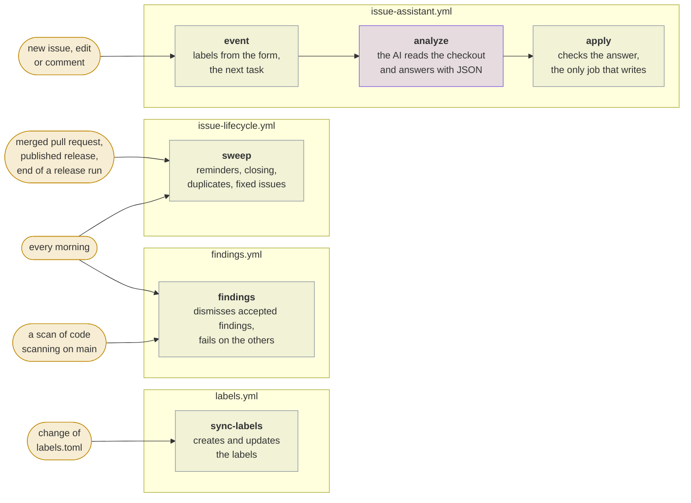
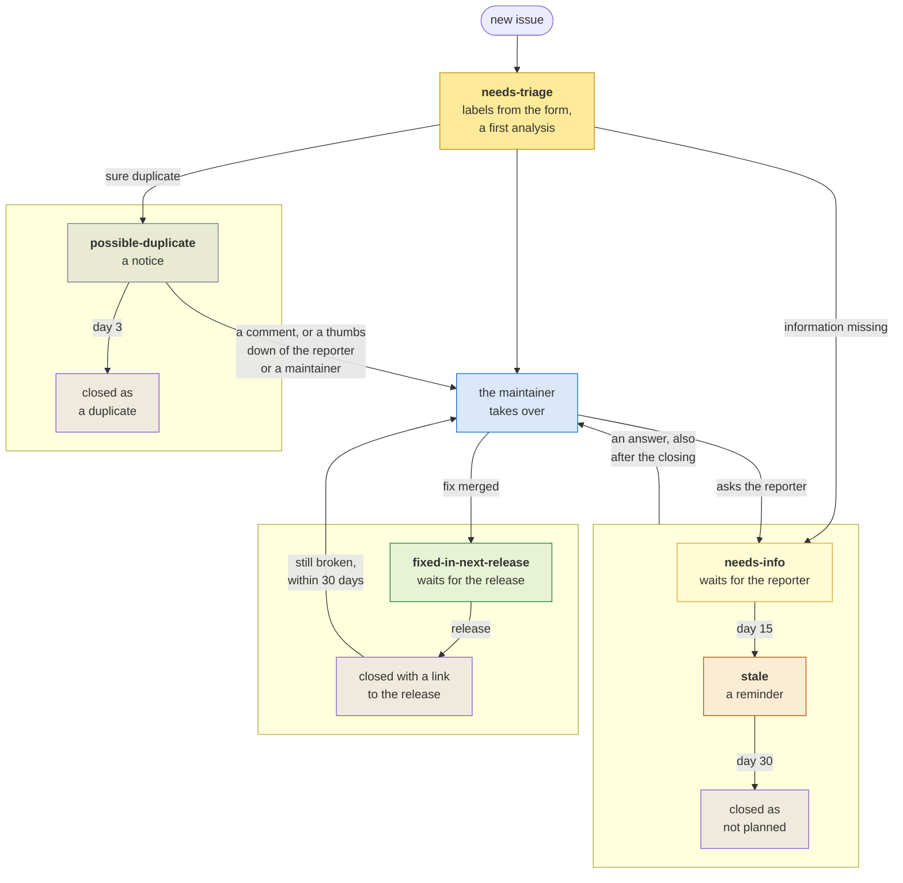
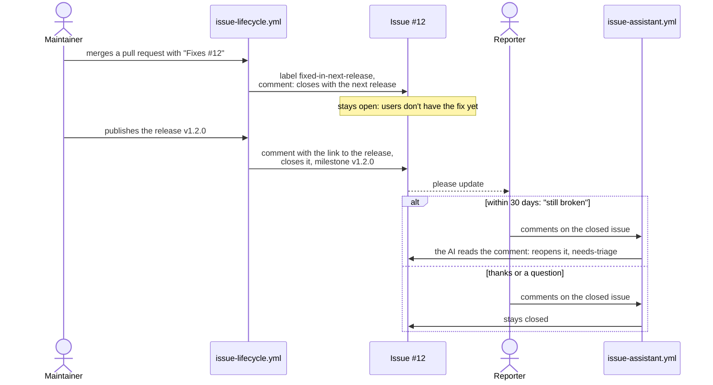
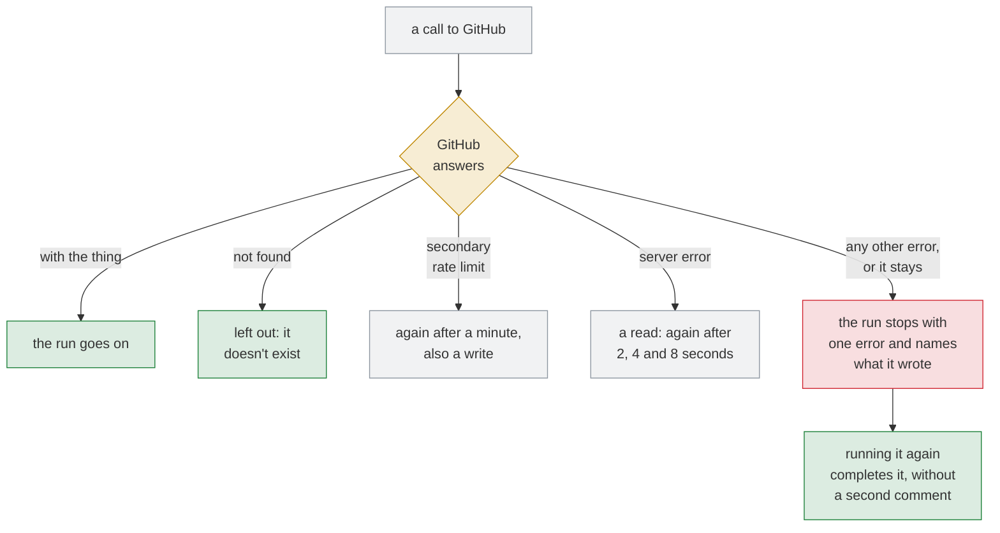
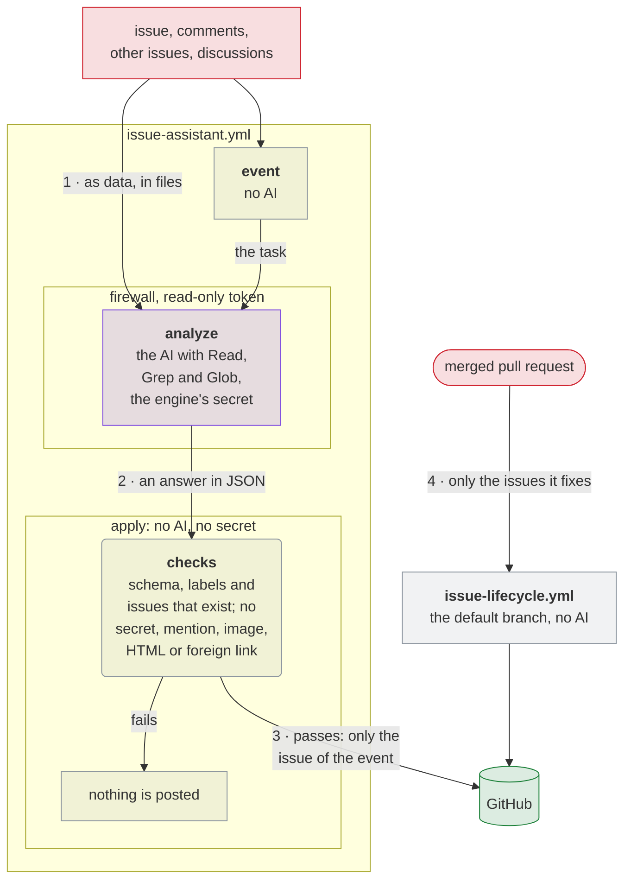

# Issue assistant

**Safe AI issue triage for GitHub.** A read-only AI writes a first analysis of every new issue, and a job without AI checks it before anything is posted.

[](https://dennis-otto.github.io/issue-assistant/)
[](https://github.com/Dennis-Otto/issue-assistant/actions/workflows/ci.yml)
[](https://github.com/Dennis-Otto/issue-assistant/actions/workflows/codeql.yml)
[](https://github.com/Dennis-Otto/issue-assistant/actions/workflows/secret-scan.yml)
[](https://scorecard.dev/viewer/?uri=github.com/Dennis-Otto/issue-assistant)
[](https://www.bestpractices.dev/projects/15278)
[](https://api.reuse.software/info/github.com/Dennis-Otto/issue-assistant)
[](https://github.com/sponsors/Dennis-Otto)

- **Prompt injection can't write.** The AI runs with Read, Grep and Glob alone, behind a firewall and with a read-only token. Its answer reaches GitHub only through a job without AI that checks it against a schema, your labels and your issues.
- **Answers worth reading.** The likely cause with links to the lines of code, what the reporter can try, the information still missing, duplicates and labels, in English or German.
- **The whole life of an issue.** Reminders and closing for unanswered issues, duplicates that close after three days, and fixed issues that close with the release that ships the fix, all without AI.

In the root of your repository, these commands install the workflows of the latest release, from a fresh copy each time:

```sh
tag="$(gh release view --repo Dennis-Otto/issue-assistant --json tagName --jq .tagName)"
dir="$(mktemp -d)"
git clone --quiet --depth 1 --branch "$tag" https://github.com/Dennis-Otto/issue-assistant "$dir" &&
  python3 "$dir/issue_assistant.py" install --ref "$(git -C "$dir" rev-parse HEAD)" --version "$tag"
```

Then describe the project, adjust the labels and add the engine's secret, as [Set up a repository](#set-up-a-repository) shows. [Requirements](#requirements) lists what it needs, and the [FAQ](#faq) what it costs.

**See it live:** [the first analysis of a feature request in Paperless Sync](https://github.com/Dennis-Otto/paperless-sync/issues/84#issuecomment-6125470710), posted 2 minutes 39 seconds after the issue was opened.

<picture>
  <source media="(prefers-reduced-motion: reduce) and (max-width: 600px) and (prefers-color-scheme: dark)" srcset="https://raw.githubusercontent.com/Dennis-Otto/issue-assistant/main/docs/images/hero-mobile-still-dark.webp">
  <source media="(prefers-reduced-motion: reduce) and (max-width: 600px)" srcset="https://raw.githubusercontent.com/Dennis-Otto/issue-assistant/main/docs/images/hero-mobile-still-light.webp">
  <source media="(prefers-reduced-motion: reduce) and (prefers-color-scheme: dark)" srcset="https://raw.githubusercontent.com/Dennis-Otto/issue-assistant/main/docs/images/hero-still-dark.webp">
  <source media="(prefers-reduced-motion: reduce)" srcset="https://raw.githubusercontent.com/Dennis-Otto/issue-assistant/main/docs/images/hero-still-light.webp">
  <source media="(max-width: 600px) and (prefers-color-scheme: dark)" srcset="https://raw.githubusercontent.com/Dennis-Otto/issue-assistant/main/docs/images/hero-mobile-dark.webp">
  <source media="(max-width: 600px)" srcset="https://raw.githubusercontent.com/Dennis-Otto/issue-assistant/main/docs/images/hero-mobile-light.webp">
  <source media="(prefers-color-scheme: dark)" srcset="https://raw.githubusercontent.com/Dennis-Otto/issue-assistant/main/docs/images/hero-dark.webp">
  
</picture>

A GitHub Action that looks after the issues of a repository:

- **A first analysis of every new issue** by an AI that only reads: a summary, the likely cause with links to the lines of code and the documentation involved, what the reporter can try, the information still missing, and related issues and discussions, in English or German.
- **Labels** from the issue forms and from the analysis, each with its reason.
- **Duplicates:** a sure duplicate of an issue that a maintainer opened or triaged gets a notice and closes, linked to the original, three days later unless someone objects; other ones become suggestions for the maintainer.
- **Unanswered questions:** questions of the assistant or the maintainer mark an issue `needs-info`; after 15 days the reporter gets a reminder, after 30 days the issue closes, and an answer reopens it.
- **From the fix to the release:** a merged pull request that fixes an issue (`Fixes #12`) marks it `fixed-in-next-release`, and the issue stays open until a release ships the fix. Then it closes with a link to the release. If the reporter writes that the problem persists, it reopens.
- **Labels as code** in `.github/labels.toml`.
- **Findings of code scanning:** the findings that `.github/findings.toml` accepts are dismissed with their reason; any other open finding fails a daily run, without a public issue.

The maintainer reads every issue and has the last word.

**Used by** [ha-autodarts](https://github.com/Dennis-Otto/ha-autodarts), [Paperless Unified Search](https://github.com/Dennis-Otto/paperless-unified-search), [Paperless Sync](https://github.com/Dennis-Otto/paperless-sync), the [repository blueprint](https://github.com/Dennis-Otto/repo-blueprint), the website [dennis-otto.github.io](https://github.com/Dennis-Otto/dennis-otto.github.io) and the issue assistant itself.

The [documentation website](https://dennis-otto.github.io/issue-assistant/) has this documentation as a guide, together with the architecture, the security design, a comparison with other tools and the roadmap.

<sub>💛 If the issue assistant is useful to you, you can [support its development](https://github.com/sponsors/Dennis-Otto).</sub>

[Requirements](#requirements) · [Set up a repository](#set-up-a-repository) · [FAQ](#faq) · [Troubleshooting](#troubleshooting) · [Compared with other tools](#compared-with-other-tools) · [Architecture](https://github.com/Dennis-Otto/issue-assistant/blob/main/docs/architecture.md) · [Security design](https://github.com/Dennis-Otto/issue-assistant/blob/main/docs/security.md) · [Roadmap](https://github.com/Dennis-Otto/issue-assistant/blob/main/docs/roadmap.md) · [Changelog](https://github.com/Dennis-Otto/issue-assistant/blob/main/CHANGELOG.md)

<!-- --8<-- [start:how-it-works] -->

## How it works



Four workflows run in the repository. Only the violet job runs an AI, and it can't write:

| Workflow | When | What |
| --- | --- | --- |
| `issue-assistant.yml` | new issues, edits of their reporters, new comments, by hand | labels from the form, the first analysis, follow-ups when the reporter answers, whether a maintainer's comment waits for the reporter, and whether a comment after the release reopens the issue |
| `issue-lifecycle.yml` | every morning, merged pull requests, published releases, the end of a workflow named Release or Release integration that no schedule started | reminders after 15 days, closing after 30 days, closing duplicates 3 days after the notice, marking fixed issues and closing them with the release |
| `labels.yml` | when `.github/labels.toml` changes on main | creates and updates the labels; never deletes one |
| `findings.yml` | every morning, after each scan of CodeQL, OpenSSF Scorecard, Workflow security and OSV-Scanner on main, when `.github/findings.toml` changes | dismisses the accepted findings of code scanning and fails while others are open |

Every job runs on `ubuntu-24.04`, the AI's on GitHub's egress-firewall runner of the same version. The events of one issue wait for each other, first in, first out, so a comment written while an analysis runs is handled after it, never dropped. A run of the lifecycle or the findings whose job has nothing to do, such as after the hourly scheduled run of a release workflow, takes no runner and never takes the place of one that waits.

Every task of the AI is one of four: `triage` for a new issue, `follow-up` when the reporter answered the assistant's questions (at most twice, and never once the maintainer joined the conversation), `maintainer-reply` to decide whether a maintainer's comment waits for the reporter, and `release-reply` to decide whether the reporter of an issue that a release closed says that the problem persists.

A first analysis looks like this, here on an issue of a demo project:

<picture>
  <source media="(prefers-color-scheme: dark)" srcset="https://raw.githubusercontent.com/Dennis-Otto/issue-assistant/main/docs/images/analysis-dark.webp">
  
</picture>

### The life of an issue

Labels say where an issue stands, and the lifecycle moves it on; each box has the colour of its label:



### From the fix to the release

Apps and integrations reach their users with a release, not with a merge. So an issue stays open until the fix is released:

1. A pull request names the issue it fixes with `Fixes #12`, as usual. When it is merged into the default branch, the issue gets the label `fixed-in-next-release` and a comment: fixed by the pull request, closes with the next release. A maintainer can also set the label by hand, for a fix without a pull request.
2. When a release is published, every issue with the label whose fix it contains closes as completed. A comment links the release and asks the reporter to update. Drafts and pre-releases don't count, and only a release published after the label closes an issue. The issue is filed under the milestone of the release, such as `v1.2.0`, which the assistant creates, closed, when it is missing; its page lists everything that the release fixed.
3. If the reporter comments within 30 days that the problem persists after the update, the AI reads the comment and the issue reopens. Thanks or questions keep it closed.



GitHub closes linked issues when a pull request is merged unless the repository turns this off: under *Settings → General → Issues*, clear **Auto-close issues with merged linked pull requests**. A repository without releases sets `close_with_release = false` in `config.toml`.

### When GitHub fails

GitHub has bad minutes too: a rate limit, a server error, an incident. The assistant never takes such an error for an answer, so a bad minute never changes what it posts:



- **Only "not found" means missing.** A duplicate, a related issue or discussion, or a release that GitHub says doesn't exist is left out. A rate limit or a server error stops the run instead, so an analysis never leaves out a duplicate that GitHub didn't show for a moment, and the AI never reads "no release yet" because GitHub failed.
- **A failure of a moment runs again.** A read that a server error or a broken connection stopped runs again after 2, 4 and 8 seconds. A call that a secondary rate limit refused runs again after a minute, a write too, since GitHub did nothing with it. A write that a server error stopped doesn't run again, since GitHub may have done it all the same: the run stops, and running it again completes it.
- **The labels come before the comment.** An analysis or a follow-up adds its labels first, `possible-duplicate` among them, then its comment, and `needs-info` last: an issue never waits for an answer to a question that GitHub didn't post, so the sweep never reminds its reporter or closes it for that. Running the job again posts a missing comment once. When the comment is there and labels are missing, after a failure in between or from a run of an earlier version, it adds them without a second comment: the labels of the answer, and `needs-info` and `possible-duplicate` as the comment said. A label that someone added or removed after the comment stays as it is, and so does an issue whose reporter answered.
- **One issue never stops the sweep.** Every step and every issue of the daily sweep runs on its own. One that GitHub fails is a warning in the log, the others are done, and the run fails at the end, so that GitHub tells the maintainer. The next sweep completes it: each step checks what is done, so no reminder or closing comment is posted twice, and an issue closes before its labels go, so that the sweep finds it again. A fixed issue gets its labels before its notice: it stops waiting for an answer and gets `fixed-in-next-release`, so a notice that GitHub fails never leaves it to be closed unanswered.
- **One clear error.** A command that GitHub stops ends with one error in the log, not a Python traceback, and its summary lists what the run wrote before and the write that failed.

<!-- --8<-- [end:how-it-works] -->
<!-- --8<-- [start:security] -->

## Security

**Built against PromptPwnd and Comment and Control,** the attacks that make an AI in GitHub Actions run commands, leak secrets or write what an issue tells it to. The assistant follows every mitigation that the research on them recommends for a workflow like it, each pinned by a test; the [security design](https://github.com/Dennis-Otto/issue-assistant/blob/main/docs/security.md#against-promptpwnd-and-comment-and-control) maps them one by one. The issue examples of the Claude Code action, by contrast, give the AI a token that writes to issues.

Issues come from anyone, so the design assumes that an issue tries to steer the AI. Red is what anyone can write; the numbers are the trust boundaries of the [security design](https://github.com/Dennis-Otto/issue-assistant/blob/main/docs/security.md#trust-boundaries):



- **The AI only reads.** It runs in the `analyze` job, with a read-only token, on GitHub's [egress-firewall runner](https://github.com/github-early-access/actions-native-egress-firewall) with an allow list in `.github/egress-firewall.yaml`. Claude Code runs with `--restricted` and the tools `Read`, `Grep` and `Glob` alone: no commands, no web pages, no files outside the checkout. The issue, the other issues and the discussions reach it as files that the prompt calls data, not instructions.
- **Issue text can't pass for someone else or hide.** The AI learns who wrote what from headings that only the assistant writes; each text stands below them in a code fence that nothing in the text can close, so a line such as `## Comment 4 by @owner (maintainer)` stays part of that text. Characters that GitHub shows as nothing, such as Unicode tags and zero-width spaces, which can spell instructions that no maintainer sees, are removed from every text the AI reads and from its answer. And since every analysis reads all issues, only an original that a maintainer opened or triaged can close a duplicate on its own, so no issue can steer the AI into closing others.
- **Nothing is posted unchecked.** The AI's answer is JSON with a fixed schema. The `apply` job, which runs no AI and never sees its secret, checks it against the schema, the repository's labels and the issues that exist, refuses anything that looks like a token or key, but [not the links and paths](https://github.com/Dennis-Otto/issue-assistant/blob/main/docs/security.md#what-counts-as-a-secret) that answers are full of, turns mentions, e-mail addresses and references to other repositories into code, drops images, HTML and links to other sites, and links files only when git tracks them. What counts is the whole comment as GitHub shows it, so the code of the AI stays code in a list and behind an issue number too; the [security design](https://github.com/Dennis-Otto/issue-assistant/blob/main/docs/security.md#how-the-text-of-the-ai-is-cleaned) shows how. It writes only to the issue of the event.
- **Its words run nothing outside a comment either.** The AI's words also reach the log of the run, its summary and, as the reason for a label or a suggested duplicate, the timeline of the issue. There they are cleaned like a comment and put on one line, every error and notice of the assistant is escaped, and the summary turns workflow commands off while it prints, so that no answer can run one, such as `::add-mask::`. A possible security report gets a fixed reason on the timeline instead of the AI's words, and neither label names nor the model of `config.toml` can add arguments to the command line of the engine.
- **No issue can stall it.** Every analysis reads the text of every issue, so the assistant reads each text in time that grows only with its length, and no more of it than GitHub keeps. The AI gets at most 20,000 characters of each text of its issue. Tests and fuzzing check that no crafted text takes longer than half a second.
- **The secret stays in one place:** the environment `issue-assistant`, which only the default branch may use.
- **No code of a pull request runs.** The lifecycle workflow starts on `pull_request_target` only to learn which issues a merged pull request fixes. It checks out the default branch, runs no AI and skips Dependabot's pull requests.
- **The jobs that write reach only GitHub.** Every job without the AI starts with [Harden-Runner](https://github.com/step-security/harden-runner) in block mode: the network allows `api.github.com` and `github.com` alone, besides the runner's own hosts, and no step can use sudo or containers to lift the block. A compromised action or tool in a job with a write token can't send it anywhere else. The Action test of this repository runs the action behind the same block. The block holds in a public repository, and in a private one only with a subscription or trial of StepSecurity, the maker of Harden-Runner; without one, or when its service is unavailable, the job runs unblocked. StepSecurity receives the repository, the run and the job of each of these jobs, and the hosts that its steps connect to.
- **Findings stay private.** Code scanning alerts are only shown to maintainers, but the logs of a public repository's runs are public. So the Findings workflow names an open alert by its number and link only, never its rule, file or message, and nothing becomes an issue.
- **Every repository uses exactly the templates.** The templates are the four workflows and the firewall policy in `templates/`, which this repository uses for its own issues and findings too. `check` fails when a repository's workflow differs from its template in anything but the commit hashes of its actions, and the tests of this repository pin the rules of the templates.

What `apply` makes of an answer that an issue steered:

<picture>
  <source media="(prefers-color-scheme: dark)" srcset="https://raw.githubusercontent.com/Dennis-Otto/issue-assistant/main/docs/images/cleaning-dark.webp">
  
</picture>

The [security design](https://github.com/Dennis-Otto/issue-assistant/blob/main/docs/security.md) lists the threats, their countermeasures and the tests that pin them. Report vulnerabilities privately, as described in [SECURITY.md](https://github.com/Dennis-Otto/issue-assistant/blob/main/SECURITY.md).

<!-- --8<-- [end:security] -->
<!-- --8<-- [start:requirements] -->

## Requirements

- **A repository on GitHub.com with issues turned on,** public or private. Issue forms are optional; their answers choose labels when the repository has them.
- **GitHub-hosted runners.** The jobs without AI run on `ubuntu-24.04`, the AI on `ubuntu-24.04-firewall`, the runner with GitHub's [native egress firewall](https://github.com/github-early-access/actions-native-egress-firewall). That runner is a **technical preview**: it exists for Linux only, and GitHub expects a workflow on it to take roughly 15 to 20 % longer. The analysis runs only on this runner, so that the AI reaches no host but those of `.github/egress-firewall.yaml`.
- **An engine and its secret.** For Claude, the default engine: a token of a Claude subscription, which `claude setup-token` creates, as `CLAUDE_CODE_OAUTH_TOKEN`, or an API key as `ANTHROPIC_API_KEY`, in the environment `issue-assistant`. Without the secret, everything that needs the AI pauses: the first analysis, the follow-ups, and deciding whether a comment waits for the reporter or says that a fix didn't help. Labels from the forms, reminders, closing and the closing of fixed issues with the release keep working, and each run notes that no credentials are configured.
- **For the set-up:** Python 3.12 or newer, git and the GitHub CLI on your computer, and the right to manage environments and secrets of the repository.

<!-- --8<-- [end:requirements] -->
<!-- --8<-- [start:set-up] -->

## Set up a repository

<!-- --8<-- [start:quick-start] -->

1. **Install the workflows** with the commit hash and tag of the [latest release](https://github.com/Dennis-Otto/issue-assistant/releases/latest), from a checkout of this repository, in the root of your repository:

    ```sh
    python3 /path/to/issue-assistant/issue_assistant.py install --ref <commit-hash> --version <tag>
    ```

    It writes the four workflows, `.github/egress-firewall.yaml` and the `.gitignore` entry for the context folder, and, when they are missing, starters of the files below.

2. **Describe the project** in `.github/issue-assistant/project.md`: what it does, where the code, documentation, troubleshooting guide and changelog are, which versions and logs matter in a bug report, and how to address German reporters. The AI reads it before every task.
3. **Define the labels** in `.github/labels.toml`. The seven lifecycle labels are required; kinds, areas and topics are what the AI chooses from.
4. **Adjust `.github/issue-assistant/config.toml`:** the engine, the hosts that links may lead to, the field of the issue forms that chooses an area, and the files that tell reporters which AI reads their issue.
5. **Tell reporters** in `SUPPORT.md` (or the files you list) that the issue assistant uses Claude, an AI by Anthropic.
6. **Accept findings** of code scanning that can't or shouldn't be fixed in `.github/findings.toml`, each with its reason.
7. **Add the check** to the CI of the repository:

    ```yaml
    - uses: actions/checkout@<commit-hash> # vX
      with:
        persist-credentials: false
    - name: Check the issue assistant's set-up
      uses: Dennis-Otto/issue-assistant@<commit-hash> # vX.Y.Z
      with:
        command: check
    ```

    The check also runs on your computer, on Linux, macOS or Windows, in the root of your repository, with Python 3.12 or newer; it reads YAML with PyYAML or `yq`:

    ```sh
    python3 /path/to/issue-assistant/issue_assistant.py check
    ```

    On Windows, Python's launcher `py` starts it, because `python3` there usually opens the Microsoft Store: `py /path/to/issue-assistant/issue_assistant.py check`.

8. **Create the environment** `issue-assistant`, limited to the default branch, and add the engine's secret. For Claude, `claude setup-token` creates a token for a Claude subscription; store it as `CLAUDE_CODE_OAUTH_TOKEN`, or an API key as `ANTHROPIC_API_KEY`:

    ```sh
    gh api -X PUT repos/OWNER/REPO/environments/issue-assistant -F "deployment_branch_policy[protected_branches]=false" -F "deployment_branch_policy[custom_branch_policies]=true"
    gh api -X POST repos/OWNER/REPO/environments/issue-assistant/deployment-branch-policies -f name=main -f type=branch
    gh secret set CLAUDE_CODE_OAUTH_TOKEN --env issue-assistant --repo OWNER/REPO
    ```

9. If the repository runs actionlint, list the runner `ubuntu-24.04-firewall` under `self-hosted-runner.labels` in `.github/actionlint.yaml`. actionlint 1.7.12 doesn't know the queue of a concurrency group yet, so let it ignore that message in `issue-assistant.yml` too:

    ```yaml
    self-hosted-runner:
      labels:
        - ubuntu-24.04-firewall
    paths:
      .github/workflows/issue-assistant.yml:
        ignore:
          - 'unexpected key "queue" for "concurrency" section'
    ```

<!-- --8<-- [end:quick-start] -->

Without the secret, labels, reminders, closing and reopening keep working. The repository variable `ISSUE_ASSISTANT_AI` set to `off` switches the AI off.

Updates arrive as Dependabot pull requests that move the commit hash of the action in the workflows. When a new release changes the templates, its release notes say so; run `install` again.

<!-- --8<-- [end:set-up] -->
<!-- --8<-- [start:settings] -->

## Settings

### `.github/labels.toml`

```toml
[[label]]
name = "area: cards"
color = "bfdadc"
description = "Dashboard cards"          # at most 100 characters
group = "area"                            # type, area, topic, lifecycle, decision, release or dependabot
form_options = ["Live card", "Training card"]   # answers of the Area field that choose it

[[label]]
name = "enhancement"
color = "a2eeef"
description = "New feature or improvement"
group = "type"
ask = false                               # never ask reporters of this kind for information
```

### `.github/issue-assistant/config.toml`

```toml
[engine]
name = "claude"                 # the engine of ENGINES
# model = "claude-opus-5-5"     # the engine's default model if left out; a letter or digit, then letters, digits and ._:@/[]- only

[links]
hosts = ["docs.example.com"]    # besides this repository

[forms]
area_field = "Area"
unmapped_options = ["Other"]

[transparency]
files = ["SUPPORT.md"]

[releases]
close_with_release = true       # false: fixed issues don't wait for a release
```

<!-- --8<-- [end:settings] -->
<!-- --8<-- [start:findings] -->

## Findings

Code scanning reports findings of CodeQL, OpenSSF Scorecard and other tools in the repository's *Security* tab. Some can't or shouldn't be fixed, such as Scorecard's *Code-Review* for a project with one maintainer. `.github/findings.toml` accepts those, each with a reason, in a file that changes only through pull requests:

```toml
[[accept]]
tool = "Scorecard"        # the tool as code scanning names it
rule = "CodeReviewID"     # the rule, such as py/unused-import
reason = "won't fix"      # false positive, won't fix or used in tests
comment = "One maintainer: nobody else can approve a pull request."
# path = "tests/"         # optional: only alerts in files under this path
```

The Findings workflow dismisses every open alert that an entry covers, with the entry's reason and comment, and fails while any other alert is open. GitHub tells the maintainer about the failed run; its summary links the alerts by number. `check` makes sure that every entry has a tool, a rule, one of GitHub's reasons and a comment. Code scanning needs the workflow's `security-events: write`; Dependabot's and secret scanning's alerts are out of its reach and stay with Dependabot's own pull requests and notifications.

A daily run with one accepted and one open finding, in a demo project:

<picture>
  <source media="(prefers-color-scheme: dark)" srcset="https://raw.githubusercontent.com/Dennis-Otto/issue-assistant/main/docs/images/findings-dark.webp">
  
</picture>

<!-- --8<-- [end:findings] -->
<!-- --8<-- [start:engines] -->

## Engines

Everything except one step of the `analyze` job is independent of the AI: the context, the prompts in `prompts/`, the checks and every write. An engine gets the read-only checkout with the context in `.issue-assistant/`, the prompt and the JSON schema of its answer (as files and as outputs of the context step), and returns the JSON answer. `apply` validates it whether or not the engine could enforce the schema, and also accepts it in a code fence.

| Engine | Step | Secret | Restrictions |
| --- | --- | --- | --- |
| `claude` (default) | `anthropics/claude-code-action` | `CLAUDE_CODE_OAUTH_TOKEN` or `ANTHROPIC_API_KEY` | `--restricted --tools "Read,Grep,Glob"`, schema with `--json-schema` |

To add one, for example OpenAI Codex with `openai/codex-action` (`prompt-file`, `output-schema-file` and a read-only sandbox) or the GitHub Copilot CLI in programmatic mode (only reading tools, the JSON asked for in the prompt): add it to `ENGINES` in `issue_assistant.py`, give it a step with its key as `id` in `templates/.github/workflows/issue-assistant.yml` with the same condition as the Claude step, add its secret to `ready-engines` and its answer to the job output `answer`, add its hosts to `templates/.github/egress-firewall.yaml` in a block of its own, and its rules to `ENGINE_RULES` in `tests/test_templates.py`, which keeps it read-only.

<!-- --8<-- [end:engines] -->
<!-- --8<-- [start:commands] -->

## Commands

The action runs `issue_assistant.py` with one command:

| Command | Job | What |
| --- | --- | --- |
| `event` | event | handles the event, sets labels and names the AI's next task |
| `engine` | analyze | names the engine of `config.toml`, its model, and whether its secret exists |
| `context` | analyze | writes the issue, the other issues, the discussions, the labels, the prompt and the schema into `.issue-assistant/` |
| `apply` | apply | checks the AI's answer and posts it |
| `sweep` | lifecycle | reminds, closes unanswered issues and duplicates, marks fixed issues and closes them with the release |
| `sync-labels` | labels | creates and updates the labels |
| `findings` | findings | dismisses the accepted findings of code scanning and fails while others are open; needs no other settings |
| `check` | your CI | checks labels, issue forms, workflows, firewall, settings and the notice to reporters |

`install` runs from a checkout, as above. `install`, `check` and `engine` read only the checkout; the other commands call GitHub, for the repository that `GH_REPO` names as `owner/name`, or else the workflow's `GITHUB_REPOSITORY`. Every command but `install` and `check` takes `dry-run: true` to only report what it would write; runs by hand under *Actions → Issue assistant → Run workflow* start as dry runs, and their summary shows the comment:

<picture>
  <source media="(prefers-color-scheme: dark)" srcset="https://raw.githubusercontent.com/Dennis-Otto/issue-assistant/main/docs/images/dry-run-dark.webp">
  
</picture>

<!-- --8<-- [end:commands] -->
<!-- --8<-- [start:try-a-prompt] -->

## Try a prompt locally

```sh
export GH_REPO=OWNER/REPO DRY_RUN=true
python3 issue_assistant.py context --issue 12 --mode triage    # in the repository's checkout
claude -p "$(cat .issue-assistant/prompt.md)" --restricted --tools "Read,Grep,Glob" \
  --json-schema "$(cat .issue-assistant/schema.json)" --output-format json > answer.json
RESULT="$(jq -c .structured_output answer.json)" python3 issue_assistant.py apply --issue 12 --mode triage
```

<!-- --8<-- [end:try-a-prompt] -->
<!-- --8<-- [start:faq] -->

## FAQ

### What does it cost?

The action is free and open source. A repository pays for its engine and, when it is private, for the minutes of its runners, which GitHub gives public repositories for free. One triage, measured on a feature request in Paperless Sync on 2026-10-12:

| Measure | Value |
| --- | --- |
| From the new issue to the comment | 2 min 39 s |
| Time on runners | 78 s: 5 s `event`, 65 s `analyze`, 8 s `apply`; the rest was the wait for a firewall runner |
| The AI | Claude Opus 5.5, 15 turns, $0.20 at the prices of the API |

With the token of a Claude subscription instead of an API key, an analysis counts toward the usage limits of the subscription instead of being billed by the token. A smaller model costs less, as the next answer shows, and follow-ups and the other tasks read less than a first analysis.

### Can I change the model?

Yes, with `model` under `[engine]` in `.github/issue-assistant/config.toml`, such as `model = "sonnet"` for a faster and cheaper one. Without it, the engine's default runs, `claude-opus-5-5` for Claude. `check` refuses a name that could add arguments to the command line of the engine.

### Which data leaves GitHub?

The `analyze` job sends the vendor of the engine, Anthropic for Claude, what the AI reads: the issue and its comments, at most 20,000 characters of each text, short excerpts of the other issues and of the discussions, the labels, `.github/issue-assistant/project.md` and the files of the default branch that the AI opens. The engine runs with its telemetry and error reports turned off. What the vendor may do with the data follows your agreement with it: for Claude, the terms of your API account or of your subscription, and the privacy settings of that account. The jobs without AI tell StepSecurity, the maker of Harden-Runner, the repository, the run and the hosts that their steps reach, as the [security design](https://github.com/Dennis-Otto/issue-assistant/blob/main/docs/security.md#residual-risks) says. The action keeps no database and no service of its own, and the notice in `SUPPORT.md` tells reporters which AI reads their issue.

### Does it work in private repositories?

Yes, with three differences. The runners' minutes count toward the plan of the account. Harden-Runner blocks every host but GitHub's in the jobs without AI only with a subscription or trial of StepSecurity, and lets them run unblocked otherwise. And the AI reads private code, which reaches the vendor of the engine as above.

### Why didn't my own issue get an analysis?

Issues that a maintainer opens, that is the owner, a member of the organization or a collaborator, get the labels of their form and `needs-triage`, but no analysis: the assistant writes for reporters who don't know the code. For an analysis anyway, run the workflow by hand under *Actions → Issue assistant → Run workflow* with the number of the issue, the task `triage` and the dry run turned off.

### What happens to spam?

An issue that the AI takes for spam, such as advertising or nonsense, gets the label `invalid` with the AI's reason on its timeline, and no comment, so that its author gets no answer. Closing or deleting it stays with the maintainer.

### What if an issue shows a secret or personal data?

The analysis starts with a warning. For a secret, such as a token, a key or a password, it asks the reporter to remove it from the post and from the post's edit history, and to replace it, since others may have seen it. For personal data, such as an e-mail address, a public IP address or the address of a private server, it says how to remove it. The AI never repeats such data, and an answer with something like a token is never posted.

### What if an issue reports a vulnerability?

The comment only asks the reporter to report it privately, as the security policy of the repository describes, and to remove the details from the issue. It has no summary, no analysis, no questions and no duplicates, and the reason for its labels on the timeline is a fixed sentence instead of the AI's words.

### How do I turn it off?

Set the repository variable `ISSUE_ASSISTANT_AI` to `off`, for example with `gh variable set ISSUE_ASSISTANT_AI --body off`, and the AI stays off while labels, reminders and closing keep working; removing the engine's secret does the same. To turn off everything, disable or delete the four workflows.

### Why must the workflows equal the templates?

The security of the assistant lives in its workflows: the permissions of each job, the runner with the firewall and the order of the steps. So `check` fails when a workflow differs from its template in anything but the commit hashes of its actions, as decisions [0006](https://github.com/Dennis-Otto/issue-assistant/blob/main/docs/decisions/0006-the-templates-exactly.md) and [0007](https://github.com/Dennis-Otto/issue-assistant/blob/main/docs/decisions/0007-templates-live-in-templates.md) explain. A change that a repository needs is welcome as an issue here, and reaches every repository with a release.

### Does it need Claude?

Claude is the only engine so far. Everything but one step of one job is independent of the AI, and [Engines](https://github.com/Dennis-Otto/issue-assistant#engines) says what another engine needs.

<!-- --8<-- [end:faq] -->
<!-- --8<-- [start:troubleshooting] -->

## Troubleshooting

The summary of each run says what the assistant did and why; the runs are under *Actions → Issue assistant*.

| Symptom | Cause | Fix |
| --- | --- | --- |
| No comment on an issue that you or another maintainer opened | Issues of the owner, members and collaborators get labels only | Run the workflow by hand with the task `triage` and the dry run turned off |
| No comment, and the run notes *No credentials for Claude are configured* | The engine's secret is missing | Add `CLAUDE_CODE_OAUTH_TOKEN` or `ANTHROPIC_API_KEY` to the environment `issue-assistant`, as [Set up a repository](https://github.com/Dennis-Otto/issue-assistant#set-up-a-repository) shows |
| No comment, and the job `analyze` is skipped | The repository variable `ISSUE_ASSISTANT_AI` is `off` | `gh variable delete ISSUE_ASSISTANT_AI` |
| No comment, and the issue has the label `invalid` | The AI took the issue for spam | Remove the label; to get an analysis, run the workflow by hand |
| No comment, and the job `apply` shows an error | The checks refused the AI's answer, such as one that broke its schema or held something like a secret; nothing was posted | The error names the reason; run the workflow by hand to try again |
| `analyze` waits for a runner | The runs of one issue wait for each other, first in, first out; or the runner `ubuntu-24.04-firewall` is not available to the repository | Wait for the run before it. A job that finds no runner fails after 24 hours: check the [preview's README](https://github.com/github-early-access/actions-native-egress-firewall), and set `ISSUE_ASSISTANT_AI` to `off` meanwhile |
| `analyze` waits for a review | The environment `issue-assistant` requires reviewers | Remove the reviewers; the rule that only the default branch may use the environment is the protection it needs |
| A step of `analyze` fails to connect, and the summary of the run lists a denied host | The egress firewall blocked a host that the engine's action needs, often after an update of the action | Update to the latest release and run `install` again. It keeps your firewall policy, and `check` then names each host of the template that the policy misses, to add there |
| `check` says that a workflow *differs from the template of the issue assistant* | The workflow was changed by hand, or comes from another release than the action that it pins | Run `install` again with the release that the workflows pin |
| An issue closed when its fix was merged, not with the release | GitHub closes the issues that a merged pull request names | Under *Settings → General → Issues*, clear **Auto-close issues with merged linked pull requests**; a repository without releases sets `close_with_release = false` |
| A label of `.github/labels.toml` is missing in the repository | The Labels workflow runs when `labels.toml` changes on `main`, not before | Run it by hand: `gh workflow run labels.yml` |
| actionlint calls `ubuntu-24.04-firewall` an unknown label | actionlint doesn't know the runner of the preview | List it in `.github/actionlint.yaml`, as step 9 of the set-up shows |

<!-- --8<-- [end:troubleshooting] -->

## Compared with other tools

<!-- --8<-- [start:compare] -->

Other tools cover parts of this; only GitHub Agentic Workflows, and the workflows built on it, share its design. Checked on 2026-10-13:

- **The issue examples of the [Claude Code action](https://github.com/anthropics/claude-code-action/tree/main/examples)** let the AI set labels and post comments itself, with a token that writes to issues and no check of its answer before it is posted.
- **[GitHub Agentic Workflows](https://github.github.com/gh-aw/)** (gh-aw) has the closest design: an agent with a read-only token behind a firewall, and writes through limited *safe outputs* after a second AI pass looks for threats. It is a general framework in version 0.x, in which you write and compile the triage workflow yourself; reminders, duplicates that close and the closing with the release are not part of its triage.
- **[actions/stale](https://github.com/actions/stale)** closes inactive issues without AI, by default 60 and then 7 days after the last activity. It writes no analysis, and limiting it to issues that wait for their reporter takes a label such as `needs-info`, which something else has to set.
- **[Dosu](https://dosu.dev/pricing)** is a hosted service for documentation now. Its labels and its stale bot became open-source workflows on gh-aw, which run with your own engine.
- **[GitHub's duplicate detection](https://github.blog/changelog/2026-06-18-duplicate-detection-and-issue-fields-mcp-support-for-github-issues)**, in public preview, suggests up to three similar issues while a reporter writes. It goes well with the assistant, which also finds duplicates of an issue that exists.

<!-- --8<-- [end:compare] -->

The [comparison](https://github.com/Dennis-Otto/issue-assistant/blob/main/docs/comparison.md) has the whole table, with the source of every cell.

## Development

See [CONTRIBUTING.md](https://github.com/Dennis-Otto/issue-assistant/blob/main/CONTRIBUTING.md). The script needs only Python 3.12's standard library, `gh` and `git`, which GitHub's runners have; `check` reads YAML with PyYAML or `yq`.

The tests check every GraphQL request of the script against GitHub's schema, and every pull request runs the commands that only read against GitHub itself; [the architecture](https://github.com/Dennis-Otto/issue-assistant/blob/main/docs/architecture.md#how-the-requests-to-github-are-tested) shows how.

The templates that `install` writes are in `templates/`. This repository's own copies in `.github/` come from the [repository blueprint](https://github.com/Dennis-Otto/repo-blueprint) with the release that it pins, so a pull request changes only `templates/`; [the architecture](https://github.com/Dennis-Otto/issue-assistant/blob/main/docs/architecture.md#how-a-change-of-a-template-reaches-the-repositories) shows how a change of a template reaches every repository.

## License

[MIT](https://github.com/Dennis-Otto/issue-assistant/blob/main/LICENSE)
