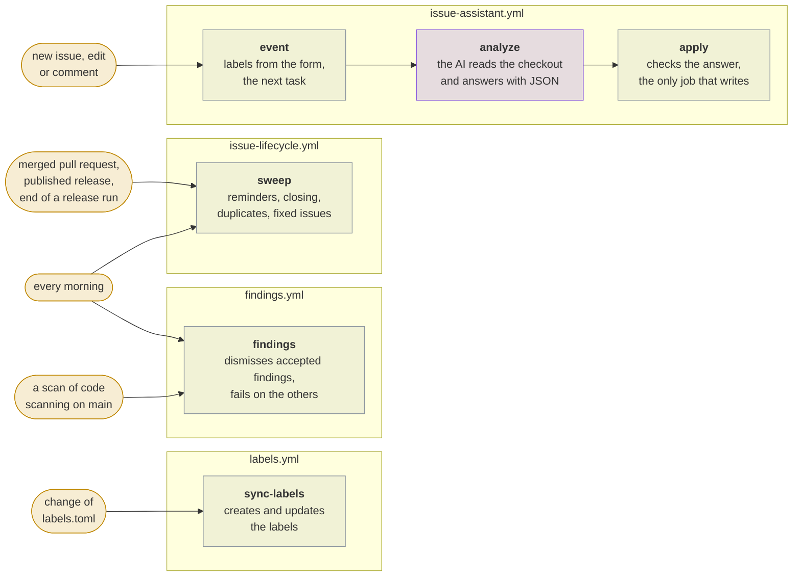
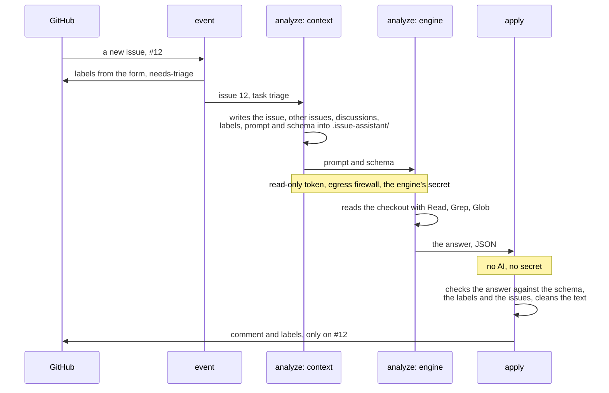
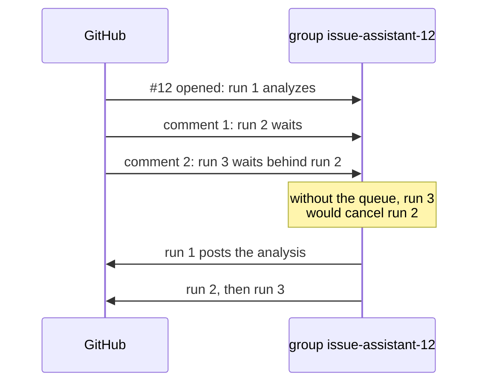
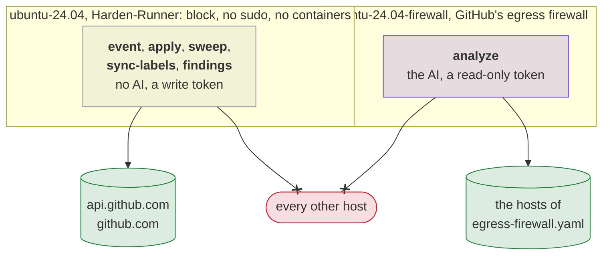
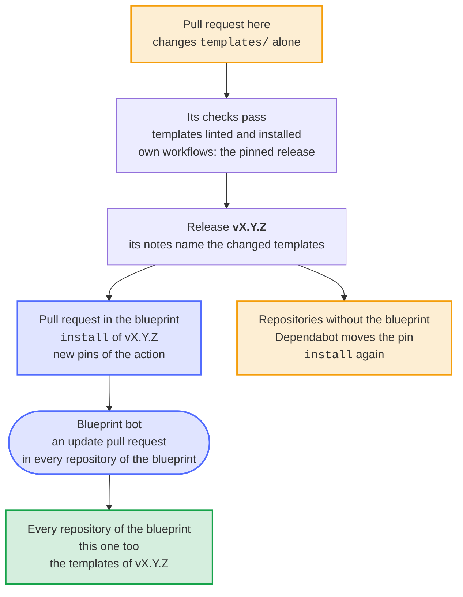

# Architecture

[← README](https://github.com/Dennis-Otto/issue-assistant) · [Security design](security.md) · [Roadmap](roadmap.md)

The issue assistant is a composite GitHub Action. `action.yml` runs `issue_assistant.py` with the Python 3.12 of GitHub's runners and the standard library alone; the script talks to GitHub through the GitHub CLI. Four workflows in the repository that it looks after call the action, and one step of one job runs the AI engine.

## Components

| Component | Files | What it does |
| --- | --- | --- |
| The action | `action.yml` | Passes every input through the environment to `issue_assistant.py` and runs one command of it |
| Commands | `main()` in `issue_assistant.py` | `event`, `engine`, `context`, `apply`, `sweep`, `sync-labels`, `findings`, `check` and `install`; [the README](https://github.com/Dennis-Otto/issue-assistant#commands) names what each does |
| GitHub client | the class `GitHub` | Every read and write through `gh api`; in a dry run it only records what it would write |
| Settings | `load_config`, `load_labels`, `load_findings` | Read `.github/issue-assistant/config.toml`, `.github/labels.toml` and `.github/findings.toml` of the repository |
| Events | `handle_event` | Labels from the issue forms, and the next task of the engine: `triage`, `follow-up`, `maintainer-reply` or `release-reply` |
| Context | `write_context` | Writes the issue, its comments, related issues and discussions, the labels, the prompt and the JSON schema of the answer into `.issue-assistant/`, for the engine to read |
| Prompts | `prompts/` | The rules of every task, which call the content of the issue data, not instructions |
| Checks of the answer | `answer_schema`, `validate`, `parse_answer`, `looks_secret`, `sanitize` | Check the engine's JSON against its schema, the labels and the issues that exist; refuse anything that looks like a secret; clean the text of mentions, images, HTML and links to other sites |
| Writing | `apply_answer` and the `render_*` functions | Post the comment, set the labels and mark duplicates, only on the issue of the event |
| Lifecycle | `sweep` | Reminders after 15 days, closing after 30 days, closing duplicates after 3 days, marking fixed issues, closing them with the release and filing them under its milestone |
| Labels | `sync_labels` | Create and update the labels of `labels.toml`, never delete one |
| Findings | `watch_findings` | Dismiss the findings of code scanning that `findings.toml` accepts and fail while others are open |
| Set-up | `install`, `check` | Write the four workflows, the firewall policy and the starter files of `templates/` into a repository, and check that its set-up still fits the templates; both need only the checkout and name its files with slashes on every system |

## The workflows of a repository

| Workflow | Jobs |
| --- | --- |
| `issue-assistant.yml` | `event` decides the next task; `analyze` writes the context and runs the engine with a read-only token, on GitHub's egress-firewall runner; `apply` checks the answer and writes it |
| `issue-lifecycle.yml` | `sweep`, every morning, after merged pull requests, published releases and the end of a run of the release workflow that no schedule started |
| `labels.yml` | `sync-labels`, when `labels.toml` changes on the default branch |
| `findings.yml` | `findings`, every morning, after each scan of code scanning on the default branch and when `findings.toml` changes |

## One run for a new issue

The three jobs of `issue-assistant.yml` hand the issue on; only the middle one sees the AI and its secret, and only the last one writes:

`install` copies the workflows of `templates/` with the commit hash of the release, and `check` fails when a repository's copy differs in anything but the commit hashes of its actions.

## Waiting, runners and the network

**The events of one issue wait in line.** The runs of `issue-assistant.yml` for one issue share the concurrency group `issue-assistant-<number>` with `queue: max`: up to 100 runs wait for their turn, first in, first out. An analysis takes about two and a half minutes, and without the queue a group keeps a single waiting run, which the next event cancels. A reporter who answered twice during an analysis then got no follow-up to the first answer, and a "still broken" after a release could stay without effect.

**A run with nothing to do takes no runner and no place in a line.** The sweep and the findings work on the whole repository, so one waiting run is enough, and their jobs, not their runs, wait in the groups `issue-lifecycle` and `findings`. A run waits for the group of its workflow before its jobs check their conditions, so a run that would only skip its job, such as after the scan of a pull request, took the place of a waiting one that had work to do; a skipped job never enters the group of a job. The release workflow of the [repository blueprint](https://github.com/Dennis-Otto/repo-blueprint) runs every hour as a safety net and mostly releases nothing: the lifecycle skips the ends of these scheduled runs, and the morning sweep catches a release that one of them made.

**The jobs without the AI reach only GitHub.** Every job runs on `ubuntu-24.04`, so a new image behind `ubuntu-latest` never reaches the repositories untested. The jobs that write start with Harden-Runner in block mode; the AI runs behind GitHub's egress firewall instead. [Decision 0008](decisions/0008-the-jobs-that-write-reach-only-github.md) explains why:

The checkout reaches `github.com` and the GitHub CLI `api.github.com`; Harden-Runner allows the hosts of the runner itself, such as those of the logs and the summary. The action turns off the telemetry of the GitHub CLI, which would only knock at a blocked host. The job `egress` of the Action test runs the action behind the same block, so a host that it starts to need fails there, before a release blocks it in every repository.

## How a change of a template reaches the repositories

The templates are in `templates/.github/`: the four workflows, the firewall policy and the starter files that `install` writes. This repository looks after its own issues with the same workflows, but its copies in `.github/` belong to the [repository blueprint](https://github.com/Dennis-Otto/repo-blueprint): every update of the blueprint writes them anew, as the templates of the release of the issue assistant that the blueprint pins. `install` and `check` of this commit never read these copies, only the check of the pinned release in the Lint workflow does (step 1 below), and no test compares them with `templates/`, because they are a release behind after every change of a template. [Decision 0007](decisions/0007-templates-live-in-templates.md) explains why.

1. **A pull request here** changes `templates/`, never the copies in `.github/`. `tests/test_templates.py` pins the rules of the templates. The Action test lints them with actionlint and zizmor, installs them into the sample repository and into a copy of this repository, and checks both set-ups through the action. The required check `issue-assistant` runs `check` of the release that the Lint workflow pins, on this repository's own copies, which the pull request leaves as they are.
2. **The release** of the change is a new minor version, and its notes say that repositories run `install` again.
3. **The blueprint takes the release over** in a pull request of its own: it runs `install` of the release in its root, takes over the firewall policy of `templates/` and moves every pin of the action, that of the check in its Lint workflow too. It also adapts its own checks to the templates when they need it, as when actionlint had to ignore the queue of a concurrency group, which it doesn't know yet. A pull request that changed only the blueprint's copies would fail the check `issue-assistant` there in the same way.
4. **The next release of the blueprint** reaches every repository made from it, this one too, as an update pull request of the blueprint bot. Repositories that use the action without the blueprint receive the release as a Dependabot pull request and run `install` again.

## Design decisions

- **The AI only reads, and a job without the AI writes.** The answer of the engine is data that `apply` checks before anything reaches GitHub.
- **Everything but one step is independent of the engine.** Context, prompts, checks and writes are the same for every engine; a new engine is a step and an entry of `ENGINES`, as the [README](https://github.com/Dennis-Otto/issue-assistant#engines) describes.
- **No third-party packages.** The script needs only the standard library, `gh` and `git`, which GitHub's runners have.
- **The maintainer has the last word.** The assistant labels, asks and suggests; it never decides on behalf of the maintainer.
