# Architecture

[← README](https://github.com/Dennis-Otto/issue-assistant) · [Security design](security.md) · [Roadmap](roadmap.md)

The issue assistant is a composite GitHub Action. `action.yml` runs `issue_assistant.py` with the Python 3.12 of GitHub's runners and the standard library alone; the script talks to GitHub through the GitHub CLI. Four workflows in the repository that it looks after call the action, and one step of one job runs the AI engine.

## Components

| Component | Files | What it does |
| --- | --- | --- |
| The action | `action.yml` | Passes every input through the environment to `issue_assistant.py` and runs one command of it |
| Commands | `main()` in `issue_assistant.py`, which hands each command of `SCRIPT_COMMANDS` to a function of its own | `event`, `engine`, `context`, `analyze`, `usage`, `apply`, `sweep`, `sync-labels`, `findings`, `check`, `install` and `evaluate`, which replays closed issues as they were with the class `Then`, a view of GitHub at a moment; [the README](https://github.com/Dennis-Otto/issue-assistant#commands) names what each does |
| GitHub client | the class `GitHub` | Every read and write through `gh api`; in a dry run it only records what it would write |
| Settings | `load_config`, `load_labels`, `load_findings` | Read `.github/issue-assistant/config.toml`, `.github/labels.toml` and `.github/findings.toml` of the repository |
| Events | `handle_event`, `limited`, `within_limits` | Labels and owners from the issue forms, and the next task of the engine: `triage`, `follow-up`, `maintainer-reply`, `release-reply` or `maintainer-question`, never on a muted issue but on a maintainer's command, and within the [limits of the AI runs](https://github.com/Dennis-Otto/issue-assistant#limits-of-the-ai-runs) for the tasks that people who don't maintain the repository start |
| Context | `write_context` | Writes what the task of the engine reads into `.issue-assistant/`: the issue with its comments; for an analysis and a follow-up the other issues and discussions of a bounded window and the labels; for a first analysis `corrections.md`, what the maintainers corrected of the analyses before (`learned_corrections`, `render_learned`); for a reply or a maintainer's question the comment of its event; then the prompt and the JSON schema of the answer ([what the AI reads](how-it-works.md#what-the-ai-reads)); [each text is read in linear time](#reading-the-text-of-issues) |
| Prompts | `prompts/` | The rules of every task, which call the content of the issue data, not instructions |
| Languages | `locales/`, `LOCALES`, `detect_language`, `issue_language`, `maintainers`, `for_maintainers` | A catalog for each language of the comments, with its texts, how it names a day and its stopwords; the language of an issue from the marker of its last analysis, or else from the reporter's words; the folded summary for the maintainers in theirs, `[maintainers] language`, below a comment in another one ([languages](how-it-works.md#languages)) |
| Checks of the answer | `answer_schema`, `validate`, `parse_answer`, `looks_secret`, `sanitize` | Check the engine's JSON against its schema, the labels and the issues that exist; refuse anything that looks like a secret; clean the text of mentions, images, HTML and links to other sites |
| Writing | `apply_answer` and the `render_*` functions | Post the comment, set the labels, assign the owners of its areas, set the issue type and mark duplicates, only on the issue of the event; post the first answer to a discussion, only on the discussion of the event |
| Lifecycle | `sweep` | Reminders after 15 days, closing after 30 days, closing duplicates after 3 days, marking fixed issues, closing them with the release and filing them under its milestone |
| Labels | `sync_labels` | Create and update the labels of `labels.toml`, never delete one, and warn of owners that can't be assigned and of issue types the repository lacks |
| Findings | `watch_findings` | Dismiss the findings of code scanning that `findings.toml` accepts and fail while others are open |
| Fixture | `read_fixture`, `GitHub.use_fixture` | An issue and its comments from a JSON file in place of GitHub's, for [the canary](#the-canary) and for trying a prompt; `context` and `apply` then write nothing |
| Set-up | `install`, `set_up_github`, `check` | Write the four workflows, the one of the discussions where `config.toml` names categories, the firewall policy and the starter files of `templates/` into a repository, add the notice to reporters and actionlint's ignored `queue` where they are missing, with `--setup` also create the environment `issue-assistant` and have gh ask for the engine's secret, and check that the set-up still fits the templates; only `check` needs nothing but the checkout, and both name its files with slashes on every system |

## The workflows of a repository

--8<-- "README.md:workflows-diagram"

| Workflow | Jobs |
| --- | --- |
| `issue-assistant.yml` | `event` decides the next task; `analyze` writes the context and runs the engine with a read-only token, on GitHub's egress-firewall runner; `apply` checks the answer and writes it |
| `issue-lifecycle.yml` | `sweep`, every morning, after merged pull requests, published releases and the end of a run of the release workflow that no schedule started |
| `labels.yml` | `sync-labels`, when `labels.toml` changes on the default branch |
| `findings.yml` | `findings`, every morning, after each scan of code scanning on the default branch and when `findings.toml` changes |

## One run for a new issue

The three jobs of `issue-assistant.yml` hand the issue on; only the middle one sees the AI and its secret, and only the last one writes:

<picture>
  <source media="(prefers-color-scheme: dark)" srcset="images/diagrams/one-run-of-issue-assistant-yml-for-a-new-issue.dark.svg">
  
</picture>

The jobs are in `.github/workflows/reusable-issue-assistant.yml`, which the template `issue-assistant.yml` calls at the commit of a release, as each of the other templates calls its own. The template `discussion-assistant.yml` calls `reusable-discussion-assistant.yml`, whose jobs give a new discussion its first answer: the same job `analyze`, which a test keeps equal, between an `event` job that only reads and the only `apply` job that may write to discussions. A called workflow that asks for more than its caller grants doesn't start, so the issues keep a workflow that never writes to discussions, for the repositories whose templates grant only reading; [decision 0018](decisions/0018-answer-questions-in-discussions.md) says why. `install` copies the templates of `templates/` with the commit hash of the release, and `check` fails when a repository's copy differs in anything but the commit hashes of its pins. A job of a reusable workflow can't name the action of its own commit with a pin, so each one checks out `job.workflow_repository` at `job.workflow_sha` into `.issue-assistant/action` and runs the action from there: the jobs and the action of one release, always. [Decision 0015](decisions/0015-reusable-workflows.md) explains why, and what a spike found: the job `analyze` gets the secret of the caller's environment and runs behind the caller's firewall policy.

## Waiting, runners and the network

**The events of one issue wait in line.** The runs of `issue-assistant.yml` for one issue share the concurrency group `issue-assistant-<number>` with `queue: max`: up to 100 runs wait for their turn, first in, first out. An analysis takes about two and a half minutes, and without the queue a group keeps a single waiting run, which the next event cancels. A reporter who answered twice during an analysis then got no follow-up to the first answer, and a "still broken" after a release could stay without effect.

<picture>
  <source media="(prefers-color-scheme: dark)" srcset="images/diagrams/comments-while-an-analysis-runs.dark.svg">
  
</picture>

**A run with nothing to do takes no runner and no place in a line.** The sweep and the findings work on the whole repository, so one waiting run is enough, and their jobs, not their runs, wait in the groups `issue-lifecycle` and `findings`. A run waits for the group of its workflow before its jobs check their conditions, so a run that would only skip its job, such as after the scan of a pull request, took the place of a waiting one that had work to do; a skipped job never enters the group of a job. The release workflow of the [repository blueprint](https://github.com/Dennis-Otto/repo-blueprint) runs every hour as a safety net and mostly releases nothing: the lifecycle skips the ends of these scheduled runs, and the morning sweep catches a release that one of them made.

**The jobs without the AI reach only GitHub.** Every job runs on `ubuntu-24.04`, so a new image behind `ubuntu-latest` never reaches the repositories untested. The jobs that write start with Harden-Runner in block mode; the AI runs behind GitHub's egress firewall instead. [Decision 0008](decisions/0008-the-jobs-that-write-reach-only-github.md) explains why:

<picture>
  <source media="(prefers-color-scheme: dark)" srcset="images/diagrams/where-the-jobs-run-and-which-hosts-they-reach.dark.svg">
  
</picture>

The checkout reaches `github.com` and the GitHub CLI `api.github.com`; Harden-Runner allows the hosts of the runner itself, such as those of the logs and the summary. The action turns off the telemetry of the GitHub CLI, which would only knock at a blocked host. The job `egress` of the Action test runs the action behind the same block, so a host that it starts to need fails there, before a release blocks it in every repository. In a private repository the block needs a subscription or trial of StepSecurity; without one, Harden-Runner lets the job run unblocked, as the [security design](security.md) says among its residual risks.

**The AI has a runner in reserve.** GitHub's egress-firewall runner is a technical preview. Should GitHub rename or end it, `analyze` would wait in the queue for up to a day, and every later run of its issue behind it. So the repository variable `ISSUE_ASSISTANT_AI_RUNNER` may name another runner in its place, without a release; [decision 0019](decisions/0019-a-runner-for-the-ai-when-the-firewall-runner-is-gone.md) explains the trade-off:

<picture>
  <source media="(prefers-color-scheme: dark)" srcset="images/diagrams/which-runner-the-ai-runs-on.dark.svg">
  
</picture>

The command `endpoints` of the job `event` accepts only GitHub's runners of Ubuntu with a fixed version, and names the hosts of the repository's `.github/egress-firewall.yaml` and GitHub's own, `github.com` and `codeload.github.com`, each on the ports 443 and 80, as the endpoints of Harden-Runner. With the variable unset, both steps of the block are skipped and every job runs as before.

## How a change of a template reaches the repositories

The templates are in `templates/.github/`: the four workflows, the workflow of the discussions, the firewall policy and the starter files that `install` writes. The jobs that the workflows call are the reusable workflows in `.github/workflows/reusable-*.yml`, which only this repository has. This repository looks after its own issues with the same workflows, but its copies in `.github/` belong to the [repository blueprint](https://github.com/Dennis-Otto/repo-blueprint): every update of the blueprint writes them anew, as the templates of the release of the issue assistant that the blueprint pins. `install` and `check` of this commit never read these copies, only the check of the pinned release in the Lint workflow does (step 1 below), and no test compares them with `templates/`, because they are a release behind after every change of a template. [Decision 0007](decisions/0007-templates-live-in-templates.md) explains why.

<picture>
  <source media="(prefers-color-scheme: dark)" srcset="images/diagrams/how-a-change-of-a-template-reaches-the-repositories.dark.svg">
  
</picture>

1. **A pull request here** changes `templates/` or the reusable workflows, never the copies of the templates in `.github/`. `tests/test_templates.py` pins the rules of the templates and of the jobs. The Action test lints them with actionlint and zizmor, installs them into the sample repository and into a copy of this repository, and checks both set-ups through the action. The required check `issue-assistant` runs `check` of the release that the Lint workflow pins, on this repository's own copies, which the pull request leaves as they are.
2. **The release** of a change of a template is a new minor version, and its notes say that repositories run `install` again; a change of the jobs alone reaches them with the move of the pins. A change of the jobs or of the firewall policy starts [the canary](#the-canary) with its merge, and the release waits until it passed: it calls the reusable workflow as every repository does, so it also shows that a caller's secret and variables reach the jobs.
3. **The blueprint takes the release over** in a pull request of its own: it runs `install` of the release in its root, takes over the firewall policy of `templates/` and moves every pin of the issue assistant, that of the check in its Lint workflow too. It also adapts its own checks to the templates when they need it, as when actionlint had to ignore the queue of a concurrency group, which it doesn't know yet. A pull request that changed only the blueprint's copies would fail the check `issue-assistant` there in the same way.
4. **The next release of the blueprint** reaches every repository made from it, this one too, as an update pull request of the blueprint bot. Repositories that use the action without the blueprint receive the release as a pull request of Dependabot or Renovate that moves the pins, and run `install` again only when the release changed a template.

## How the requests to GitHub are tested

Most tests replace GitHub with the fake in `tests/support.py`, which answers the calls of the script from the issues, comments and pull requests that a test sets up, as the end of this part shows. The fake knows a GraphQL query by its words, so it can't tell a misspelt field from a right one, or a field that GitHub renamed last week. The script, for its part, falls back where one of GitHub's newer fields fails: labels go without their rationale, and an issue closes through REST, without the link to its original. Such a mistake would show only as a notice in the log of a repository that uses the action, so three checks look for it before a release:

<picture>
  <source media="(prefers-color-scheme: dark)" srcset="images/diagrams/three-checks-of-the-requests-to-github.dark.svg">
  
</picture>

1. **Every GraphQL document meets GitHub's schema.** `tests/test_graphql_contract.py` runs each method of the class `GitHub` that sends GraphQL, catches what it hands to `gh` and checks it against GitHub's public schema, whose copy is `tests/github/schema.docs.graphql`: every field and argument must exist and none may be deprecated, and every variable must fit its type, such as the reason for closing an issue. The answer is worked out from the schema as well, so it holds only the fields that the document asks for, and the method can read no other. A document that the test doesn't know fails it, so a new one comes with its case.
2. **The commands that read run against GitHub.** The job `egress` of the Action test runs the action of the pull request as dry runs of `sweep` and `sync-labels` on this repository, and `context` for a closed issue of [HomeDarts for Autodarts](https://github.com/Dennis-Otto/homedarts-for-autodarts), a public repository that uses the action, with its comments, the other issues and the discussions. Its token can only read, so a write that a dry run let through would fail too.
3. **Every week, the schema of the day.** GitHub changes its API without a release of the action. The job `schema` of the Action test checks the documents every week against the schema that GitHub publishes that day. GitHub deprecates a field, an argument or a value of an enum months before it removes it, and says when, so the run turns red as soon as the script uses something deprecated, while it still works. When the copy in `tests/github/` is behind, a notice says so, and a pull request refreshes it with the command in `tests/test_graphql_contract.py`.

The fake itself is as strict as GitHub, so that what it lets through works on GitHub too:

<picture>
  <source media="(prefers-color-scheme: dark)" srcset="images/diagrams/how-the-tests-stand-in-for-github.dark.svg">
  
</picture>

- **Long lists come in pages.** The fake gives every list of the REST API in pages, of 30 items unless the request asks for up to 100. A reader that pages gets every item, and one that forgets to gets the first page alone, as from GitHub. Tests with 150 comments, events, reactions, issues, labels, milestones and alerts show that every reader reaches the last page, also in a sweep and in an event of an issue whose reporter answered in its 140th comment.
- **Every write has the body that GitHub reads.** The fake refuses a write whose body lacks a key that GitHub needs or has one that GitHub ignores, and a reaction, a colour or a reason for closing that GitHub doesn't know.
- **gh runs for real, with a stand-in.** The tests of the class `GitHub`, which builds the commands of `gh`, run Python's real `subprocess.run` with the options of the script. In place of `gh`, it starts `tests/fake_gh.py`, which writes down its arguments and what it read, and answers as the test asks, also with an error. So the tests see whole commands and the JSON that a write sends, and that a failing `gh` ends in the error that the script handles, never in an exception that it doesn't expect.
- **What the assistant writes is pinned word for word.** Golden files in `tests/golden/` hold every comment in English and in German, the files of the context of each task, the plan and the requests of each kind of event, and the job summaries. A change of a text, of its Markdown or of the schema of an answer fails `tests/test_golden.py` until its golden file shows it, so the pull request shows what readers will see differently. `tests/README.md` says how to write them anew.

## How the names of the engines are checked

What keeps each engine to reading rests on names that its vendor owns: the inputs of the Codex action that choose its sandbox, the keys of the settings that leave the Gemini CLI only its tools that read, the flags that do so for the Copilot CLI, and the outputs that hold the answer. `tests/test_templates.py` and `tests/test_engines.py` check our side of these names. The other side changes with a release of the engine, and nothing would fail: GitHub only warns about an input that an action doesn't have and runs the step without it, the Gemini CLI ignores a key of its settings that it doesn't know, and so does Codex with a key of its configuration. No check of a pull request runs an engine with its secret, and the Canary runs Claude alone, so the job *engine contracts* of the Action test runs the pinned versions without one:

<picture>
  <source media="(prefers-color-scheme: dark)" srcset="images/diagrams/how-the-names-of-the-engines-are-checked.dark.svg">
  
</picture>

1. **The actions.** `scripts/engine_contract.py actions` finds every step whose id is the key of an engine in the workflows of `.github/workflows/`, and reads the `action.yml` of its action at the commit that the step pins through GitHub's API. Every input that the step passes must be there and not deprecated, every input that the action requires must be passed, and every output of the step that its job reads, such as `structured_output` or `final-message`, must be there. The Codex action must still say that it hands `permission-profile` to Codex as `default_permissions` of its configuration, which the next step checks.
2. **The command lines.** `clis` installs Codex at the version of `codex-version`, and the Gemini CLI and the Copilot CLI at the versions of `engine-version`, without the scripts of their packages, as `analyze` does. Every flag of the command line that `analyze` or the action builds must be in the `--help` of that version, with each value that the step gives it among those that the help lists, such as each level of effort. Every key of the Gemini CLI's settings must be in the JSON schema of the settings at the tag of that version, in the repository that its package names; without a schema, the check fails.
3. **A run without a key.** The Gemini CLI and the Copilot CLI run as `analyze` runs them, with a home of their own in a folder of the runner's temporary folder and their settings where `analyze` writes them, and must stop asking for their secret, never at an argument, and without naming the file of their settings: the Gemini CLI names it only to refuse it or to say that it skips it, as it does for system settings that root doesn't own. The first run of this check found that it did so on GitHub's runners, so `analyze` now writes them with sudo into a folder of root's below `/etc/issue-assistant`. Codex checks its key only at OpenAI, whose host the block stops, so it runs with `--strict-config`, which fails on a key of its configuration that it doesn't know, and passes when it starts its turn.

The job runs on a pull request that changes a workflow with the step of an engine, `issue_assistant.py`, `action.yml`, the script, the Action test or `.github/renovate.json5`, so on every update of an engine that Renovate opens, every Thursday, by the schedule of the Action test, and by hand. Its block lets through `api.github.com`, `github.com` and `registry.npmjs.org` alone, and no command line sees the token of the job. A part that fails names the workflow, the step and the input, or the version and the flag or the key, and the PR coach explains it from `.github/checks.project.toml`. What the check can't see is the behaviour behind a name that stays: the pull request of Renovate still asks to read the release notes, as [the security design](security.md#residual-risks) says.

## How the mutation tests test the tests

A test that runs a line doesn't yet check it. Every Saturday the *Mutation* workflow changes `issue_assistant.py` in thousands of small ways, each a mutant, such as `<` for `<=` or another string, and runs the tests that call the changed function against each: a mutant that no test notices shows a line that the tests run but don't check. mutmut does this in a copy of the repository, `mutants/`, in which each function of the script has every one of its mutants beside it.

<picture>
  <source media="(prefers-color-scheme: dark)" srcset="images/diagrams/how-the-weekly-mutation-run-tests-the-tests.dark.svg">
  
</picture>

- **The tests pass in the copy first.** Before any mutant, the run takes every test in `mutants/` once, with `-m "not mutation_unsafe"`; a test that fails there stops the whole run, which then measures nothing. A test that reads the script as text, such as the one that collects every GraphQL document of the script, sees each mutant in that copy, whichever one runs, so it can't notice one and fails without any. It carries `@pytest.mark.mutation_unsafe`, and a check of behaviour that it makes as well is a test of its own, which the mutants run against.
- **A guard finds an unmarked one in every pull request.** `tests/test_mutation_safety.py` reads every test with Python's `ast` and fails for one that reads `issue_assistant.py` with `read_text()`, `open()` or `inspect.getsource()`, itself or through a helper, a fixture or a constant of the same module, without the marker, and names the fix. It doesn't follow the shared helpers of `conftest.py` and `support.py`, so these never read the script as text. So the weekly run doesn't learn of it days later.
- **The mutants change logic, not help.** mutmut leaves the constants of a module alone and copies a whole function for each of its mutants. The commands of the script and the help of each command and option are the tables `SCRIPT_COMMANDS` and `SCRIPT_OPTIONS`, from which `command_line()` builds the parser, and `main()` hands each command to a function of its own, such as `apply_command()`. A mutant of `main()` is a copy of 66 lines, not of 333, whose 949 mutants made almost a third of the 43 MB of the copy, and none changes a text of the help, which no test needs to check.

## When a check of this project fails

The checks of this project alone, the three jobs of the Action test and the fuzzing of `fuzz/`, explain themselves as the checks of the blueprint do. Each job of the Action test is made of parts, such as the workflows of the templates, their security and the set-ups of the sample repository and of this repository, and each part runs also when one before it failed, so that the check reports every failure at once. Its last step, *Explain the failure*, writes the explanation of each part that failed, from `.github/checks.project.toml`, into the summary of the check and as its annotation: what is wrong, why it matters, how to fix it, and the commands that run the part on your machine. After the checks, the PR coach of the blueprint keeps one comment on the pull request with these explanations, also on a pull request from a fork, whose own runs can't write to it.

<picture>
  <source media="(prefers-color-scheme: dark)" srcset="images/diagrams/how-a-failed-job-of-the-action-test-explains-itself.dark.svg">
  
</picture>

No command can fix what these checks find on its own: a template, a request to GitHub or an input that fuzzing found needs a person, so each explanation says why in its `autofix`, and the fix bot leaves the check alone. `tests/test_coach.py` keeps the explanations true to the workflow: every job ends with that step, every step after the checkout belongs to one part, every job and every part has its explanation, and the commands of a part are those that its steps run.

## The canary

The tests replace the engine, and the Action test runs everything but it, so the path that matters most, from an issue through the engine to the checked answer, ran only when someone opened an issue: here that is rare, and every repository that uses the action runs it with its own secret. A renamed output of the engine's action, a host that the firewall blocks, an expired secret, or a secret or variable that no longer reaches the called workflow would show as issues without an answer, in every repository at once. The Canary, `.github/workflows/canary.yml`, runs the whole path every Monday, after every change on `main` of what it runs, and by hand:

<picture>
  <source media="(prefers-color-scheme: dark)" srcset="images/diagrams/how-the-canary-runs-the-path-of-an-issue-through-the-ai.dark.svg">
  
</picture>

- **It calls the reusable workflow as every repository does.** Its job is the call of the template `templates/.github/workflows/issue-assistant.yml`, with the same name, the same permissions and the engine's secrets passed by name, which `tests/test_templates.py` keeps equal to the template's. Only the workflow differs, `./.github/workflows/reusable-issue-assistant.yml` of the commit, and the input `canary`. So the run takes the path of production: the job that calls can't name an environment, and the job `analyze` gets the value of the secret from the environment `issue-assistant`; the called jobs see the variable `ISSUE_ASSISTANT_AI` of the repository; and the engine runs on the firewall runner, with the steps and pins of every repository. Only with `canary` do the engines also accept a run that a bot started, as the canary's own runs after a push are.
- **The issue exists nowhere.** `tests/fixtures/canary-issue.json` holds an issue of the bug report form of this repository and a comment, as GitHub's REST API gives them. With `canary`, the environment variable `ISSUE_ASSISTANT_FIXTURE` gives them to `context` and `apply` in place of an issue on GitHub; the other issues, the discussions, the labels and the latest release come from GitHub, as for a real issue. The job `event` takes the canary's issue in place of that of an event and sets no labels, and with a fixture `apply` is a dry run whatever `dry-run` says, so nothing reaches an issue, although the token of `apply` may write, as in every repository. A test keeps the issue fitting the form and the labels of this repository.
- **Where a repository's run skips the AI, the canary fails.** The job `event` fails when the called workflow doesn't see `ISSUE_ASSISTANT_AI` set to `on`, which the settings bot sets here from `.github/repository.toml`, and the job `analyze` fails without the engine's secret or without an answer. A repository's run would skip `analyze` or `apply` there, and the canary would stay green.
- **Only this repository passes `canary`.** The job `event` fails a call with `canary` from another repository, which has no canary's issue. Every step and value of the canary in the reusable workflow names `inputs.canary`, which every other caller leaves `false`, and a test keeps the job `analyze` of the discussions equal to that of the issues without them.
- **The repository of the caller is that of the workflow.** The Canary calls the workflow of its own repository, so it shows that the secret and the variables reach a called job, not whose they are when the two repositories differ: that a called job sees the caller's rests on GitHub's documentation, as [decision 0015](decisions/0015-reusable-workflows.md) says.
- **The firewall policy is this repository's.** The runner enforces `.github/egress-firewall.yaml`, the blueprint's copy of the template of the release that it pins, so a change of `templates/.github/egress-firewall.yaml` reaches the canary with the blueprint's next update.
- **Only `main` runs it.** Only the default branch may use the environment `issue-assistant`, so no pull request runs the canary, and an update of the engine's action doesn't merge on its own: Renovate gives it a pull request of its own that waits for the maintainer, as `.github/renovate.json5` says. The push of its merge starts the canary with the new version; the release waits until the canary passed, and a failed update is reverted. The engine's action runs for a schedule or a run by hand, not for a push, so after a push the job `start`, whose token may only start workflows, starts the canary as a run by hand and waits for its result.
- **It measures the wait for the firewall runner.** Its job *the AI's wait for its runner* runs `scripts/canary_queue.py` beside the call and reads the jobs of its own run until `analyze` starts. The wait counts from the end of the job `event`, which `analyze` needs, so neither the event nor an earlier canary counts; the summary shows it, with a warning above 10 minutes and a failure above 30, also while `analyze` still waits, which the PR coach explains from `.github/checks.project.toml`. On `main` the job then opens the issue of the bot-health bot for the Canary at once, since the run, and with it GitHub's mail and bot-health's look, ends only when `analyze` does.
- **A red canary is seen.** GitHub mails the failure of a scheduled run to whoever last changed its schedule, here the maintainer. A run that the job `start` started has nobody to mail, so that job fails with it, and GitHub mails the failure of the push's run to the person who merged; a canary that a later push's canary replaced fails nothing. Every red run also shows under Actions.

## When a call to GitHub fails

Every call goes through `gh api`, in `GitHub._gh`. When it fails, the `GitHubError` carries what GitHub said: the HTTP status from the message of gh, `gh: Not Found (HTTP 404)`, and the types of GraphQL's errors from GitHub's JSON, such as `NOT_FOUND`. Its methods decide what happens next:

| The error | What happens |
| --- | --- |
| `missing()`: status 404 or 410, or the type `NOT_FOUND` | the thing doesn't exist: no other issue, discussion or release, a commit that no release contains, an issue that was deleted or moved |
| `rate_limited()`: a secondary rate limit | GitHub refused the call before doing anything, so it runs again after a minute, a write too, up to 3 times; gh never shows the header Retry-After, and a minute is what GitHub asks for without it |
| `transient()`: a status of 500 or more, or a broken connection | a read runs again after 2, 4 and 8 seconds; a write doesn't, since GitHub may have done it anyway |
| any other, such as the rate limit of the hour | the error goes up to the command |

Only the places that look a thing up catch an error, and only when it is `missing()`. Every other error stops the command: `main` prints it as one escaped `::error::` and the summary lists the writes of the run before it, and the write that failed. A run again repeats nothing, because every step checks first what is done:

<picture>
  <source media="(prefers-color-scheme: dark)" srcset="images/diagrams/how-a-run-of-apply-after-a-failed-one-avoids-a-second-comment.dark.svg">
  
</picture>

The sweep runs each step and each issue through `isolate`: a `GitHubError` becomes a `::warning::` and a line of `SweepIncomplete`, which `main` reports with what was done before it fails the run. The steps of the sweep check what an earlier one did: a fixed issue loses `needs-info` and `stale` and gets `fixed-in-next-release` before its notice, so a failed notice never leaves it waiting for an answer, a comment of the release, of the closing of an unanswered issue or of a duplicate isn't posted twice, and an issue closes before its labels are removed, so the next sweep still finds one that GitHub didn't close.

**Which release closes a fixed issue.** `mark_fixed` reads the pull requests merged in the last 14 days, `MERGE_LOOKBACK`, a hundred at a time: GitHub lists them by their last update, which a merge is, so the pages end with the first one that nobody updated within the lookback. A busy repository merges far more than a page in that time. The query gives the state of each issue that a pull request fixes, so a closed one, as most are by then, costs no request of the token's 1,000 an hour; the read of an open issue decides. After its labels and before its notice, `mark_issue_fixed` asks whether a final release published after the merge already contains the merge commit, as when the run of the merge failed, so that a read of the releases that GitHub fails loses only the notice; then `close_issue_released` closes the issue at once, unless another fix still waits, and a later sweep never announces a fix that a `released` comment came after. `close_issue_released` takes the fixes of an issue from `closedByPullRequestsReferences`, only those of this repository, merged at most `MERGE_LOOKBACK` and `LABEL_SLACK`, an hour, before its last `labeled` event of `fixed-in-next-release` (a sweep labels the issue later in its run than the start that its lookback counts from), and not before a `released` comment that came before its last `reopened` event: the release closed the issue with that fix, and the reporter reopened it. `first_release` skips the releases published before the last of them was merged, or before the label without a fix or when someone other than `github-actions[bot]` set it, and `compare` proves that a release contains each merge commit. `releases` reads the newest hundred, as a beta channel publishes a pre-release for each fix.

## Reading the text of issues

Anyone can write an issue, and every analysis reads the text of every open issue and of the closed ones that changed last, for the excerpts of the other issues. One text that kept a pattern busy for minutes would stall every analysis until its job timed out. So the time to read a text grows only with its length:

<picture>
  <source media="(prefers-color-scheme: dark)" srcset="images/diagrams/how-the-assistant-reads-the-text-of-an-issue.dark.svg">
  
</picture>

- **No pattern backtracks.** Each one looks at a character a bounded number of times: a form heading is one line, a tag ends on its line, and when no `>` closes a tag on its line, the rest of the line is passed over in one step.
- **HTML comments go as GitHub hides them.** A line that starts with a `<!--` that never ends hides the rest of the text, as on GitHub, so instructions hidden that way don't reach the AI either. A `<!--` without its end within a line stays text, as GitHub shows it.
- **Each text keeps to its place.** `render_issue` puts each text in a code fence one backtick longer than its longest run of backticks, under a heading that only the script writes, so no text can pass for another comment, the maintainer or the assistant; `Visible` takes out the characters that GitHub shows as nothing before the fence is chosen, so that none can split a run of backticks, and after the HTML, so that none can end an HTML comment that GitHub never ends and show the AI what it hides. The [security design](security.md#how-the-text-of-an-issue-reaches-the-ai) shows why.
- **Tests and fuzzing time it.** The tests read texts of 64 KiB that took the earlier patterns up to hours, and compare the results with theirs on ordinary texts; `fuzz/fuzz_issue_text.py` fails when reading a crafted text takes longer than half a second.

## Design decisions

- **The AI only reads, and a job without the AI writes.** The answer of the engine is data that `apply` checks before anything reaches GitHub.
- **Everything but one step is independent of the engine.** Context, prompts, checks and writes are the same for every engine; a new engine is a step and an entry of `ENGINES`, as the [README](https://github.com/Dennis-Otto/issue-assistant#engines) describes.
- **An error of GitHub is never an answer.** Only "not found" means that a thing is missing; any other error stops the run instead of changing what it posts, and a run again completes it without a second comment.
- **No text can make it slow.** Issues come from anyone, so every pattern that reads them takes time linear in the length of the text.
- **No third-party packages.** The script needs only the standard library, `gh` and `git`, which GitHub's runners have.
- **The maintainer has the last word.** The assistant labels, asks and suggests; it never decides on behalf of the maintainer.
