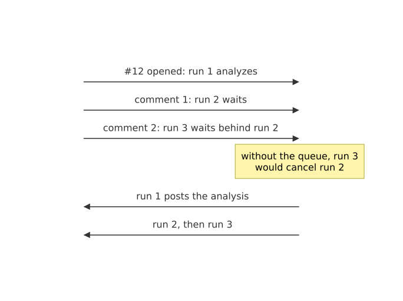

# Architecture

[← README](https://github.com/Dennis-Otto/issue-assistant) · [Security design](security.md) · [Roadmap](roadmap.md)

The issue assistant is a composite GitHub Action. `action.yml` runs `issue_assistant.py` with the Python 3.12 of GitHub's runners and the standard library alone; the script talks to GitHub through the GitHub CLI. Four workflows in the repository that it looks after call the action, and one step of one job runs the AI engine.

## Components

| Component | Files | What it does |
| --- | --- | --- |
| The action | `action.yml` | Passes every input through the environment to `issue_assistant.py` and runs one command of it |
| Commands | `main()` in `issue_assistant.py`, which hands each command of `SCRIPT_COMMANDS` to a function of its own | `event`, `engine`, `context`, `analyze`, `usage`, `apply`, `sweep`, `sync-labels`, `findings`, `check`, `install`, `evaluate`, which replays closed issues as they were with the class `Then`, a view of GitHub at a moment, and `accuracy-page`, which takes the numbers of its report onto the website; [the reference](reference.md#commands) names what each does |
| GitHub client | the class `GitHub` | Every read and write through `gh api`; in a dry run it only records what it would write |
| Settings | `load_config`, `load_labels`, `load_findings` | Read `.github/issue-assistant/config.toml`, `.github/labels.toml` and `.github/findings.toml` of the repository |
| Events | `handle_event`, `limited`, `within_limits` | Labels and owners from the issue forms, and the next task of the engine: `triage`, `follow-up`, `maintainer-reply`, `release-reply` or `maintainer-question`, never on a muted issue but on a maintainer's command, and within the [limits of the AI runs](features/limits.md) for the tasks that people who don't maintain the repository start |
| Context | `write_context` | Writes what the task of the engine reads into `.issue-assistant/`: the issue with its comments; for an analysis and a follow-up the other issues and discussions of a bounded window and the labels; for a first analysis `corrections.md`, what the maintainers corrected of the analyses before (`learned_corrections`, `render_learned`); for a reply or a maintainer's question the comment of its event; then the prompt and the JSON schema of the answer ([what the AI reads](features/what-the-ai-reads.md)); [each text is read in linear time](architecture/failures.md#reading-the-text-of-issues) |
| Prompts | `prompts/` | The rules of every task, which call the content of the issue data, not instructions |
| Languages | `locales/`, `LOCALES`, `detect_language`, `own_letters`, `issue_language`, `days`, `plural_form`, `maintainers`, `for_maintainers` | A catalog for each language of the comments, with its texts, how it names a day and its stopwords; the language of an issue from the marker of its last analysis, or else from the reporter's words and the letters that only one language writes, such as Hangul or kana; a number of days in the form that the language asks for; the folded summary for the maintainers in theirs, `[maintainers] language`, below a comment in another one ([languages](features/languages.md)) |
| Checks of the answer | `answer_schema`, `validate`, `parse_answer`, `looks_secret`, `sanitize` | Check the engine's JSON against its schema, the labels and the issues that exist; refuse anything that looks like a secret; clean the text of mentions, images, HTML and links to other sites |
| Writing | `apply_answer` and the `render_*` functions | Post the comment, set the labels, assign the owners of its areas, set the issue type and mark duplicates, only on the issue of the event; post the first answer to a discussion, only on the discussion of the event |
| Lifecycle | `sweep` | Reminders after 15 days, closing after 30 days, closing duplicates after 3 days, marking fixed issues, closing them with the release and filing them under its milestone |
| Labels | `sync_labels` | Create and update the labels of `labels.toml`, never delete one, and warn of owners that can't be assigned and of issue types the repository lacks |
| Findings | `watch_findings` | Dismiss the findings of code scanning that `findings.toml` accepts and fail while others are open |
| Fixture | `read_fixture`, `GitHub.use_fixture` | An issue and its comments from a JSON file in place of GitHub's, for [the canary](architecture/dry-runs.md#the-canary) and for trying a prompt; `context` and `apply` then write nothing |
| Set-up | `install`, `set_up_github`, `check` | Write the four workflows, the one of the discussions where `config.toml` names categories, the firewall policy and the starter files of `templates/` into a repository, add the notice to reporters and actionlint's ignored `queue` where they are missing, with `--setup` also create the environment `issue-assistant` and have gh ask for the engine's secret, and check that the set-up still fits the templates; only `check` needs nothing but the checkout, and both name its files with slashes on every system |

## The workflows of a repository

<picture>
  <source media="(prefers-color-scheme: dark)" srcset="images/diagrams/the-four-workflows-of-a-repository-and-what-starts-them.dark.svg">
  
</picture>

| Workflow | Jobs |
| --- | --- |
| `issue-assistant.yml` | `event` decides the next task; `analyze` writes the context and runs the engine with a read-only token, on GitHub's egress-firewall runner; `apply` checks the answer and writes it |
| `issue-lifecycle.yml` | `sweep`, every morning, after merged pull requests, published releases and the end of a run of the release workflow that no schedule started |
| `labels.yml` | `sync-labels`, when `labels.toml` changes on the default branch |
| `findings.yml` | `findings`, every morning, after each scan of code scanning on the default branch and when `findings.toml` changes |

## One run for a new issue

The three jobs of `issue-assistant.yml` hand the issue on; only the middle one sees the AI and its secret, and only the last one writes:

<picture>
  <source media="(prefers-color-scheme: dark)" srcset="images/diagrams/one-run-of-issue-assistant-yml-for-a-new-issue.dark.svg">
  
</picture>

The jobs are in `.github/workflows/reusable-issue-assistant.yml`, which the template `issue-assistant.yml` calls at the commit of a release, as each of the other templates calls its own. The template `discussion-assistant.yml` calls `reusable-discussion-assistant.yml`, whose jobs give a new discussion its first answer: the same job `analyze`, which a test keeps equal, between an `event` job that only reads and the only `apply` job that may write to discussions. A called workflow that asks for more than its caller grants doesn't start, so the issues keep a workflow that never writes to discussions, for the repositories whose templates grant only reading; [decision 0018](decisions/0018-answer-questions-in-discussions.md) says why. `install` copies the templates of `templates/` with the commit hash of the release, and `check` fails when a repository's copy differs in anything but the commit hashes of its pins. A job of a reusable workflow can't name the action of its own commit with a pin, so each one checks out `job.workflow_repository` at `job.workflow_sha` into `.issue-assistant/action` and runs the action from there: the jobs and the action of one release, always. [Decision 0015](decisions/0015-reusable-workflows.md) explains why, and what a spike found: the job `analyze` gets the secret of the caller's environment and runs behind the caller's firewall policy.

## Waiting, runners and the network

**The events of one issue wait in line.** The runs of `issue-assistant.yml` for one issue share the concurrency group `issue-assistant-<number>` with `queue: max`: up to 100 runs wait for their turn, first in, first out. An analysis takes about two and a half minutes, and without the queue a group keeps a single waiting run, which the next event cancels. A reporter who answered twice during an analysis then got no follow-up to the first answer, and a "still broken" after a release could stay without effect.

<picture>
  <source media="(prefers-color-scheme: dark)" srcset="images/diagrams/comments-while-an-analysis-runs.dark.svg">
  
</picture>

**A run with nothing to do takes no runner and no place in a line.** The sweep and the findings work on the whole repository, so one waiting run is enough, and their jobs, not their runs, wait in the groups `issue-lifecycle` and `findings`. A run waits for the group of its workflow before its jobs check their conditions, so a run that would only skip its job, such as after the scan of a pull request, took the place of a waiting one that had work to do; a skipped job never enters the group of a job. The release workflow of the [repository blueprint](https://github.com/Dennis-Otto/repo-blueprint) runs every hour as a safety net and mostly releases nothing: the lifecycle skips the ends of these scheduled runs, and the morning sweep catches a release that one of them made.

**The jobs without the AI reach only GitHub.** Every job runs on `ubuntu-24.04`, so a new image behind `ubuntu-latest` never reaches the repositories untested. The jobs that write start with Harden-Runner in block mode; the AI runs behind GitHub's egress firewall instead. [Decision 0008](decisions/0008-the-jobs-that-write-reach-only-github.md) explains why:

<picture>
  <source media="(prefers-color-scheme: dark)" srcset="images/diagrams/where-the-jobs-run-and-which-hosts-they-reach.dark.svg">
  
</picture>

The checkout reaches `github.com` and the GitHub CLI `api.github.com`; Harden-Runner allows the hosts of the runner itself, such as those of the logs and the summary. The action turns off the telemetry of the GitHub CLI, which would only knock at a blocked host. The job `egress` of the Action test runs the action behind the same block, so a host that it starts to need fails there, before a release blocks it in every repository. In a private repository the block needs a subscription or trial of StepSecurity; without one, Harden-Runner lets the job run unblocked, as the [security design](security.md) says among its residual risks.

**The AI has a runner in reserve.** GitHub's egress-firewall runner is a technical preview. Should GitHub rename or end it, `analyze` would wait in the queue for up to a day, and every later run of its issue behind it. So the repository variable `ISSUE_ASSISTANT_AI_RUNNER` may name another runner in its place, without a release; [decision 0019](decisions/0019-a-runner-for-the-ai-when-the-firewall-runner-is-gone.md) explains the trade-off:

<picture>
  <source media="(prefers-color-scheme: dark)" srcset="images/diagrams/which-runner-the-ai-runs-on.dark.svg">
  
</picture>

The command `endpoints` of the job `event` accepts only GitHub's runners of Ubuntu with a fixed version, and names the hosts of the repository's `.github/egress-firewall.yaml` and GitHub's own, `github.com` and `codeload.github.com`, each on the ports 443 and 80, as the endpoints of Harden-Runner. With the variable unset, both steps of the block are skipped and every job runs as before.

## Design decisions

- **The AI only reads, and a job without the AI writes.** The answer of the engine is data that `apply` checks before anything reaches GitHub.
- **Everything but one step is independent of the engine.** Context, prompts, checks and writes are the same for every engine; a new engine is a step and an entry of `ENGINES`, as [Engines](engines.md) describes.
- **An error of GitHub is never an answer.** Only "not found" means that a thing is missing; any other error stops the run instead of changing what it posts, and a run again completes it without a second comment.
- **No text can make it slow.** Issues come from anyone, so every pattern that reads them takes time linear in the length of the text.
- **No third-party packages.** The script needs only the standard library, `gh` and `git`, which GitHub's runners have.
- **The maintainer has the last word.** The assistant labels, asks and suggests; it never decides on behalf of the maintainer.

## The details

Each of these has a page of its own:

- [How a change of a template reaches the repositories](architecture/templates.md)
- [How the assistant is tested](architecture/testing.md)
- [The canary and the Workflow test](architecture/dry-runs.md)
- [Failures and hard texts](architecture/failures.md)
