# When GitHub fails

[← All features](README.md)

GitHub has bad minutes too: a rate limit, a server error, an incident. The assistant never takes such an error for an answer, so a bad minute never changes what it posts:

<picture>
  <source media="(prefers-color-scheme: dark)" srcset="../images/diagrams/what-the-assistant-does-when-a-call-to-github-fails.dark.svg">
  
</picture>

- **Only "not found" means missing.** A duplicate, a related issue or discussion, or a release that GitHub says doesn't exist is left out. A rate limit or a server error stops the run instead, so an analysis never leaves out a duplicate that GitHub didn't show for a moment, and the AI never reads "no release yet" because GitHub failed.
- **A failure of a moment runs again.** A read that a server error or a broken connection stopped runs again after 2, 4 and 8 seconds. A call that a secondary rate limit refused runs again after a minute, a write too, since GitHub did nothing with it. A write that a server error stopped doesn't run again, since GitHub may have done it all the same: the run stops, and running it again completes it.
- **The labels come before the comment.** An analysis or a follow-up adds its labels first, `possible-duplicate` among them, then its comment, and `needs-info` last: an issue never waits for an answer to a question that GitHub didn't post, so the sweep never reminds its reporter or closes it for that. Running the job again posts a missing comment once. When the comment is there and labels are missing, after a failure in between or from a run of an earlier version, it adds them without a second comment: the labels of the answer, and `needs-info` and `possible-duplicate` as the comment said. A label that someone added or removed after the comment stays as it is, and so does an issue whose reporter answered.
- **One issue never stops the sweep.** Every step and every issue of the daily sweep runs on its own. One that GitHub fails is a warning in the log, the others are done, and the run fails at the end, so that GitHub tells the maintainer. The next sweep completes it: each step checks what is done, so no reminder or closing comment is posted twice, and an issue closes before its labels go, so that the sweep finds it again. A fixed issue gets its labels before its notice: it stops waiting for an answer and gets `fixed-in-next-release`, so a notice that GitHub fails never leaves it to be closed unanswered.
- **One clear error.** A command that GitHub stops ends with one error in the log, not a Python traceback, and its summary lists what the run wrote before and the write that failed.

## A second try for failed runs

A job of *Issue assistant* can fail for a reason that has nothing to do with the issue: Harden-Runner may take itself away after one failed lookup, and the job that makes sure that it blocks stops the job then. The analysis is there, but nobody posts it until the run goes again. A repository with a workflow of its own that gives such a run a second try, such as the bot-health bot of [Repo Blueprint](https://github.com/Dennis-Otto/repo-blueprint), names it under `[failures]` of `config.toml`:

```toml
[failures]
workflow = "bot-health.yml"
```

and runs `install` again, which writes `issue-assistant.yml` with one more job, *Start the workflow for failed runs*. It needs the other jobs and runs only when one of them failed at the first attempt of a run, never at a second attempt, never in a fork and never for a run by hand, whose second try would check the role of the person who ran it again. It holds `actions: write` alone, blocks every host but `api.github.com`, checks out nothing, and starts the workflow with the id of the run as its input `run`, with `gh workflow run`; when GitHub fails the call, it tries twice more. What the workflow does then is the repository's: the bot-health bot runs the failed jobs once more when Harden-Runner stopped one of them.

So the workflow that the key names must:

- be a file of `.github/workflows`, named without a folder, such as `bot-health.yml`;
- start on `workflow_dispatch` with an input `run`, which gets the id of the failed run, and no other input that is required without a default;
- run on the default branch, whose version of it GitHub starts.

`check` expects that form of `issue-assistant.yml`, with the name of the key in the job, and fails while the workflow isn't there, has no input `run` or has another input that is required without a default. Without the key, or with it empty, nothing changes ([decision 0037](../decisions/0037-a-failed-run-of-the-assistant-can-start-a-workflow-of-the-repository.md)).

A second try runs the failed jobs alone, and nothing is posted twice: GitHub keeps the jobs that passed, with their outputs, when it runs the failed jobs of a run again, also those inside the reusable workflow of the issue assistant, so the engine doesn't analyze the issue a second time. On 2026-11-18, *Check and post the analysis* of a run for a new issue stopped because Harden-Runner didn't block; when its failed jobs ran again an hour later, its second attempt took *Handle the event*, *Download the attachments of the issue* and *Analyze with the AI engine* from the first one, with their times of then, and ran only the job that posts, which found the analysis that a run by hand had posted in the meantime and posted nothing. A job that posts always leaves an issue alone that has the comment of its task.
