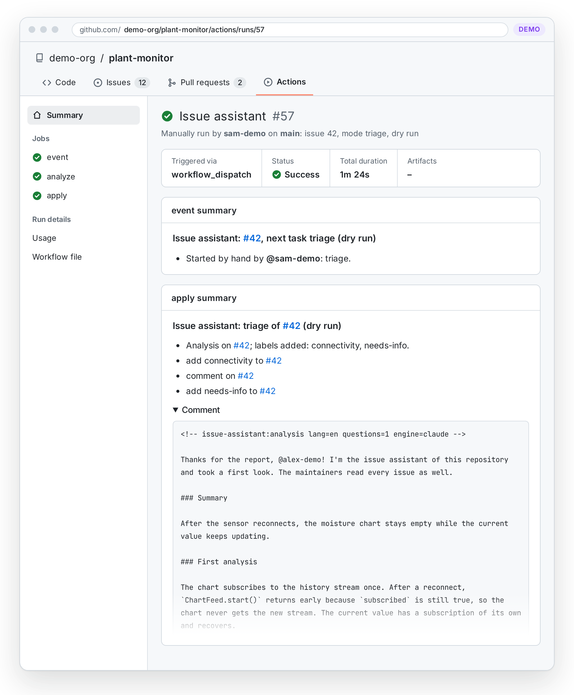

<a id="get-started"></a>

# Loslegen

Was ein Repository für den Issue-Assistenten braucht, wie du ihn dort einrichtest und wie du ihn arbeiten siehst, bevor die erste Meldung kommt.

<a id="requirements"></a>

## Voraussetzungen

- **Ein Repository auf GitHub.com mit eingeschalteten Issues,** öffentlich oder privat. Issue-Formulare sind freiwillig; hat das Repository welche, wählen ihre Antworten Labels.
- **Von GitHub gehostete Runner.** Die Jobs ohne KI laufen auf `ubuntu-24.04`, die KI auf `ubuntu-24.04-firewall` mit GitHubs [nativer Egress-Firewall](https://github.com/github-early-access/actions-native-egress-firewall). Dieser Runner ist eine **technische Vorschau**: nur für Linux, und laut GitHub etwa 15 bis 20 % langsamer. Dort erreicht die KI nur die Hosts aus `.github/egress-firewall.yaml`, außer die Repository-Variable `ISSUE_ASSISTANT_AI_RUNNER` nennt einen Runner von GitHub mit Ubuntu in fester Version, etwa `ubuntu-24.04`, wo Harden-Runner die anderen Hosts sperrt: [Was, wenn der Firewall-Runner wegfällt?](faq.md#what-if-the-firewall-runner-is-gone)
- **Eine Engine und ihr Secret** in der Umgebung `issue-assistant`: für Claude, die Standard-Engine, das Token eines Claude-Abos aus `claude setup-token` als `CLAUDE_CODE_OAUTH_TOKEN` oder einen API-Schlüssel als `ANTHROPIC_API_KEY`; für Codex, Gemini oder Copilot das Secret, das [Engines](engines.md) nennt. Gemini ist im Rahmen der Tageslimits seiner kostenlosen API-Stufe gratis. Ohne Secret pausiert alles mit KI: die erste Analyse, die Nachfragen und die Entscheidung, ob ein Kommentar auf die meldende Person wartet oder sagt, dass ein Fix nicht half. Alles ohne KI läuft weiter, und jeder Lauf vermerkt die fehlenden Zugangsdaten.
- **Dependabot oder Renovate,** deren Pull Requests jedes neue Release bringen: [Updates einschalten](#turn-on-updates).
- **Für die Einrichtung:** Python 3.12 oder neuer mit PyYAML (`pip install pyyaml`) oder `yq`, git und die GitHub CLI auf deinem Rechner, und das Recht, Umgebungen und Secrets zu verwalten.

<a id="set-up-a-repository"></a>

## Ein Repository einrichten

Eine Einrichtung hat drei Teile: was `install` schreibt, was du bearbeitest und was du auf GitHub einstellst:

<picture>
  <source media="(prefers-color-scheme: dark)" srcset="images/diagrams/what-install-writes-what-you-edit-and-what-you-set-on-github.de.dark.svg">
  
</picture>

<!-- --8<-- [start:quick-start] -->

1. **Installiere das neueste Release** im Wurzelordner deines Repositorys, mit Python 3.12 oder neuer, PyYAML (`pip install pyyaml`) oder [`yq`](https://github.com/mikefarah/yq) zum Lesen von YAML, git und der [GitHub CLI](https://cli.github.com):

    ```sh
    tag="$(gh release view --repo Dennis-Otto/issue-assistant --json tagName --jq .tagName)"
    dir="$(mktemp -d)"
    git clone --quiet --depth 1 --branch "$tag" https://github.com/Dennis-Otto/issue-assistant "$dir" &&
      PYTHONPATH="$dir" python3 -P -m issue_assistant install --setup
    ```

    `install` pinnt die Workflows auf Commit und Tag des Checkouts und schreibt die fehlenden Einstellungen und Vorlagen. `--setup` legt die Umgebung `issue-assistant` an, die nur der Standard-Branch nutzen darf, und fragt nach dem Secret der Engine: für Claude das Token eines Claude-Abos aus `claude setup-token`, `CLAUDE_CODE_OAUTH_TOKEN`, oder einen API-Schlüssel, `ANTHROPIC_API_KEY`. Für eine andere Engine setze zuerst ihren `name` in `config.toml`, wie [Die Engine wechseln](engines.md#change-the-engine) zeigt. Jeder Schritt prüft erst, ein zweiter Lauf ändert nur die Workflows.

2. **Beschreibe das Projekt** in `.github/issue-assistant/project.md`: was es tut, wo Code, Dokumentation, Fehlerbehebung und Changelog liegen, welche Versionen und Logs ein Fehlerbericht braucht, und wie Meldende angesprochen werden, wenn anders als in den [Katalogen der Sprachen](features/languages.md), etwa mit *Sie*. Die KI liest die Datei vor jeder Aufgabe. Passe dann die Vorlagen an Projekt, Labels und Issue-Formulare an, bis die Prüfung besteht:

    ```sh
    PYTHONPATH="$dir" python3 -P -m issue_assistant check
    ```

3. **Lass das Release behobene Issues schließen:** Entferne unter *Settings → General → Issues* den Haken bei **Auto-close issues with merged linked pull requests**, damit ein behobenes Issue bis zum Release mit dem Fix offen bleibt. Dafür hat GitHub keine API. Ein Repository ohne Releases setzt stattdessen `close_with_release = false` in `config.toml`.

    **Schalte ein, worauf die Auswahl verlinkt,** wenn `install` `.github/ISSUE_TEMPLATE/config.yml` geschrieben hat, da beide Links sonst ins Leere führen: *Settings → General → Features → Discussions* und *Settings → Advanced Security → Private vulnerability reporting*. Private Meldungen gibt es nur für öffentliche Repositorys, ein privates streicht ihn.

    **[Schalte Updates ein](getting-started.md#turn-on-updates)** durch Dependabot oder Renovate, falls sich noch keins von beiden um das Repository kümmert.

4. **Probiere es aus:** Committe die Einrichtung, pushe sie auf den Standard-Branch und gib unter *Actions → Issue assistant → Run workflow* die Nummer eines Issues ein. Ein Lauf von Hand startet als Probelauf, der nichts schreibt; die Zusammenfassung des Jobs *Check and post the analysis* (`apply`) zeigt die Labels und den Kommentar, die er posten würde:

    <picture>
      <source media="(prefers-color-scheme: dark)" srcset="https://raw.githubusercontent.com/Dennis-Otto/issue-assistant/main/docs/images/dry-run-dark.webp">
      
    </picture>

<!-- --8<-- [end:quick-start] -->

Unter Windows führst du die Befehle in Git Bash aus; Pythons Starter `py` tritt an die Stelle von `python3`, das dort meist den Microsoft Store öffnet.

<a id="what-install-writes"></a>

### Was install schreibt

| Datei | Wann | Was du tust |
| --- | --- | --- |
| `.github/workflows/issue-assistant.yml`, `issue-lifecycle.yml`, `labels.yml`, `findings.yml` | immer, mit dem Pin des Releases | nichts: die Prüfung stellt sicher, dass sie den Vorlagen gleichen |
| `.github/workflows/discussion-assistant.yml` | mit dem Pin des Releases, wenn `[discussions] answer_categories` in `config.toml` eine Kategorie nennt, wie die Vorlage, oder wenn er schon da ist | nichts: die Prüfung stellt sicher, dass er seiner Vorlage gleicht, und verlangt ihn, solange eine Kategorie genannt ist |
| `.github/egress-firewall.yaml` | wenn sie fehlt | die Hosts ergänzen, die die Engine über die der Vorlage hinaus braucht, falls es welche gibt |
| `.github/issue-assistant/project.md` | wenn sie fehlt | das Projekt beschreiben, wie Schritt 2 sagt |
| `.github/labels.toml` | wenn sie fehlt | die Labels festlegen: die sieben des Lebenszyklus sind Pflicht; Arten, Bereiche, Themen und, falls ergänzt, Prioritäten sind das, woraus die KI wählt |
| `.github/issue-assistant/config.toml` | wenn sie fehlt | die Engine wählen, die Hosts, zu denen Links führen dürfen, das Feld der Issue-Formulare, das einen Bereich wählt, die Kategorien der Discussions, die eine erste Antwort bekommen, und die Dateien, die Meldenden sagen, welche KI ihr Issue liest |
| `.github/findings.toml` | wenn sie fehlt | Befunde des Code-Scannings akzeptieren, die sich nicht beheben lassen oder nicht behoben werden sollen, jeden mit seinem Grund |
| `.github/ISSUE_TEMPLATE/bug_report.yml`, `feature_request.yml` | zusammen mit der Vorlage `labels.toml`, wenn das Repository keine Issue-Formulare oder -Vorlagen hat | die Antworten des Felds *Area* anpassen, deren `form_options` in `labels.toml` ein Bereichslabel wählen; ihr Kästchen *Automated analysis* lässt Meldende [Nein zur KI sagen](features/opt-out.md) |
| `.github/ISSUE_TEMPLATE/config.yml` | mit diesen Formularen, wenn sie fehlt | einschalten, was ihre Links in den Einstellungen des Repositorys brauchen: Discussions, für die erste Kategorie von `[discussions] answer_categories`, und private Meldungen von Sicherheitslücken, die GitHub nur für öffentliche Repositorys anbietet; einen unerwünschten oder unmöglichen Link entfernen |
| `SUPPORT.md` oder die Dateien von `[transparency]` | wenn sie die Engine nicht nennen; in einem vorhandenen Hinweis die Tage von `[lifecycle]` in jeder Zeile, die noch wie die der Vorlage lautet | der Abschnitt *What happens with your issue*, den die Fußzeile jeder Analyse und Nachfrage verlinkt, sagt Meldenden, welche KI ihr Issue liest, auf Deutsch für eine Datei wie `SUPPORT.de.md` |
| `.github/actionlint.yaml` | wenn sie existiert | nichts: sie ignoriert die `queue` von `issue-assistant.yml`, die actionlint 1.7.12 noch nicht kennt |
| `.gitignore` | wenn der Eintrag fehlt | nichts: `/.issue-assistant/` hält den Kontext der KI aus Commits heraus |

Die Auswahl zeigt GitHub unter *New issue*. Sie schaltet leere Issues ab, damit jedes Issue mit einem Formular beginnt, und ihre Links bringen den Rest an seinen Ort: die erste Kategorie von `answer_categories`, sofern genannt, private Meldungen von Sicherheitslücken und die erste Datei von `[transparency]`. Besitzer und Namen in den Links nimmt `install` aus `GH_REPO`, `GITHUB_REPOSITORY` oder dem Remote `origin`; ohne sie schreibt es `OWNER/NAME`, und die Prüfung bittet dich, das zu ersetzen, was ein neuer Lauf von `install` tut, sobald das Remote das Repository nennt.

<picture>
  <source media="(prefers-color-scheme: dark)" srcset="images/diagrams/where-the-chooser-of-new-issues-leads.de.dark.svg">
  
</picture>

GitHub ignoriert die Groß- und Kleinschreibung von Labels, also benennt der Workflow Labels ein Label in anderer Schreibung um, etwa `Bug` für `bug`, statt ein zweites anzulegen. Eine YAML-Datei, die `install` nicht ändern kann, ohne den Rest zu ändern, etwa eine Liste in geschweiften Klammern, lässt es, wie sie ist, und nennt, was zu ergänzen ist.

<a id="keep-it-checked"></a>

### Dauerhaft prüfen

Nimm die Prüfung in die CI des Repositorys auf, damit eine Änderung der Labels, der Formulare oder der Einstellungen den Assistenten nicht unbemerkt kaputt machen kann:

```yaml
- uses: actions/checkout@<commit-hash> # vX
  with:
    persist-credentials: false
- name: Check the issue assistant's set-up
  uses: Dennis-Otto/issue-assistant@<commit-hash> # vX.Y.Z
  # Optional: check the runner that the variable names for the AI, too.
  env:
    ISSUE_ASSISTANT_AI_RUNNER: ${{ vars.ISSUE_ASSISTANT_AI_RUNNER }}
  with:
    command: check
```

Der [Eintrag im GitHub Marketplace](https://github.com/marketplace/actions/read-only-issue-assistant) bietet unter *Use latest version* einen nackten Schritt der Action an, mit jeder Eingabe und einem leeren `command`; für sich allein gib ihm `command: check`, wie oben. Die vier Workflows des Assistenten kommen von `install` in Schritt 1 von [Ein Repository einrichten](#set-up-a-repository) und rufen die anderen Befehle selbst auf.

Die Prüfung läuft unter Linux, macOS oder Windows, mit Python 3.12 oder neuer, und liest YAML mit PyYAML oder `yq`. Als Job ist die Action auf `ubuntu-24.04`, `ubuntu-26.04` und `ubuntu-24.04-arm` getestet; ein älteres Python bricht mit einem Fehler ab, der Version und Abhilfe nennt. Weicht ein Workflow von seiner Vorlage ab, nennt sie die Befehle, die die Vorlagen ihres Releases neu schreiben.

<a id="without---setup"></a>

### Ohne `--setup`

`install` allein schreibt nur Dateien. Lege die Umgebung und das Secret selbst auf GitHub an, unter *Settings → Environments* oder mit der GitHub CLI:

```sh
gh api -X PUT repos/OWNER/REPO/environments/issue-assistant -F "deployment_branch_policy[protected_branches]=false" -F "deployment_branch_policy[custom_branch_policies]=true"
gh api -X POST repos/OWNER/REPO/environments/issue-assistant/deployment-branch-policies -f name=main -f type=branch
gh secret set CLAUDE_CODE_OAUTH_TOKEN --env issue-assistant --repo OWNER/REPO
```

`install` läuft aus dem git-Checkout eines Releases und pinnt Commit und Tag. Ein Checkout eines anderen Commits braucht `--ref` mit diesem Commit und eine `--version`, die keinen anderen nennt; ein Ordner ohne git, etwa ein entpacktes Paket eines Releases, braucht beides.

Ohne das Secret laufen Labels, Erinnerungen, Schließen und Wiederöffnen weiter. Die Repository-Variable `ISSUE_ASSISTANT_AI` auf `off` schaltet die KI ab.

<a id="turn-on-updates"></a>

### Updates einschalten

Updates kommen als Pull Requests von Dependabot oder Renovate, die den Commit-Hash des Issue-Assistenten in den Workflows verschieben, und das ist das ganze Update: Die Jobs sind die des Releases, auf das die Workflows gepinnt sind. Nur ein Release, das eine Vorlage ändert, braucht die Befehle aus Schritt 1 noch einmal, und seine Release Notes sagen das.

Dependabot verschiebt sie erst, wenn `.github/dependabot.yml` das Ökosystem `github-actions` nennt:

```yaml
version: 2
updates:
  - package-ecosystem: "github-actions"
    directory: "/"
    schedule:
      interval: "weekly"
    cooldown:
      default-days: 7
```

Der Cooldown wartet eine Woche auf neue Releases, wie zizmor verlangt; Sicherheitsupdates kommen sofort. Renovate verschiebt sie mit seinen Standards, sobald eine Konfiguration wie `renovate.json` oder der Schlüssel `renovate` in `package.json` da ist. Ohne beides bleibt das Repository beim Release seiner Einrichtung, ohne Fix, die [Sicherheitsrichtlinie](https://github.com/Dennis-Otto/issue-assistant/blob/main/SECURITY.md) unterstützt aber nur das neueste. Darum nennt `install` den Schritt, und `check` warnt nur: Renovate kann auch anderswo laufen, etwa per Preset der Organisation.

<a id="check-that-it-works"></a>

## Prüfen, dass er läuft

1. **Die Prüfung besteht** auf deinem Rechner und in der CI, wie oben unter *Dauerhaft prüfen*. Sie nennt jedes Problem der Labels, Issue-Formulare, Workflows, Firewall-Richtlinie und Einstellungen, jeden unbekannten Schlüssel und eine `project.md` mit der ersten Zeile der Vorlage oder unter 80 Zeichen. Die [Fehlerbehebung](troubleshooting.md) hat die Abhilfe für jedes.
2. **Die Labels existieren**, sobald die Einrichtung im Standard-Branch gemergt ist: Der Workflow Labels legt die aus `.github/labels.toml` an, und *Issues → Labels* listet sie.
3. **Ein Probelauf zeigt den Kommentar**: Die Zusammenfassung des Jobs *Check and post the analysis* (`apply`) zeigt die Labels und den Kommentar, die er posten würde, und schreibt nichts.
4. **Ein neues Issue bekommt seine Analyse** innerhalb weniger Minuten. Öffne es mit einem Konto, das kein Maintainer ist: Issues des Besitzers, von Mitgliedern und Collaborators bekommen die Labels ihres Formulars, aber keine Analyse.

Kommt kein Kommentar, hat die [Fehlerbehebung](troubleshooting.md) die üblichen Ursachen, jede mit ihrer Abhilfe. [Was Meldende sehen](comments.md) zeigt jeden Kommentar, den der Assistent postet.

<a id="start-with-a-backlog"></a>

## Mit einem Rückstand beginnen

Issues, die schon vorher offen waren, bekommen ihre erste Analyse durch die Aufgabe [backlog](features/runs-by-hand.md#the-backlog).

<details markdown="1">
<summary>Drei Schritte, für Maintainer</summary>

1. **Sieh nach, was er tun würde.** Wähle unter *Actions → Issue assistant → Run workflow* die Aufgabe `backlog` und gib `0` als Issue ein, oder führe `gh workflow run issue-assistant.yml -f mode=backlog -f issue=0` aus. Als Probelauf wählt er die ältesten offenen Issues ohne erste Analyse, bis zu `backlog_per_run` aus `config.toml`, standardmäßig 20; er lässt für jedes die KI laufen, setze den Wert für einen ersten Blick also niedrig. Die Zusammenfassung des Jobs *Check and post the analysis* (`apply`) jedes Issues zeigt seine Labels, ein mögliches Duplikat und die fehlenden Angaben als Tabelle.
2. **Setze die Labels.** Starte ihn noch einmal ab derselben Nummer, mit *dry_run* aus. Er setzt die Labels jeder Analyse und postet keinen Kommentar auf die alten Issues, es sei denn, du setzt den Haken bei *comment*.
3. **Mach weiter.** Die Zusammenfassung des Jobs `assistant` nennt das letzte Issue, das er gewählt hat: Gib diese Nummer als Issue des nächsten Laufs ein, bis er sagt, dass der Rückstand erledigt ist.

Jedes Issue kostet eine erste Analyse, die auf kein Tageslimit zählt.

</details>

<a id="show-that-you-use-it"></a>

## Zeig, dass du ihn nutzt

Die Fußzeile jedes Kommentars der KI verlinkt den Issue-Assistenten bereits, es sei denn, `[transparency] credit = false` in `.github/issue-assistant/config.toml` lässt das weg. Ein Badge in deiner README zeigt es vor dem ersten Issue und hilft anderen, das Werkzeug zu finden:

```markdown
[](https://dennis-otto.github.io/issue-assistant/)
```
