# Get started

What a repository needs for the issue assistant, how to set it up there, and how to see it work before the first reporter does.

## Requirements

- **A repository on GitHub.com with issues turned on,** public or private. Issue forms are optional; their answers choose labels when the repository has them.
- **GitHub-hosted runners.** The jobs without AI run on `ubuntu-24.04`, the AI on `ubuntu-24.04-firewall`, the runner with GitHub's [native egress firewall](https://github.com/github-early-access/actions-native-egress-firewall). That runner is a **technical preview**: it exists for Linux only, and GitHub expects a workflow on it to take roughly 15 to 20 % longer. The analysis runs on this runner, so that the AI reaches no host but those of `.github/egress-firewall.yaml`, unless the repository variable `ISSUE_ASSISTANT_AI_RUNNER` names one of GitHub's runners of Ubuntu with a fixed version in its place, such as `ubuntu-24.04`, where Harden-Runner blocks the other hosts: [What if the firewall runner is gone?](faq.md#what-if-the-firewall-runner-is-gone)
- **An engine and its secret,** in the environment `issue-assistant`: for Claude, the default engine, a token of a Claude subscription, which `claude setup-token` creates, as `CLAUDE_CODE_OAUTH_TOKEN`, or an API key as `ANTHROPIC_API_KEY`; for Codex, Gemini or Copilot, the secret that [Engines](engines.md) names. Gemini starts for free, within the daily limits of the free tier of the Gemini API. Without the secret, everything that needs the AI pauses: the first analysis, the follow-ups, and deciding whether a comment waits for the reporter or says that a fix didn't help. Labels from the forms, reminders, closing and the closing of fixed issues with the release keep working, and each run notes that no credentials are configured.
- **For the set-up:** Python 3.12 or newer with PyYAML (`pip install pyyaml`) or `yq`, git and the GitHub CLI on your computer, and the right to manage environments and secrets of the repository.

## Set up a repository

A set-up has three parts: what `install` writes, what you edit, and what you set on GitHub:

<picture>
  <source media="(prefers-color-scheme: dark)" srcset="images/diagrams/what-install-writes-what-you-edit-and-what-you-set-on-github.dark.svg">
  
</picture>

<!-- --8<-- [start:quick-start] -->

1. **Install the latest release** in the root of your repository, with Python 3.12 or newer, PyYAML (`pip install pyyaml`) or [`yq`](https://github.com/mikefarah/yq) to read YAML, git and the [GitHub CLI](https://cli.github.com):

    ```sh
    tag="$(gh release view --repo Dennis-Otto/issue-assistant --json tagName --jq .tagName)"
    dir="$(mktemp -d)"
    git clone --quiet --depth 1 --branch "$tag" https://github.com/Dennis-Otto/issue-assistant "$dir" &&
      python3 "$dir/issue_assistant.py" install --setup
    ```

    `install` pins the workflows to the commit and the tag of its checkout, and writes the settings and the starters that the repository lacks. `--setup` creates the environment `issue-assistant`, which only the default branch may use, and asks for the engine's secret. For Claude, `claude setup-token` creates the token of a Claude subscription, `CLAUDE_CODE_OAUTH_TOKEN`; an API key goes into `ANTHROPIC_API_KEY` instead. For another engine, set its `name` in `config.toml` first, as [Change the engine](engines.md#change-the-engine) shows, and `--setup` asks for its secret. Each step looks first, so running it again changes nothing but the workflows.

2. **Describe the project** in `.github/issue-assistant/project.md`: what it does, where the code, documentation, troubleshooting guide and changelog are, which versions and logs matter in a bug report, and how to address reporters if not as the [catalogs of the languages](features/languages.md) do, such as with *Sie* in German. The AI reads it before every task. Then adapt the starters to the project, its labels and its issue forms, until the check passes:

    ```sh
    python3 "$dir/issue_assistant.py" check
    ```

3. **Let the release close fixed issues:** under *Settings → General → Issues*, clear **Auto-close issues with merged linked pull requests**, so that a fixed issue stays open until the release that ships the fix. GitHub has no API for this setting. A repository without releases sets `close_with_release = false` in `config.toml` instead.

4. **Try it:** commit the set-up, push it to the default branch, and under *Actions → Issue assistant → Run workflow*, enter the number of an existing issue. A run by hand starts as a dry run, which writes nothing; the summary of its `apply` job shows the labels and the comment that it would post:

    <picture>
      <source media="(prefers-color-scheme: dark)" srcset="https://raw.githubusercontent.com/Dennis-Otto/issue-assistant/main/docs/images/dry-run-dark.webp">
      
    </picture>

<!-- --8<-- [end:quick-start] -->

On Windows, run the commands in Git Bash; Python's launcher `py` takes the place of `python3`, which there usually opens the Microsoft Store.

### What install writes

| File | When | What you do |
| --- | --- | --- |
| `.github/workflows/issue-assistant.yml`, `issue-lifecycle.yml`, `labels.yml`, `findings.yml` | always, with the pin of the release | nothing: the check makes sure that they equal the templates |
| `.github/workflows/discussion-assistant.yml` | with the pin of the release, when `[discussions] answer_categories` of `config.toml` names a category, as the starter does, or when it is there | nothing: the check makes sure that it equals its template, and wants it while a category is named |
| `.github/egress-firewall.yaml` | when missing | add the hosts that the engine needs besides those of the template, if any |
| `.github/issue-assistant/project.md` | when missing | describe the project, as step 2 says |
| `.github/labels.toml` | when missing | define the labels: the seven lifecycle labels are required; kinds, areas, topics and, if you add them, priorities are what the AI chooses from |
| `.github/issue-assistant/config.toml` | when missing | choose the engine, the hosts that links may lead to, the field of the issue forms that chooses an area, the categories of the discussions that get a first answer, and the files that tell reporters which AI reads their issue |
| `.github/findings.toml` | when missing | accept findings of code scanning that can't or shouldn't be fixed, each with its reason |
| `.github/ISSUE_TEMPLATE/bug_report.yml`, `feature_request.yml` | together with the starter `labels.toml`, when the repository has no issue forms or templates | adapt the answers of the field *Area*, whose `form_options` in `labels.toml` choose an area label |
| `.github/ISSUE_TEMPLATE/config.yml` | with these forms, when it is missing | turn on what its links need in the settings of the repository: Discussions, for the first category of `[discussions] answer_categories`, and private vulnerability reporting; remove a link that you don't want |
| `SUPPORT.md`, or the files of `[transparency]` | when they don't name the engine | the section *What happens with your issue*, which the footer of every analysis and follow-up links, tells reporters which AI reads their issue, in German for a file such as `SUPPORT.de.md` |
| `.github/actionlint.yaml` | when it exists | nothing: it ignores the `queue` of `issue-assistant.yml`, which actionlint 1.7.12 doesn't know yet |
| `.gitignore` | when the entry is missing | nothing: `/.issue-assistant/` keeps the context of the AI out of commits |

The chooser is what GitHub shows on *New issue*. It turns blank issues off, so that every issue starts from a form, and its links take the rest to where it belongs: the first category of `answer_categories`, a link that it leaves out when none is named, private vulnerability reporting, and the first file of `[transparency]`. `install` takes the owner and the name in these links from `GH_REPO`, from `GITHUB_REPOSITORY` or from the remote `origin`; without any of them, it writes `OWNER/NAME`, and the check asks you to replace it.

<picture>
  <source media="(prefers-color-scheme: dark)" srcset="images/diagrams/where-the-chooser-of-new-issues-leads.dark.svg">
  
</picture>

GitHub ignores the case of label names, so the Labels workflow renames a label that the repository has in another case, such as `Bug` for `bug`, instead of creating a second one. A YAML file that `install` can't edit without changing the rest, such as a list in braces, it leaves as it is and names what to add.

### Keep it checked

Add the check to the CI of the repository, so that a change of the labels, the forms or the settings can't break the assistant unnoticed:

```yaml
- uses: actions/checkout@<commit-hash> # vX
  with:
    persist-credentials: false
- name: Check the issue assistant's set-up
  uses: Dennis-Otto/issue-assistant@<commit-hash> # vX.Y.Z
  # Optional: check the runner that the variable names for the AI, too.
  env:
    ISSUE_ASSISTANT_AI_RUNNER: ${{ vars.ISSUE_ASSISTANT_AI_RUNNER }}
  with:
    command: check
```

The check runs on Linux, macOS or Windows, with Python 3.12 or newer, and reads YAML with PyYAML or `yq`. When a workflow differs from its template, it names the commands that write the templates of its release anew.

### Without `--setup`

`install` alone writes only files. Create the environment and the secret on GitHub yourself, under *Settings → Environments*, or with the GitHub CLI:

```sh
gh api -X PUT repos/OWNER/REPO/environments/issue-assistant -F "deployment_branch_policy[protected_branches]=false" -F "deployment_branch_policy[custom_branch_policies]=true"
gh api -X POST repos/OWNER/REPO/environments/issue-assistant/deployment-branch-policies -f name=main -f type=branch
gh secret set CLAUDE_CODE_OAUTH_TOKEN --env issue-assistant --repo OWNER/REPO
```

`install` runs from a git checkout of a release, whose commit and tag it pins. A checkout of another commit needs `--ref` with that commit and a `--version` that names no other one; a folder without git, such as an unpacked package of a release, needs both.

Without the secret, labels, reminders, closing and reopening keep working. The repository variable `ISSUE_ASSISTANT_AI` set to `off` switches the AI off.

Updates arrive as pull requests of Dependabot or Renovate that move the commit hash of the issue assistant in the workflows, and that is the whole update: the jobs are those of the release that the workflows pin. Only a release that changes a template needs the commands of step 1 again, and its release notes say so.

## Check that it works

1. **The check passes** on your computer and in the CI of the repository, as *Keep it checked* above adds it. It names every problem of the labels, the issue forms, the workflows, the firewall policy and the settings, every key that it doesn't know, and a `project.md` that still holds the starter's first line or says less than 80 characters. [Troubleshooting](troubleshooting.md) has the fix for each.
2. **The labels exist** once the set-up is merged into the default branch: the Labels workflow creates those of `.github/labels.toml`, and *Issues → Labels* lists them.
3. **A dry run shows the comment**, as the last step of the set-up tries it: the summary of the `apply` job of a run by hand shows the labels and the comment that it would post, and writes nothing.
4. **A new issue gets its analysis** within a few minutes. Open it from an account that is not a maintainer's: issues of the owner, members and collaborators get the labels of their form, but no analysis.

When no comment comes, [troubleshooting](troubleshooting.md) has the usual causes, each with its fix. [What reporters see](comments.md) shows every comment that the assistant posts.

## Show that you use it

The footer of every comment of the AI already links the issue assistant, unless `[transparency] credit = false` in `.github/issue-assistant/config.toml` leaves that out. A badge in your README tells people before they open an issue, and helps others find the tool:

```markdown
[](https://dennis-otto.github.io/issue-assistant/)
```
