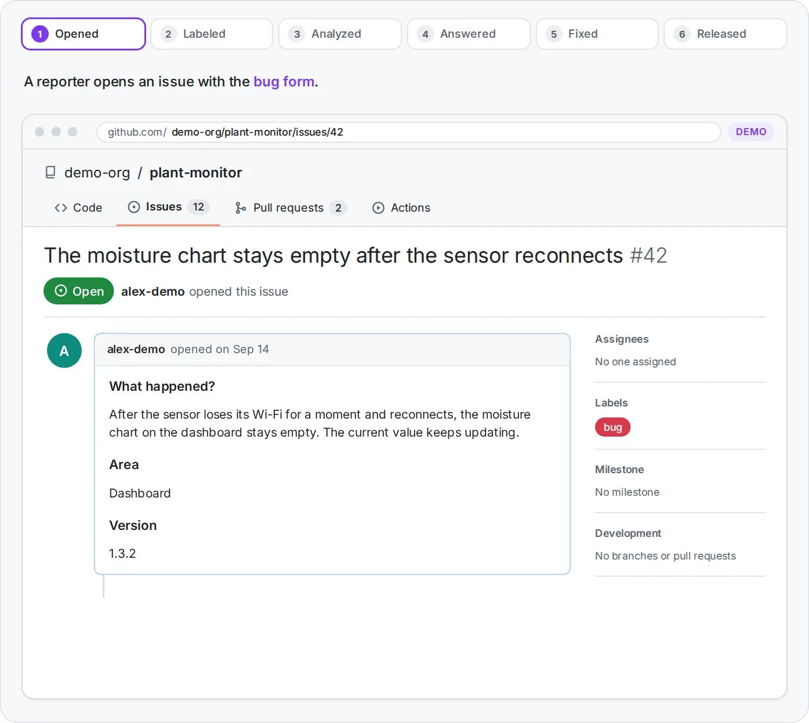

# Issue assistant

**Safe AI issue triage for GitHub.** A read-only AI writes a first analysis of every new issue, and a job without AI checks it before anything is posted. Labels, duplicates, reminders and the closing of fixed issues with the release come with it.

[Get started](getting-started.md){ .md-button .md-button--primary }
[See it live](https://github.com/Dennis-Otto/paperless-sync/issues/84#issuecomment-6125470710){ .md-button }
[Latest release](https://github.com/Dennis-Otto/issue-assistant/releases/latest){ .md-button }

<picture>
  <source media="(prefers-reduced-motion: reduce) and (max-width: 600px) and (prefers-color-scheme: dark)" srcset="images/hero-mobile-still-dark.webp">
  <source media="(prefers-reduced-motion: reduce) and (max-width: 600px)" srcset="images/hero-mobile-still-light.webp">
  <source media="(prefers-reduced-motion: reduce) and (prefers-color-scheme: dark)" srcset="images/hero-still-dark.webp">
  <source media="(prefers-reduced-motion: reduce)" srcset="images/hero-still-light.webp">
  <source media="(max-width: 600px) and (prefers-color-scheme: dark)" srcset="images/hero-mobile-dark.webp">
  <source media="(max-width: 600px)" srcset="images/hero-mobile-light.webp">
  <source media="(prefers-color-scheme: dark)" srcset="images/hero-dark.webp">
  
</picture>

## What it does

- :material-robot-outline:{ .lg .middle } **A first analysis of every new issue**

    ---

    An AI that only reads writes a summary, the likely cause with links to the code and the documentation involved, what the reporter can try and what is still missing, in English or German.

- :material-label-multiple-outline:{ .lg .middle } **Labels**

    ---

    Labels from the issue forms and from the analysis, each with its reason. The labels themselves are code, in `.github/labels.toml`.

- :material-content-duplicate:{ .lg .middle } **Duplicates**

    ---

    A sure duplicate of an issue that a maintainer opened or triaged gets a notice and closes three days later, linked to the original, unless someone objects. Other ones become suggestions for the maintainer.

- :material-clock-alert-outline:{ .lg .middle } **Unanswered questions**

    ---

    Open questions mark an issue `needs-info`. After 15 days the reporter gets a reminder that names the day the issue closes, and after 30 days it closes on that day. An answer, in a comment or by an edit, ends the waiting, and a comment reopens a closed issue.

- :material-tag-check-outline:{ .lg .middle } **From the fix to the release**

    ---

    A merged pull request with `Fixes #12` marks the issue `fixed-in-next-release`. The issue closes with a link to the release that ships the fix, and reopens if the problem persists.

- :material-slash-forward-box:{ .lg .middle } **Slash commands**

    ---

    A comment such as `/assistant again`, `/assistant ask` and a question, `/assistant duplicate #12` or `/assistant mute` steers the assistant on its issue. Maintainers give every command; the reporter can ask once for a new analysis.

- :material-shield-search:{ .lg .middle } **Findings of code scanning**

    ---

    The findings that `.github/findings.toml` accepts are dismissed with their reason. Any other open finding fails a daily run, without a public issue.

The maintainer reads every issue and has the last word.

**Used by** [ha-autodarts](https://github.com/Dennis-Otto/ha-autodarts), [Paperless Unified Search](https://github.com/Dennis-Otto/paperless-unified-search), [Paperless Sync](https://github.com/Dennis-Otto/paperless-sync), the [repository blueprint](https://github.com/Dennis-Otto/repo-blueprint), the website [dennis-otto.github.io](https://github.com/Dennis-Otto/dennis-otto.github.io) and the issue assistant itself. **See it live:** [the first analysis of a feature request in Paperless Sync](https://github.com/Dennis-Otto/paperless-sync/issues/84#issuecomment-6125470710), posted 2 minutes 39 seconds after the issue was opened.

## Careful by design

What the assistant does on its own, so that an answer never makes matters worse:

- :material-cancel:{ .lg .middle } **Spam gets no answer**

    ---

    An issue that the AI takes for advertising or nonsense gets the label `invalid` and no comment, so its author gets no reply. Closing or deleting it stays with the maintainer.

- :material-key-alert-outline:{ .lg .middle } **Secrets and personal data**

    ---

    A token, a key or a password in an issue gets a warning to remove it, also from the edit history, and to replace it. Personal data, such as an e-mail address, gets a note on how to remove it. The AI never repeats either.

- :material-shield-bug-outline:{ .lg .middle } **Vulnerabilities stay private**

    ---

    A possible security report gets only a pointer to the private reporting of the security policy: no analysis, no questions, no duplicates, and a fixed reason for its labels.

- :material-account-tie-outline:{ .lg .middle } **A maintainer's issue gets labels only**

    ---

    Issues that the owner, a member or a collaborator opens get the labels of their form, but no analysis. A run by hand gives one anyway.

- :material-forum-outline:{ .lg .middle } **The conversation stays the maintainer's**

    ---

    When the reporter answers its questions, the assistant follows up at most twice, and never once the maintainer has joined the conversation.

- :material-lock-outline:{ .lg .middle } **Nothing twice, nothing on closed issues**

    ---

    An analysis is not posted on an issue that was closed or locked in the meantime, and a task that already has its comment gets no second one, unless a maintainer runs it by hand.

## Quick start

--8<-- "README.md:quick-start"

[Get started](getting-started.md) has the [requirements](getting-started.md#requirements) of a repository, every step in detail and how to check that it works; [Configuration](configuration.md) has every setting.

## Learn more

- :material-rocket-launch-outline:{ .lg .middle } **Get started**

    ---

    What a repository needs, the set-up step by step, and how to check that it works before the first reporter comes.

    [:octicons-arrow-right-24: Get started](getting-started.md)

- :material-sitemap-outline:{ .lg .middle } **How it works**

    ---

    The four workflows, the life of an issue from its first analysis to the release that ships its fix, and what keeps the AI in check.

    [:octicons-arrow-right-24: How it works](how-it-works.md)

- :material-tune-variant:{ .lg .middle } **Configuration and reference**

    ---

    Every key of the labels, the settings and the accepted findings, the commands, and every input and output of the action.

    [:octicons-arrow-right-24: Configuration](configuration.md) · [Reference](reference.md)

- :material-comment-text-multiple-outline:{ .lg .middle } **What reporters see**

    ---

    Every comment that the assistant posts, from the first analysis to the release that ships the fix, in English and in German.

    [:octicons-arrow-right-24: What reporters see](comments.md)

- :material-frequently-asked-questions:{ .lg .middle } **Questions and troubleshooting**

    ---

    What it costs, which data leaves GitHub, and what to do when an issue gets no comment.

    [:octicons-arrow-right-24: FAQ](faq.md)

- :material-compare-horizontal:{ .lg .middle } **Compared with other tools**

    ---

    The Claude Code action's examples, GitHub Agentic Workflows, actions/stale, Dosu and GitHub's duplicate detection, cell by cell with sources.

    [:octicons-arrow-right-24: Comparison](comparison.md)

- :material-sitemap-outline:{ .lg .middle } **Architecture**

    ---

    The action, its commands and the four workflows that call it in a repository.

    [:octicons-arrow-right-24: Architecture](architecture.md)

- :material-shield-lock-outline:{ .lg .middle } **Security design**

    ---

    What the assistant protects, what it trusts, the threats with their countermeasures, and the risks that remain.

    [:octicons-arrow-right-24: Security design](security.md)

- :material-map-marker-path:{ .lg .middle } **Roadmap and decisions**

    ---

    What the assistant intends to do in the next twelve months and what it will not do, and the decisions that shape it, each with its reasons.

    [:octicons-arrow-right-24: Roadmap](roadmap.md) · [Decisions](decisions/README.md)

- :material-history:{ .lg .middle } **Releases and changelog**

    ---

    Every release with its notes on GitHub, and the changes of each version.

    [:octicons-arrow-right-24: Releases](https://github.com/Dennis-Otto/issue-assistant/releases) · [Changelog](changelog.md)

