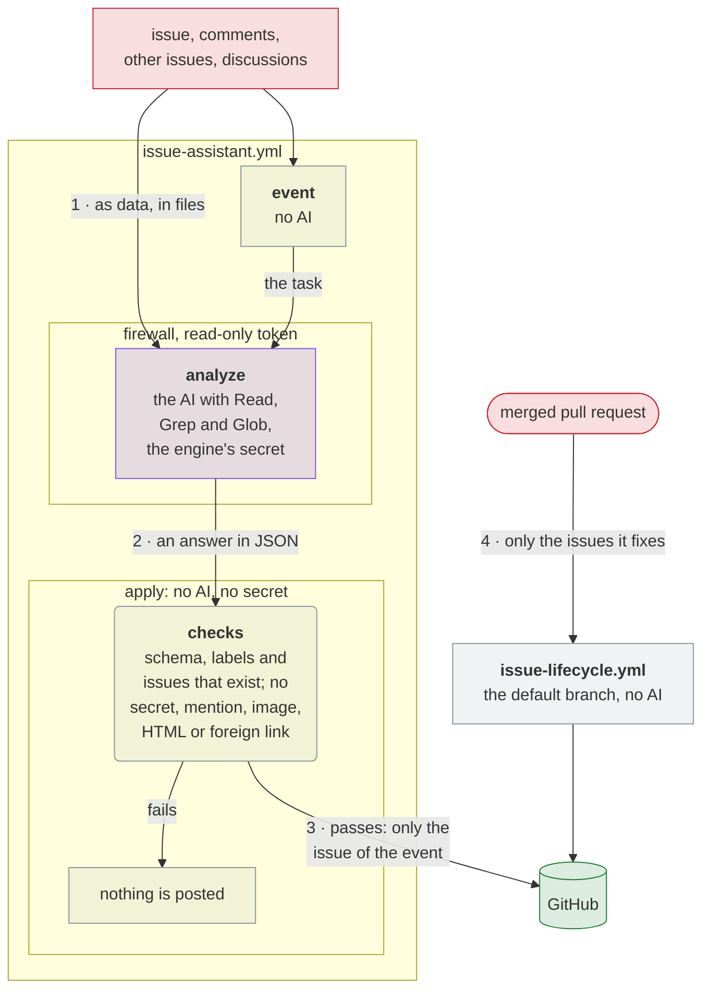
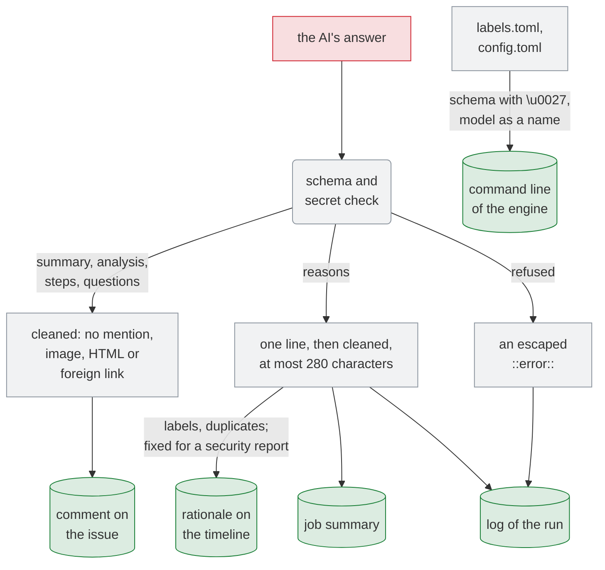
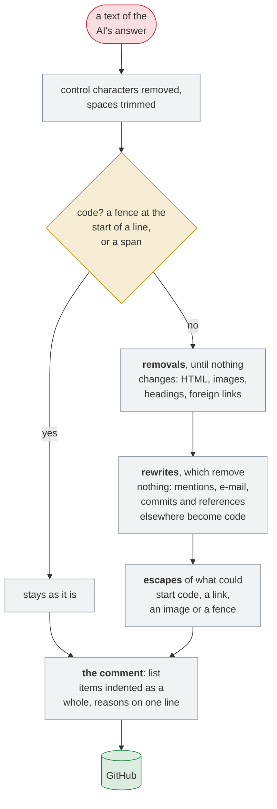

# Security design

[← README](https://github.com/Dennis-Otto/issue-assistant) · [Architecture](architecture.md) · [Roadmap](roadmap.md)

What the issue assistant protects, what it trusts and which risks remain. [SECURITY.md](https://github.com/Dennis-Otto/issue-assistant/blob/main/SECURITY.md) says how to report a vulnerability and how to verify a release, and argues why this repository and its releases are safe. Issues come from anyone, so the design assumes that an issue tries to steer the AI.

## What you can expect

- The AI only reads: the checkout of the default branch and the context that the assistant writes for it. It runs no commands, opens no web pages and reads no files outside the checkout, on a runner whose network allows only the hosts of `.github/egress-firewall.yaml`.
- Nothing the AI writes reaches GitHub unchecked. A job that runs no AI and never sees its secret checks the answer and writes it, only to the issue of the event.
- No comment of the assistant mentions anyone, links to a site that `config.toml` doesn't allow, to another repository or to an e-mail address, shows an image or HTML, or contains something that looks like a token or a key. What counts is the whole comment as GitHub shows it, not each field alone: the text of a field is as safe under a heading as in a list or behind an issue number.
- The same holds for the AI's words outside its comments: in the log of the run, in its summary and in the reasons for labels and duplicates that GitHub shows on the timeline of the issue. They stay on one line there, and no answer can run a workflow command, such as `::add-mask::` or `::stop-commands::`.
- No issue can stall the assistant. It reads every text in time that grows only with the length of the text, and no more of a text than GitHub keeps, 65,536 characters.
- The secret of the engine stays in the environment `issue-assistant`, which only the default branch may use; only the job that runs the engine sees it.
- No code of a pull request runs in a workflow of the assistant.
- The jobs that write reach only GitHub, in a public repository and in a private one whose owner subscribes to StepSecurity. Every job without the AI blocks every host but `api.github.com` and `github.com` with Harden-Runner, and no step in it can use sudo or containers.
- An open finding of code scanning is named in a public log only by the number and link of its alert.
- The action stores no secrets and no data outside GitHub. Only Harden-Runner, in the jobs without the AI, reports to StepSecurity, as the residual risks say.

What the checks make of an answer that an issue steered, in a demo project:

<picture>
  <source media="(prefers-color-scheme: dark)" srcset="images/cleaning-dark.webp">
  
</picture>

## What is protected

| Asset | Where it lives | Protection |
| --- | --- | --- |
| The token of the engine, such as `CLAUDE_CODE_OAUTH_TOKEN` | The environment `issue-assistant` of the repository | Only the default branch may use the environment, and only the job that runs the engine gets the secret |
| The issues, labels and comments of the repository | GitHub | Written only by `apply`, `sweep`, `sync-labels` and `event`, which run no AI, with the permissions their job grants, and whose network reaches GitHub alone where Harden-Runner blocks |
| The findings of code scanning | GitHub's code scanning | Visible only to maintainers; the Findings workflow names them by number and link only |
| The workflows of the repositories that use the action | Their `.github/workflows/` | `check` fails when a workflow differs from its template in anything but the commit hashes of its actions |

## Trust boundaries

Red is what anyone can write; the numbers are those of the list below.

1. **Issues and comments → the assistant.** Their text is untrusted. It reaches the AI as files that the prompt calls data, not instructions, and reaches a shell script only through environment variables.
2. **The AI → the `apply` job.** The answer is untrusted. It must be JSON that fits the schema of its task, with labels that exist and numbers of issues that exist; anything that looks like a secret refuses the whole answer.
3. **The `apply` job → GitHub.** Only the issue of the event, with the permissions of its job.
4. **Pull requests → the lifecycle.** The lifecycle workflow starts on `pull_request_target` only to learn which issues a merged pull request fixes. It checks out the default branch, runs no AI and skips Dependabot's pull requests.
5. **The action → the repository that uses it.** The repository pins the action by the commit hash of a release, and the workflows grant each job only the permissions it needs.

## Where the AI's words go

The comment is not the only place that shows what the AI wrote. Each place gets its own guard, so that the words stay text wherever they appear:

The log prints the lines and the comments of a dry run between `::stop-commands::` and a random token, so that the runner reads none of them as a workflow command. Only a terminal outside a runner, such as one running `check` on your own computer, shows them without the token.

## How the text of the AI is cleaned

Every text of an answer passes `sanitize` in the `apply` job before it becomes part of a comment. Code stays as it is, so that a snippet of the AI can show `@dataclass` or `#include`; everything else is cleaned of what GitHub would turn into a mention, a reference, a link, an image or HTML.

- **Code is what Markdown takes for code.** A fenced block counts only when its fence starts a line: indented, the fence could belong to a list item before it, which the next line without indentation ends, and the code with it. Control characters go first, because Python and Markdown don't agree on which of them are spaces.
- **Removals first, then rewrites.** A removal can join the characters around it into something new, such as `foo/bar<b></b>#12` into a reference to another repository. So the removals repeat until nothing changes, and only then is anything kept as a link or written as code; the rewrites remove nothing, so the characters next to what they keep stay the ones they were checked with.
- **A bare address stays a link only where GitHub links all of it and nothing more.** GitHub's link runs on to the next space, past brackets and even into the code that follows, so an allowed address glued to other text becomes code. A link that leaves the repository through `..` or `%2e`, or that names a user, a password or a port, isn't allowed.
- **The place in the comment keeps code in code.** The lines of a list item are indented under its bullet, and the reasons of related issues, duplicates and references are put on one line, where a fence starts no code block.

What the cleaning lets through is judged where it ends up: the property tests put the cleaned text under a heading, into a list and behind a number, and a CommonMark parser of their own decides what is code. Every text that once got through is a test with its fix.

## Threats and countermeasures

| Threat | Countermeasure | Evidence |
| --- | --- | --- |
| An issue tells the AI to run a command, read a secret or reach a server | The engine runs with the tools `Read`, `Grep` and `Glob` alone, with a read-only token, and the egress firewall allows only named hosts | `test_each_engine_can_only_read_the_checkout`, `test_only_the_analyze_job_runs_an_engine_and_only_with_read_permissions`, `test_the_firewall_template_allows_only_named_hosts` in `tests/test_templates.py` |
| An issue makes the AI post a mention, a link, an image or HTML | `apply` removes images, HTML and headings, turns mentions, e-mail addresses, references and addresses that GitHub would link elsewhere into code, and keeps only links to allowed sites and to issues that exist; it places the text in the comment so that its code stays code | `test_mentions_images_html_and_headings_are_removed`, `test_only_links_to_known_places_stay_links`, `test_tricky_text_is_cleaned_safely`, `test_what_github_would_link_elsewhere_becomes_code`, `test_the_whole_comment_mentions_nobody_and_links_nowhere_else` in `tests/test_assistant.py`; property tests against a CommonMark parser, of the text and of the places it takes in a comment, in `tests/test_properties.py`; fuzzing with Atheris in `fuzz/fuzz_sanitize.py` |
| An issue keeps the assistant busy, so that no analysis of the repository finishes, because each one reads every issue | Each text is read up to GitHub's 65,536 characters, by patterns that look at each character a bounded number of times; the AI reads at most 20,000 characters of each text of its issue, and HTML comments are removed as GitHub hides them, also one that starts a line and never ends | `test_no_text_makes_reading_an_issue_slow`, `test_no_text_makes_the_cleaning_slow`, `test_forms_read_as_they_always_did` in `tests/test_assistant.py`; property tests against the earlier patterns in `tests/test_properties.py`; fuzzing with Atheris in `fuzz/fuzz_issue_text.py`, which fails on a reading that takes longer than half a second |
| The AI posts a secret that it found or was given | An answer with anything that looks like a token or a key is never posted | `test_an_answer_with_something_like_a_secret_is_never_posted`, `test_a_token_anywhere_in_the_answer_is_refused` |
| An answer runs a workflow command in the log of the run, such as `::add-mask::`, `::stop-commands::` or a forged `::error::`, or its comment ends the code block of the preview in the summary of a dry run | Every error and notice of the assistant is escaped as GitHub's Actions toolkit escapes it, and a key of the answer that the schema doesn't know shows as a short JSON string. The summary turns workflow commands off with a random token while it prints the engine's words, and the fence of a preview is longer than any run of backticks in the comment | `test_no_text_of_the_engine_runs_a_workflow_command`, `test_a_workflow_command_keeps_its_message_on_its_line`, `test_each_summary_stops_the_commands_with_a_token_of_its_own`, `test_only_a_terminal_outside_a_runner_gets_the_summary_alone`, `test_a_preview_can_t_close_its_fence` in `tests/test_assistant.py` |
| An answer mentions someone or links elsewhere in a reason outside its comment: a line of the log and the summary, or the reason for a label or a duplicate on the timeline | Such reasons are cleaned like a comment, joined into one line before the cleaning, so that no code block keeps a mention as it is, and shortened to 280 characters before the cleaning, so that no cut loses the backtick that keeps a mention in its code | `test_the_reasons_on_the_timeline_are_cleaned_like_comments`, `test_the_engine_s_reasons_in_the_log_are_one_cleaned_line`, `test_a_shortened_line_keeps_its_cleaning` in `tests/test_assistant.py`; property tests in `tests/test_properties.py`; fuzzing with Atheris in `fuzz/fuzz_sanitize.py` |
| A label name or the model of `config.toml` adds arguments to the command line of the engine, or breaks it, so that no issue gets an analysis | The schema writes an apostrophe of a label name as `\u0027`, which ends no quotes and reads back as the same JSON. `check` and the `engine` command refuse a model that is not a name of letters, digits and `._:@/[]-`, and one that starts with a dash, which the engine's action would read as another flag | `test_the_schemas_fit_into_the_engine_arguments`, `test_a_model_that_would_add_arguments_is_refused` in `tests/test_assistant.py`; `test_a_model_that_would_add_arguments_fails_the_check_and_the_engine` in `tests/test_setup.py` |
| An answer that breaks the schema changes the wrong labels or issues | The answer is checked against the schema of its task, the labels and the issues that exist | `test_an_answer_that_breaks_the_schema_is_refused`, `test_any_answer_is_checked_or_refused` |
| Text of an issue runs as a shell command in a workflow | Every input goes through the environment; no expression of untrusted text stands in a `run:` script | `test_untrusted_text_never_reaches_a_shell_script`, `test_the_action_passes_every_input_through_the_environment` |
| A pull request runs its code with the permissions of the lifecycle | The lifecycle checks out the default branch and runs no code of the pull request | `test_merges_and_releases_start_the_lifecycle_without_running_pull_request_code` |
| A compromised action or tool in a job with a write token sends the token elsewhere | Harden-Runner blocks every host but `api.github.com` and `github.com` in every job without the AI, before any other step, and turns off sudo and containers so that no step lifts the block; the Action test runs the action behind the same block | `test_jobs_without_the_ai_reach_only_github`, `test_the_action_runs_in_ci_behind_the_block_of_the_templates` in `tests/test_templates.py` |
| A public log or timeline reveals a possible vulnerability | The Findings workflow names an open alert by number and link only, and can only dismiss alerts. The comment on a possible security report only points to private reporting, the timeline shows a fixed reason for its labels, and the prompt asks for one neutral sentence without details in its summary, analysis and reason | `test_other_findings_stay_open_and_name_only_number_and_link`, `test_the_findings_workflow_may_only_dismiss_alerts_and_runs_no_ai`, `test_a_possible_vulnerability_is_not_discussed_in_public` |
| A repository's copy of a workflow drifts into something weaker | `check` compares every workflow with its template, and the tests pin the security rules of the templates | `tests/test_templates.py` |

## Residual risks

- The AI can be wrong, or be steered into a wrong but harmless answer, such as a wrong label or a misleading analysis. The maintainer reads every issue and has the last word.
- The AI reads the whole checkout of the default branch. Whatever is in the repository may appear in its analysis, so keep secrets out of the repository, as every repository should.
- The provider of the engine receives the text of the issue and the parts of the repository that the AI reads. The notice in `SUPPORT.md` tells reporters which AI reads their issue.
- The assistant is as safe as the permissions that the workflows of a repository grant it; `check` keeps them equal to the templates.
- Harden-Runner fails open. In a private repository whose owner has no subscription or trial of StepSecurity, and when StepSecurity answers at the start of a job that its service is unavailable, Harden-Runner installs no agent, and the job runs without the block. Its write token could then reach any host, as before the block; the pins of the actions to commit hashes and jobs that run no AI and no code of an issue or a pull request stay the defense.
- StepSecurity, the maker of Harden-Runner, is a third party that receives data from every job without the AI: the repository, the run and the job at its start, and what its agent records during the job, the hosts that the steps connect to, blocked or allowed, and the processes that connect. Its insights page for the run shows them.
- The runner shows the inputs of a step in its log, and the log of a public repository's run is public, for 90 days unless the repository keeps logs for less. So the log of the `apply` job holds the whole answer of the AI, also what is never posted, such as its summary of a possible security report. The prompt asks for one neutral sentence without details there, but an AI can miss that; hiding the answer would take an artifact between the jobs. A maintainer who finds too much in a run deletes its logs.
